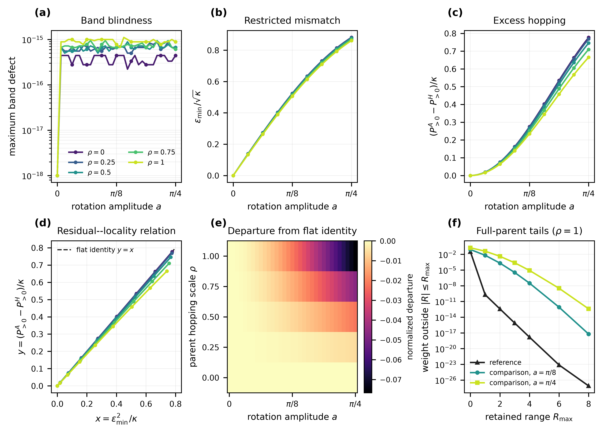
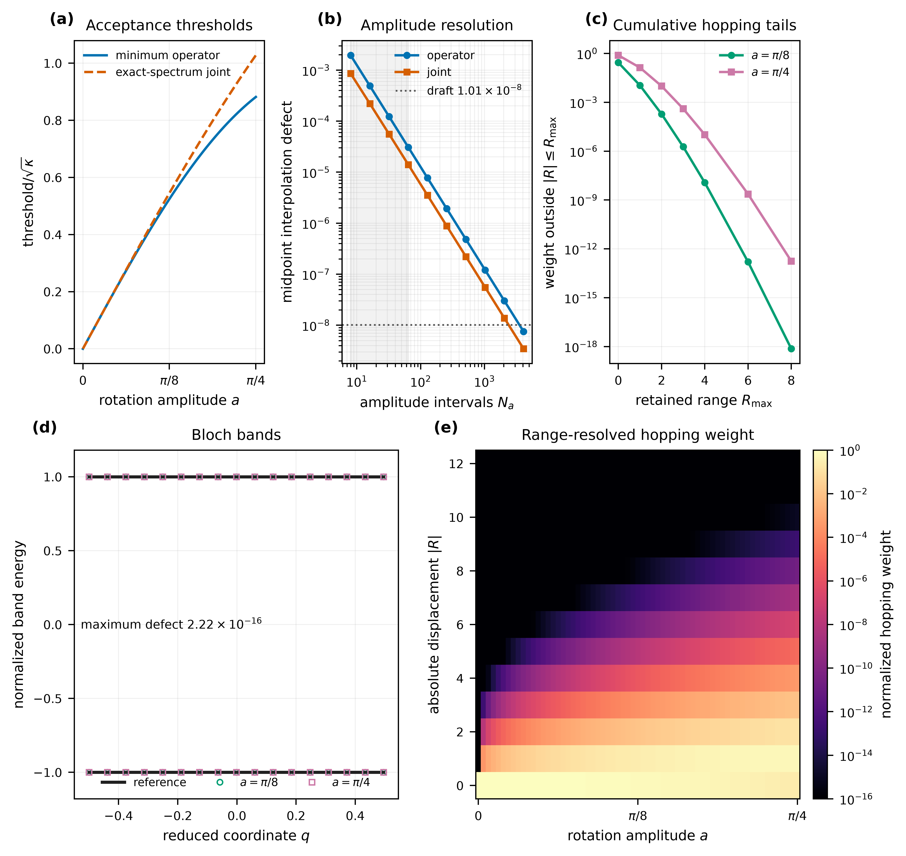
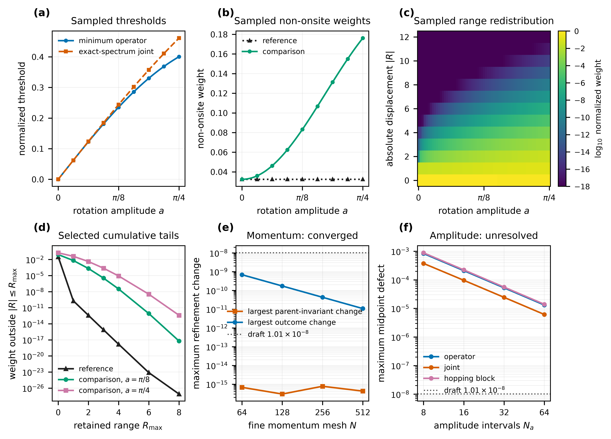
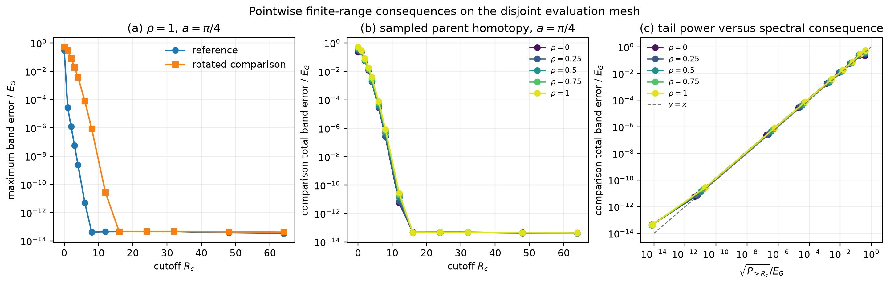

# Exploratory analysis

## Status and scope

This directory analyzes both realizations implemented by **Band Equivalence versus
Hopping Locality**: the normalized flat-parent analytic benchmark and an initial smooth
non-flat four-state construction. Both are local deterministic development analyses,
not retained runs, immutable experiment versions, evidence packages, publication
results, or material validation. The non-flat momentum study is `converged` under its
frame-invariant controls, but its amplitude-interpolation study remains `unresolved`;
neither status makes the exploratory calculation retained or validated evidence. Primary
non-flat claims are restricted to directly evaluated amplitude nodes; connected curves
are guides to the eye, while continuum interpolation is a separate numerical question.

The flat-parent analysis command is:

```console
python/.venv/bin/python \
  calculations/periodic1d/rank2/band-equivalence-locality/run_flat_development.py
python/.venv/bin/python \
  calculations/periodic1d/rank2/band-equivalence-locality/analysis/development/plot.py
```

It reads [`smooth-threshold-continuum.csv`](../../simulations/development/inputs/smooth-threshold-continuum.csv)
and writes:

- [`momentum-refinement.csv`](../../simulations/development/results/momentum-refinement.csv);
- [`amplitude-resolution.csv`](../../simulations/development/results/amplitude-resolution.csv);
- [`selected-hopping-tails.csv`](../../simulations/development/results/selected-hopping-tails.csv);
- [`hopping-power-map.csv`](../../simulations/development/results/hopping-power-map.csv);
- the vector [`band-equivalence-versus-hopping-locality.pdf`](figures/band-equivalence-versus-hopping-locality.pdf)
  and 600-dpi [`PNG`](figures/band-equivalence-versus-hopping-locality.png) via `plot.py`; and
- suggested Results prose and caption in
  [`journal-narrative.md`](journal-narrative.md).

The separate non-flat analysis and plotting commands are:

```console
python/.venv/bin/python \
  calculations/periodic1d/rank2/band-equivalence-locality/run_nonflat_development.py
python/.venv/bin/python \
  calculations/periodic1d/rank2/band-equivalence-locality/analysis/development/plot_nonflat.py
```

They write `nonflat-continuum.csv`, `nonflat-hopping-power-map.csv`,
`nonflat-momentum-refinement.csv`, `nonflat-amplitude-resolution.csv`,
`nonflat-selected-hopping-tails.csv`, and the vector
[`nonflat-four-state-exploratory.pdf`](figures/nonflat-four-state-exploratory.pdf) plus 600-dpi
[`PNG`](figures/nonflat-four-state-exploratory.png). These files intentionally carry an
exploratory identity rather than the flat benchmark's publication-figure identity.

The bounded parent-family robustness study is generated by:

```console
python/.venv/bin/python \
  calculations/periodic1d/rank2/band-equivalence-locality/run_parent_family_development.py
python/.venv/bin/python \
  calculations/periodic1d/rank2/band-equivalence-locality/analysis/development/plot_parent_family.py
python/.venv/bin/python \
  calculations/periodic1d/rank2/band-equivalence-locality/analysis/development/plot_scientific_story.py
```

It writes `parent-family-continuum.csv`, `parent-family-summary.csv`, the diagnostic
pair `parent-family-robustness-exploratory.*`, and the main scientific-story pair
`band-equivalence-locality-scientific-story.*`.

The finite-range consequence study is generated by:

```console
python/.venv/bin/python \
  calculations/periodic1d/rank2/band-equivalence-locality/run_truncation_development.py
python/.venv/bin/python \
  calculations/periodic1d/rank2/band-equivalence-locality/analysis/development/plot_truncation.py
```

It writes `truncation-consequences.csv`, `truncation-summary.csv`, and the vector
[`truncation-band-consequences.pdf`](figures/truncation-band-consequences.pdf) plus
[`PNG`](figures/truncation-band-consequences.png). The calculation removes and separately
reports the cyclic Nyquist block before applying ordinary-lattice cutoffs through
PhysKit's canonical ordered range-family evaluator.










The source analytic curve contains 181 amplitudes from zero through $\pi/4$. The local
analysis uses momentum meshes $N=(32,64,128,256,512)$ and 65 nested amplitude nodes.
The convergence comparison uses the manuscript's draft unit-scale tolerance
$10^{-10}+10^{-8}=1.01\times10^{-8}$ and the implementation's additional
$10^{-11}$ verification margin. These are exploratory numerical controls, not frozen
acceptance thresholds.

## Analytic threshold curve

Both normalized analytic thresholds increase strictly over all 181 retained samples.
At $a=\pi/4$,

| Quantity | Value |
|---|---:|
| Minimum operator threshold divided by $\sqrt{\kappa}$ | $0.8815978971806299$ |
| Exact-spectrum joint threshold divided by $\sqrt{\kappa}$ | $1.0276174231996704$ |
| Joint-minus-minimum threshold | $0.1460195260190406$ |
| Joint/minimum threshold ratio | $1.165630528936167$ |

At the first nonzero sample, both threshold-to-amplitude ratios are within
$1.1\times10^{-5}$ of the small-amplitude limit $\sqrt{2}$. The data therefore exhibit
the expected common linear onset before the joint threshold separates increasingly from
the independently minimized operator threshold.

## Momentum-mesh analysis

Every adjacent momentum refinement satisfies the draft controls. Across all four
refinements, the largest observed changes or final-mesh defects are:

| Channel | Maximum |
|---|---:|
| Finite-mesh maximum correlation change | $2.22\times10^{-16}$ |
| Operator-threshold change | $6.40\times10^{-15}$ |
| Nonzero hopping-weight change | $2.22\times10^{-15}$ |
| Shared hopping-block power change | $5.22\times10^{-15}$ |
| Maximizing-angle change | $0$ |
| Fine-mesh Bessel quadrature defect | $1.11\times10^{-16}$ |
| Bloch-band defect | $2.22\times10^{-16}$ |
| Three-way identity defect | $1.44\times10^{-15}$ |
| Parseval defect | $4.44\times10^{-15}$ |
| Independent mesh-reconstruction defect | $6.40\times10^{-15}$ |

The typed study returns `converged`, and independent reconstruction passes. For this
smooth analytic flat-parent family, the proposed momentum ladder begins after the
trapezoidal quadrature has already reached approximately binary64 roundoff. This result
does **not** show that $N=32$ is sufficient for the non-flat four-state realization.

## Amplitude resolution

Comparing only amplitudes shared by nested grids would return zero by construction and
would not test behavior between amplitude nodes. The analysis instead measures the
maximum midpoint error of piecewise-linear interpolation against the exact Bessel
threshold laws.

| Amplitude intervals $N_a$ | Operator-threshold defect | Joint-threshold defect |
|---:|---:|---:|
| 8 | $1.9569\times10^{-3}$ | $8.5972\times10^{-4}$ |
| 16 | $4.9193\times10^{-4}$ | $2.2074\times10^{-4}$ |
| 32 | $1.2319\times10^{-4}$ | $5.5897\times10^{-5}$ |
| 64 | $3.0815\times10^{-5}$ | $1.4062\times10^{-5}$ |
| 2048 | $3.0104\times10^{-8}$ | $1.3815\times10^{-8}$ |
| 4096 | $7.5261\times10^{-9}$ | $3.4542\times10^{-9}$ |

Thus the proposed $N_a=(8,16,32,64)$ ladder does not support a uniform
$1.01\times10^{-8}$ piecewise-linear reconstruction of the threshold curves. The
amplitude design must therefore do one of the following before it is frozen:

1. evaluate the analytic threshold laws directly rather than infer a continuous curve
   from the sampled amplitudes;
2. extend or adapt the amplitude grid; or
3. declare a less stringent, scientifically justified interpolation target.

For the current uniform linear-interpolation test, $N_a=4096$ is the first tested grid
that meets the draft unit-scale tolerance for both curves. This is an interpolation
finding, not a requirement that every future calculation use 4096 amplitudes.

## Hopping-locality analysis

The $N=512$ finite transform gives the following cumulative normalized hopping weight
outside selected ranges:

| Amplitude | Outside $|R|\leq0$ | Outside $|R|\leq4$ | Outside $|R|\leq6$ | Outside $|R|\leq8$ |
|---:|---:|---:|---:|---:|
| $0$ | $1.27\times10^{-28}$ | $1.26\times10^{-28}$ | $1.26\times10^{-28}$ | $1.26\times10^{-28}$ |
| $\pi/8$ | $2.7472\times10^{-1}$ | $1.1555\times10^{-8}$ | $1.5751\times10^{-13}$ | $7.2753\times10^{-19}$ |
| $\pi/4$ | $7.7721\times10^{-1}$ | $1.0264\times10^{-5}$ | $2.3144\times10^{-9}$ | $1.7463\times10^{-13}$ |

At $a=\pi/4$, the minimum operator threshold is $0.8815978972$, the exact-spectrum
joint threshold is $1.0276174232$, and the total nonzero hopping weight is
$0.7772148523$. The Bloch-band defect remains at roundoff while the represented operator
residual and non-onsite hopping weight become large. This directly demonstrates the
experiment's intended contrast: band equivalence does not imply operator or hopping
locality equivalence.

The range distribution also broadens with amplitude. Although the tail outside range
four remains small compared with the total nonzero weight, it grows from numerical noise
at $a=0$ to about $10^{-5}$ at $a=\pi/4$.

## Non-flat four-state exploratory status

The initial four-state realization constructs a dispersive Hermitian parent, selects its
isolated lower two-state subspace, closes a deterministic parallel-transport frame, and
applies the same smooth $U_a(q)$ family within that retained space. Unlike the flat
benchmark, it has existing reference hopping and no $J_0(2a)$ comparator or exact
residual--tail identity. Fourier coefficients are therefore interpreted only as
finite-mesh aliased blocks.

At the finest tested mesh, $N=512$, the minimum sampled external gap is
$1.0566461211497051$, the minimum neighboring-frame transport singular value is
$0.9999997322796249$, and independent reconstruction differs by at most
$3.09\times10^{-15}$. The largest band defect over the 65 tested amplitudes is
$1.45\times10^{-15}$. At $a=\pi/4$, the discrete maximum correlation is
$0.5079908088$, the minimum operator threshold is $0.4004394264$, and the exact-spectrum
joint threshold is $0.4611609032$. The comparison non-onsite hopping weight rises from
the reference value $0.0323839143$ to $0.1761532501$.

The momentum study is `converged`: physical outcome channels change by at most
$1.08\times10^{-11}$ between $N=256$ and $N=512$, while the largest parent-invariant
change is $1.67\times10^{-16}$. The neighboring-frame transport singular value remains
a qualification lower bound rather than a refinement observable because its approach
toward one is determined by the shrinking neighbor separation. Shared parent
eigenvalues and retained spectral projectors provide the invariant cross-mesh checks.

The amplitude study remains `unresolved`: with 64 intervals, the largest
correlation midpoint defect is $3.49\times10^{-5}$ and the largest hopping-block-power
defect is $1.39\times10^{-5}$. A deterministic adaptive action caches direct samples,
refines failing midpoint intervals, and requires disjoint quarter-point validation before
returning `converged`. It fails conservatively at its explicit level or unique-sample cap,
but its production cap and thresholds have not been selected or qualified. That contract
must be reviewed before any protocol freeze or retained run.

## Parent-family robustness study

To distinguish a representation orbit from dependence on one selected parent, the
non-onsite blocks are scaled by

```math
K_\rho(q)=T_0+\rho\left(e^{2\pi iq}T_{+1}+e^{-2\pi iq}T_{-1}\right),
\qquad 0\leq\rho\leq1.
```

The exploratory study samples five parent scales and 33 amplitudes on momentum meshes
through $N=256$. All five momentum studies return `converged`. The smallest sampled
external gap decreases from $1.3436583$ at $\rho=0$ to $1.0566461$ at $\rho=1$ while
remaining above the declared unit lower bound. The reference non-onsite weight grows
from numerical noise to $0.0323839$.

At $a=\pi/4$, the scale-normalized minimum threshold changes only from $0.8815979$ to
$0.8613625$ across the homotopy. The excess comparison non-onsite weight similarly
changes from $0.1431824$ to $0.1437693$. The normalized departure from the flat
residual--tail identity changes from roundoff at $\rho=0$ to $-0.0767265$ at $\rho=1$.
Thus the mismatch and excess hopping remain large while the exact flat identity deforms
systematically with dispersion. The representation-induced mismatch is observed
throughout the sampled parent family rather than only at one dispersive parent.
This is robustness evidence for the synthetic family, not a continuous-$\rho$
certificate, material validation, or retained evidence. The 33-node amplitude inventory
also does not resolve the existing interpolation limitation.

## Finite-range band consequences

The exploratory consequence study uses the already tested $N=256$ construction mesh,
$M=1025$ shifted evaluation coordinates, the same five parent scales and 33 directly
sampled amplitudes, and the declared cutoffs
$R_c=(0,1,2,3,4,6,8,12,16,24,32,48,64)$. The smallest periodic separation between a
construction and evaluation coordinate is $1.48\times10^{-8}$. These controls are a
sampled development inventory, not a frozen retained protocol.

Across the full sampled family, direct pointwise unitary comparison preserves the two
bands within $1.33\times10^{-15}E_G$. The maximum comparison-interpolant error on the
disjoint mesh is $2.40\times10^{-14}E_G$, so the observed finite-range errors are not
being set by interpolation at the reported scales. The separately reported Nyquist
conversion power remains distinct from PhysKit's ordinary-lattice omitted power.

At the dispersive endpoint $(\rho,a)=(1,\pi/4)$, retaining only $|R|\le3$ gives a
reference maximum band error of $5.53\times10^{-8}E_G$ but a comparison total band
error of $1.86\times10^{-2}E_G$. At $R_c=8$, the corresponding values are
$4.22\times10^{-14}E_G$ and $8.65\times10^{-7}E_G$. By $R_c=16$, both are at the
binary64/interpolation floor. Thus, at the directly sampled endpoint, the rotated
representation requires substantially greater hopping range to reproduce the same
complete bands to comparable accuracy. The same qualitative ordering occurs throughout
the five sampled parent scales.

The tail-power and band-error curves track closely in this synthetic sample, but the
plotted $y=x$ line is only a visual comparator. No equality, bound, universal
range-to-accuracy rule, or continuous-$(\rho,a)$ certificate is claimed. The action does
not yet report velocity, curvature, or physical effective-mass errors and has no
independent result verifier or frozen acceptance threshold.

## Conclusion

The available data are sufficient to establish the expected behavior of the analytic
flat-parent software model:

- the bands remain equal to numerical precision;
- operator-acceptance thresholds grow monotonically with the basis-rotation amplitude;
- non-onsite hopping weight grows with the same irreducible operator residual; and
- the momentum discretization is already roundoff-limited on the proposed ladder.

The data also expose an unresolved design issue: the proposed amplitude ladder is too
coarse for a $10^{-8}$ uniform linearly interpolated threshold curve in both
realizations. Momentum refinement now clears the corrected frame-invariant controls, and
the parent homotopy supports robustness across the five sampled scales. The new sampled
truncation layer additionally shows that equal complete bands can require materially
different finite hopping ranges for comparable band accuracy. Final amplitude sampling,
cutoff targets, independent truncation verification, and continuous-domain claims must
still be resolved before protocol freeze.
