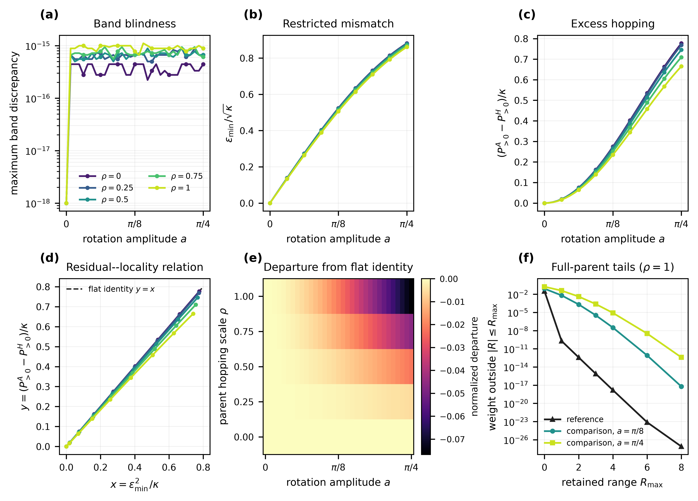
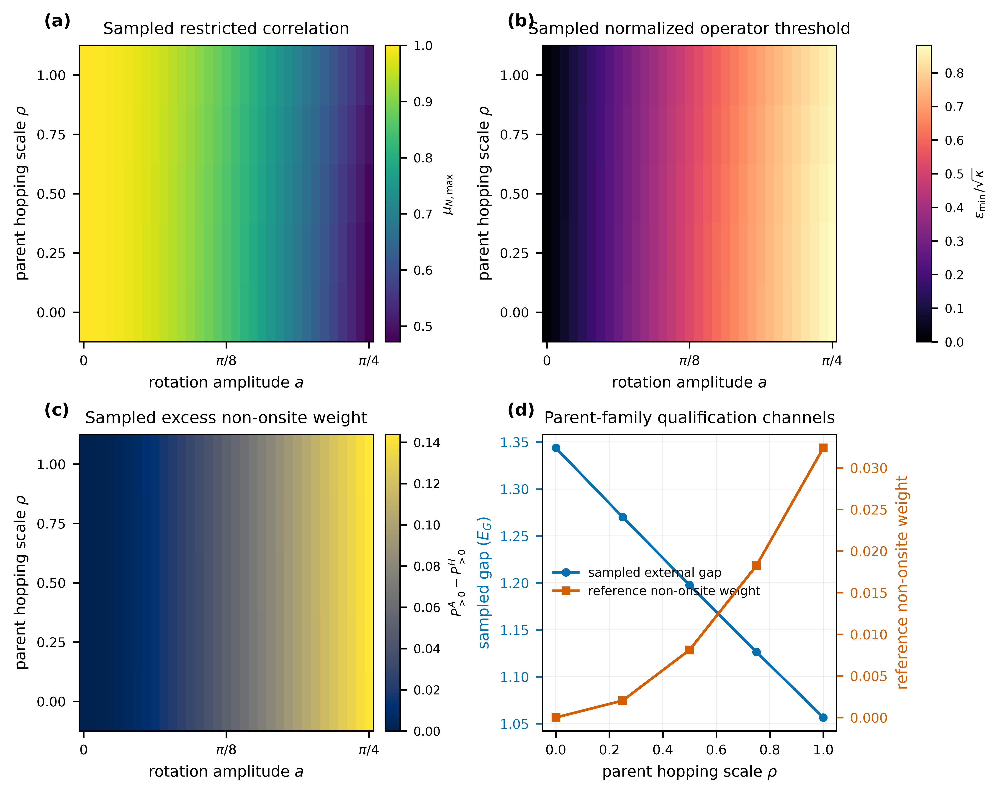
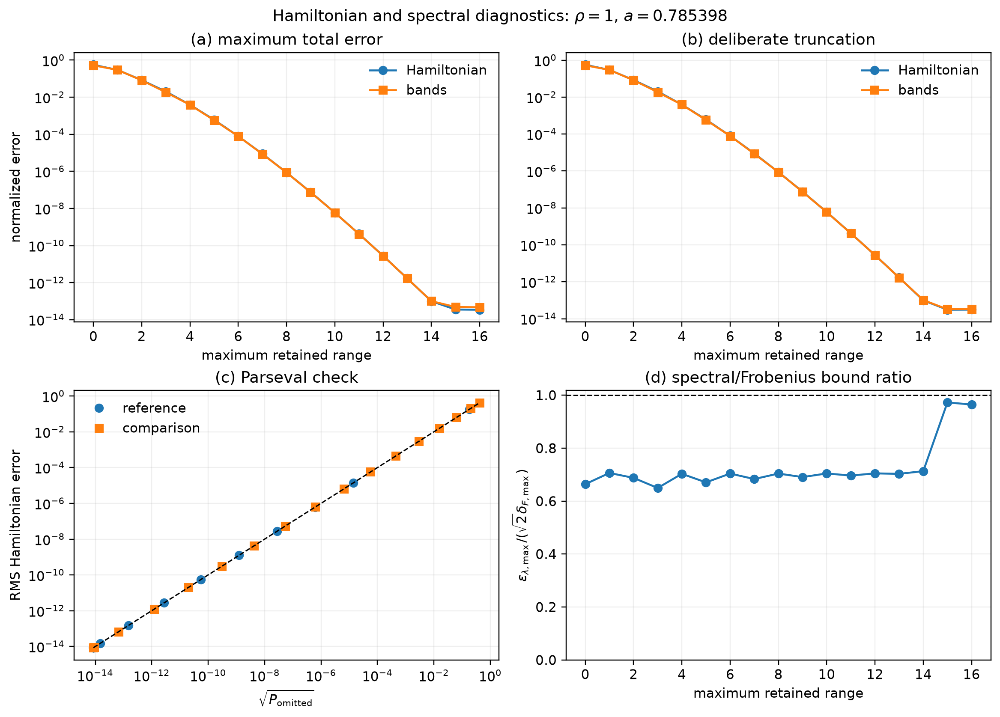
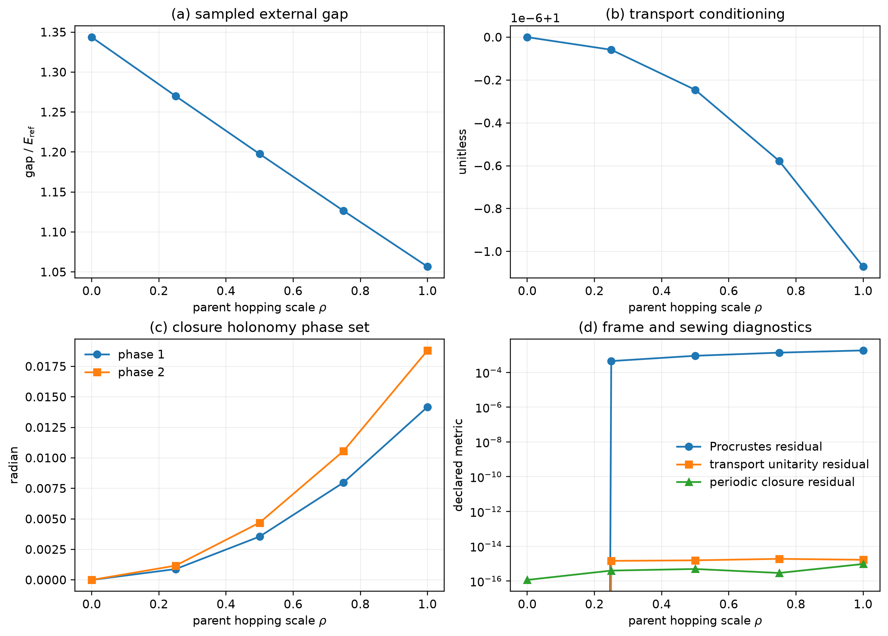
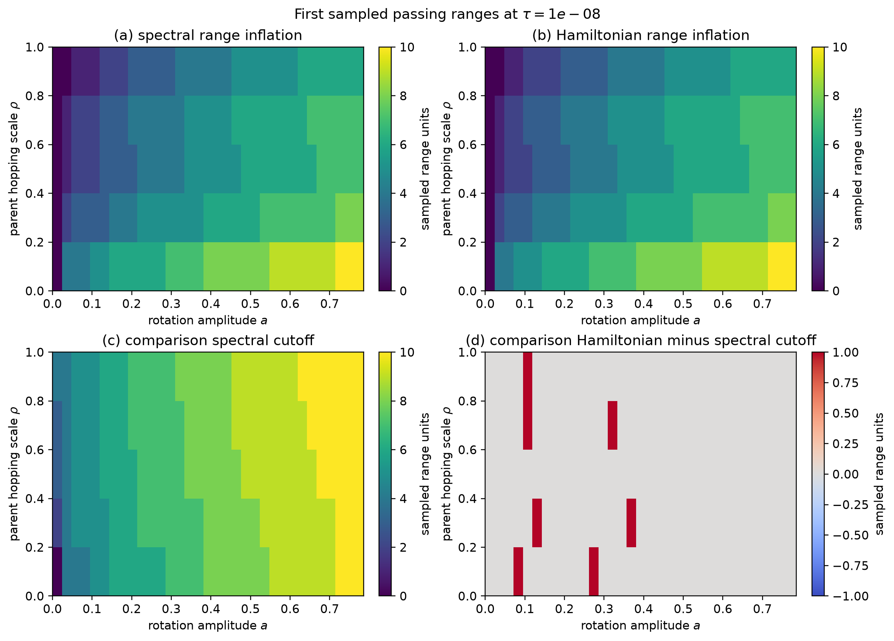

# Exploratory analysis

## Status and scope

This directory analyzes both realizations implemented by **Band Equivalence versus
Hopping Locality**: the normalized flat-parent analytic benchmark and an initial smooth
non-flat four-state construction. Calculation inputs and results own provenance;
derived tables, catalogs, narratives, and figures under `analysis/` do not carry a
separate provenance identity. Analysis also does not promote or change the evidence
status of its source calculations.

The flat-parent continuum is evaluated directly from its analytic $J_0(2a)$ laws rather
than reconstructed from an amplitude grid. The non-flat momentum study is `converged`
under its frame-invariant controls. Primary non-flat claims are restricted to directly
evaluated amplitude nodes; connected curves are guides to the eye, and no continuum
interpolation claim is made.

The optional diagnostic producers have an explicit execution order:

1. `run_10_flat_control.py`
2. `run_11_nonflat_control.py`
3. `run_12_parent_family_control.py`
4. `run_13_truncation_control.py`
5. `run_14_truncation_mesh_stability.py`
6. `run_15_five_scale_evidence_assessment.py`
7. `run_16_diagnostic_packaging.py`

The numbered sequence is separate from the direct `run_01` → `run_02` → `run_03`
lifecycle and does not create retained evidence. Plot-only scripts consume the producer
outputs after the corresponding numbered step.

The flat-parent analysis command is:

```console
python/.venv/bin/python calculations/periodic1d/rank2/band-equivalence-versus-hopping-locality/run_10_flat_control.py
python/.venv/bin/python calculations/periodic1d/rank2/band-equivalence-versus-hopping-locality/analysis/development/plot.py
```

It reads [`smooth-threshold-continuum.csv`](../../simulations/development/inputs/smooth-threshold-continuum.csv) and
writes:

- [`momentum-refinement.csv`](../../simulations/development/results/momentum-refinement.csv);
- [`amplitude-resolution.csv`](../../simulations/development/results/amplitude-resolution.csv);
- [`selected-hopping-tails.csv`](../../simulations/development/results/selected-hopping-tails.csv);
- [`hopping-power-map.csv`](../../simulations/development/results/hopping-power-map.csv);
- the vector [`band-equivalence-versus-hopping-locality.pdf`](figures/band-equivalence-versus-hopping-locality.pdf)
  and 600-dpi [`PNG`](figures/band-equivalence-versus-hopping-locality.png) via `plot.py`; and
- suggested Results prose and caption in
  [`journal-narrative.md`](journal-narrative.md).

The separate non-flat analysis and plotting commands are:

```console
python/.venv/bin/python calculations/periodic1d/rank2/band-equivalence-versus-hopping-locality/run_11_nonflat_control.py
python/.venv/bin/python calculations/periodic1d/rank2/band-equivalence-versus-hopping-locality/analysis/development/plot_nonflat.py
```

They write `nonflat-continuum.csv`, `nonflat-hopping-power-map.csv`,
`nonflat-momentum-refinement.csv`, `nonflat-amplitude-resolution.csv`,
`nonflat-selected-hopping-tails.csv`, and the vector
[`nonflat-four-state-exploratory.pdf`](figures/nonflat-four-state-exploratory.pdf) plus 600-dpi
[`PNG`](figures/nonflat-four-state-exploratory.png). These files intentionally carry an
exploratory identity rather than the flat benchmark's publication-figure identity.

The bounded parent-family robustness study is generated by:

```console
python/.venv/bin/python calculations/periodic1d/rank2/band-equivalence-versus-hopping-locality/run_12_parent_family_control.py
python/.venv/bin/python calculations/periodic1d/rank2/band-equivalence-versus-hopping-locality/analysis/development/plot_parent_family.py
python/.venv/bin/python calculations/periodic1d/rank2/band-equivalence-versus-hopping-locality/analysis/development/plot_scientific_story.py
```

It writes `parent-family-continuum.csv`, `parent-family-summary.csv`, the diagnostic
pair `parent-family-robustness-exploratory.*`, and the main scientific-story pair
`band-equivalence-locality-scientific-story.*`.

The finite-range consequence study is generated by:

```console
python/.venv/bin/python calculations/periodic1d/rank2/band-equivalence-versus-hopping-locality/run_13_truncation_control.py
python/.venv/bin/python calculations/periodic1d/rank2/band-equivalence-versus-hopping-locality/analysis/development/plot_truncation.py
```

It writes `truncation-consequences.csv`, `truncation-summary.csv`, and the vector
[`truncation-band-consequences.pdf`](figures/truncation-band-consequences.pdf) plus
[`PNG`](figures/truncation-band-consequences.png). The calculation removes and separately
reports the cyclic Nyquist block before applying ordinary-lattice cutoffs through
PhysKit's canonical ordered range-family evaluator. The CSV contains separate
interpolation, truncation, and total Hamiltonian and spectral channels.

Threshold-adjacent construction-mesh stability is calculated after the dense truncation
control:

```console
python/.venv/bin/python calculations/periodic1d/rank2/band-equivalence-versus-hopping-locality/run_14_truncation_mesh_stability.py
```

The byte-bound five-scale assessment then reads the completed controls and the immutable
direct-v2 calculation without rerunning a scientific owner:

```console
python/.venv/bin/python calculations/periodic1d/rank2/band-equivalence-versus-hopping-locality/run_15_five_scale_evidence_assessment.py
```

The complete analysis package is then validated and rendered with:

```console
MPLBACKEND=Agg python/.venv/bin/python calculations/periodic1d/rank2/band-equivalence-versus-hopping-locality/run_16_diagnostic_packaging.py
```

The typed `DiagnosticBundle` loads all 14 source CSVs, checks identity columns,
uniqueness, canonical order, parent/amplitude/cutoff product grids, and cross-table parent
identities, then returns defensive table copies. These are analysis-integrity checks,
not a second provenance system. The packaging command writes:

- an in-memory metadata-labelled tidy table available through
  `DiagnosticBundle.long_form()` without duplicating the source CSVs;
- [`diagnostic-catalog.csv`](../../simulations/development/results/diagnostic-catalog.csv), the quantity/category/unit/
  normalization/role catalog;
- [`sampled-range-decisions.csv`](../../simulations/development/results/sampled-range-decisions.csv), separate minimum tolerance-satisfying
  sampled spectral and Hamiltonian supports;
- the `hamiltonian-spectral-diagnostics.*`, `frame-sewing-diagnostics.*`, and
  `sampled-range-decision-map.*` overview figure pairs; and
- no scientific quantities that replace the producer-owned calculations.

The exploratory interpretation is recorded in
[`diagnostic-ledger-findings.md`](diagnostic-ledger-findings.md). Plotters consume the
validated bundle rather than reparsing individual CSVs or reconstructing scientific
results.













The plotted analytic curve contains 181 direct formula evaluations from zero through
$\pi/4$; the line between them is only a rendering choice, not the scientific
evaluation rule. The finite-mesh analysis uses momentum meshes
$N=(32,64,128,256,512)$ and 65 nested amplitude nodes.
The convergence comparison uses the manuscript's draft unit-scale tolerance
$10^{-10}+10^{-8}=1.01\times10^{-8}$ and the implementation's additional
$10^{-11}$ verification margin. These are exploratory numerical controls, not frozen
acceptance thresholds.

## Analytic threshold curve

Both normalized analytic thresholds increase strictly over all 181 retained samples.
At $a=\pi/4$,

| Quantity | Value |
|---|---:|
| Minimum operator threshold divided by $\sqrt{\kappa}$ | $0.8815978971806299$ |
| Exact-spectrum joint threshold divided by $\sqrt{\kappa}$ | $1.0276174231996704$ |
| Joint-minus-minimum threshold | $0.1460195260190406$ |
| Joint/minimum threshold ratio | $1.165630528936167$ |

At the first nonzero sample, both threshold-to-amplitude ratios are within
$1.1\times10^{-5}$ of the small-amplitude limit $\sqrt{2}$. The data therefore exhibit
the expected common linear onset before the joint threshold separates increasingly from
the independently minimized operator threshold.

## Momentum-mesh analysis

Every adjacent momentum refinement satisfies the draft controls. Across all four
refinements, the largest observed changes or final-mesh discrepancies are:

| Channel | Maximum |
|---|---:|
| Finite-mesh maximum correlation change | $2.22\times10^{-16}$ |
| Operator-threshold change | $6.40\times10^{-15}$ |
| Nonzero hopping-weight change | $2.22\times10^{-15}$ |
| Shared hopping-block power change | $5.22\times10^{-15}$ |
| Maximizing-angle change | $0$ |
| Fine-mesh Bessel quadrature discrepancy | $1.11\times10^{-16}$ |
| Bloch-band discrepancy | $2.22\times10^{-16}$ |
| Three-way identity discrepancy | $1.44\times10^{-15}$ |
| Parseval discrepancy | $4.44\times10^{-15}$ |
| Independent mesh-reconstruction discrepancy | $6.40\times10^{-15}$ |

The typed study returns `converged`, and independent reconstruction passes. For this
smooth analytic flat-parent family, the proposed momentum ladder begins after the
trapezoidal quadrature has already reached approximately binary64 roundoff. This result
does **not** show that $N=32$ is sufficient for the non-flat four-state realization.

## Analytic amplitude evaluation

The flat-parent correlation and threshold curves are evaluated directly from
$\mu_{\max}(a)=J_0(2a)$ and the two exact threshold laws. They are not reconstructed by
piecewise-linear interpolation. The earlier uniform-grid study is retained as a rejected
method diagnostic: comparing only shared nodes returns zero by construction, while its
midpoint test demonstrates why the interpolant is not used.

| Amplitude intervals $N_a$ | Operator-threshold discrepancy | Joint-threshold discrepancy |
|---:|---:|---:|
| 8 | $1.9569\times10^{-3}$ | $8.5972\times10^{-4}$ |
| 16 | $4.9193\times10^{-4}$ | $2.2074\times10^{-4}$ |
| 32 | $1.2319\times10^{-4}$ | $5.5897\times10^{-5}$ |
| 64 | $3.0815\times10^{-5}$ | $1.4062\times10^{-5}$ |
| 2048 | $3.0104\times10^{-8}$ | $1.3815\times10^{-8}$ |
| 4096 | $7.5261\times10^{-9}$ | $3.4542\times10^{-9}$ |

The $N_a=(8,16,32,64)$ ladder therefore does not support the rejected uniform
$1.01\times10^{-8}$ piecewise-linear reconstruction. The active flat-parent rule instead
uses direct analytic evaluation at each requested amplitude. For the diagnostic uniform
interpolant, $N_a=4096$ is the first tested grid that meets the draft unit-scale
tolerance for both curves; that historical finding is not an active sampling
requirement.

## Hopping-locality analysis

The $N=512$ finite transform gives the following cumulative normalized hopping weight
outside selected ranges:

| Amplitude | Outside $|R|\leq0$ | Outside $|R|\leq4$ | Outside $|R|\leq6$ | Outside $|R|\leq8$ |
|---:|---:|---:|---:|---:|
| $0$ | $1.27\times10^{-28}$ | $1.26\times10^{-28}$ | $1.26\times10^{-28}$ | $1.26\times10^{-28}$ |
| $\pi/8$ | $2.7472\times10^{-1}$ | $1.1555\times10^{-8}$ | $1.5751\times10^{-13}$ | $7.2753\times10^{-19}$ |
| $\pi/4$ | $7.7721\times10^{-1}$ | $1.0264\times10^{-5}$ | $2.3144\times10^{-9}$ | $1.7463\times10^{-13}$ |

At $a=\pi/4$, the minimum operator threshold is $0.8815978972$, the exact-spectrum
joint threshold is $1.0276174232$, and the total nonzero hopping weight is
$0.7772148523$. The Bloch-band discrepancy remains at roundoff while the represented operator
residual and non-onsite hopping weight become large. This directly demonstrates the
experiment's intended contrast: band equivalence does not imply operator or hopping
locality equivalence.

The range distribution also broadens with amplitude. Although the tail outside range
four remains small compared with the total nonzero weight, it grows from numerical noise
at $a=0$ to about $10^{-5}$ at $a=\pi/4$.

## Non-flat four-state exploratory status

The initial four-state realization constructs a dispersive Hermitian parent, selects its
isolated lower two-state subspace, closes a deterministic parallel-transport frame, and
applies the same smooth $U_a(q)$ family within that retained space. Unlike the flat
benchmark, it has existing reference hopping and no $J_0(2a)$ comparator or exact
residual--tail identity. Fourier coefficients are therefore interpreted only as
finite-mesh aliased blocks.

At the finest tested mesh, $N=512$, the minimum sampled external isolation gap is
$1.0566461211497051$, the minimum neighboring-frame transport singular value is
$0.9999997322796249$, and independent reconstruction differs by at most
$3.09\times10^{-15}$. The largest band discrepancy over the 65 tested amplitudes is
$1.45\times10^{-15}$. At $a=\pi/4$, the discrete maximum correlation is
$0.5079908088$, the minimum operator threshold is $0.4004394264$, and the exact-spectrum
joint threshold is $0.4611609032$. The comparison non-onsite hopping weight rises from
the reference value $0.0323839143$ to $0.1761532501$.

The momentum study is `converged`: physical outcome channels change by at most
$1.08\times10^{-11}$ between $N=256$ and $N=512$, while the largest parent-invariant
change is $1.67\times10^{-16}$. The neighboring-frame transport singular value remains
a qualification lower bound rather than a refinement observable because its approach
toward one is determined by the shrinking neighbor separation. Shared parent
eigenvalues and retained spectral projectors provide the invariant cross-mesh checks.

With 64 intervals, the diagnostic non-flat interpolant has a largest correlation
midpoint discrepancy of $3.49\times10^{-5}$ and a largest hopping-block-power discrepancy
of $1.39\times10^{-5}$. It is therefore not used. The reported non-flat results are
direct point samples, not a continuous-amplitude reconstruction. A deterministic adaptive
action caches direct samples, refines failing midpoint intervals, and requires disjoint
quarter-point validation; it is reserved for a future claim that actually requires
between-node control.

## Parent-family robustness study

To distinguish a representation orbit from dependence on one selected parent, the
non-onsite blocks are scaled by

```math
K_\rho(q)=T_0+\rho\left(e^{2\pi iq}T_{+1}+e^{-2\pi iq}T_{-1}\right),
\qquad 0\leq\rho\leq1.
```

The exploratory study samples five parent scales and 33 amplitudes on momentum meshes
through $N=256$. All five momentum studies return `converged`. The smallest sampled
external isolation gap decreases from $1.3436583$ at $\rho=0$ to $1.0566461$ at $\rho=1$ while
remaining above the declared unit lower bound. The reference non-onsite weight grows
from numerical noise to $0.0323839$.

At $a=\pi/4$, the scale-normalized minimum threshold changes only from $0.8815979$ to
$0.8613625$ across the homotopy. The excess comparison non-onsite weight similarly
changes from $0.1431824$ to $0.1437693$. The normalized departure from the flat
residual--tail identity changes from roundoff at $\rho=0$ to $-0.0767265$ at $\rho=1$.
Thus the mismatch and excess hopping remain large while the exact flat identity deforms
systematically with dispersion. The representation-induced mismatch is observed
throughout the sampled parent family rather than only at one dispersive parent.
This is robustness evidence for the synthetic family, not a continuous-$\rho$
certificate, material validation, or retained evidence. The 33-node amplitude inventory
also does not resolve the existing interpolation limitation.

## Finite-range Hamiltonian and band consequences

The development consequence study uses the already tested $N=256$ construction mesh,
$M=1025$ shifted evaluation coordinates, the same five parent scales and 33 directly
sampled amplitudes, and every integer cutoff $R_c=0,\ldots,16$. The smallest periodic
separation between a construction and evaluation coordinate is $1.48\times10^{-8}$.
These controls are a sampled development inventory, not a frozen retained protocol.

Across the full sampled family, direct pointwise unitary comparison preserves the two
bands within $1.11\times10^{-15}E_{\mathrm{ref}}$. The maximum comparison-interpolant error on the
disjoint mesh is $2.35\times10^{-14}E_{\mathrm{ref}}$, so the observed finite-range errors are not
being set by interpolation at the reported scales. The separately reported Nyquist
conversion power remains distinct from PhysKit's ordinary-lattice omitted power.

At the dispersive endpoint $(\rho,a)=(1,\pi/4)$, retaining only $|R|\le3$ gives a
reference maximum band error of $5.53\times10^{-8}E_{\mathrm{ref}}$ but a comparison total band
error of $1.86\times10^{-2}E_{\mathrm{ref}}$. At $R_c=8$, the corresponding values are
$4.22\times10^{-14}E_{\mathrm{ref}}$ and $8.65\times10^{-7}E_{\mathrm{ref}}$. By $R_c=16$, both are at the
binary64/interpolation floor. Thus, at the directly sampled endpoint, the rotated
representation requires substantially greater hopping range to reproduce the same
complete bands to comparable accuracy. The same qualitative ordering occurs throughout
the five sampled parent scales.

The tail-power and band-error curves track closely in this synthetic sample, but the
plotted $y=x$ line is only a visual comparator. No equality, bound, universal
range-to-accuracy rule, or continuous-$(\rho,a)$ certificate is claimed. The independent
verifier reconstructs the dense result and separate first-passing decisions with maximum
absolute discrepancy $4.61\times10^{-13}$. A threshold-adjacent refinement over
$N=(128,256,512)$ and $M=4N+1$ changes none of the $10^{-8}$ decisions; every selected
cutoff passes and every immediately preceding integer cutoff fails. The action does not
yet report velocity, curvature, or physical effective-mass errors and has no frozen
acceptance threshold or retained calculation identity.

## Conclusion

The available data are sufficient to establish the expected behavior of the analytic
flat-parent software model:

- the bands remain equal to numerical precision;
- operator-acceptance thresholds grow monotonically with the basis-rotation amplitude;
- non-onsite hopping weight grows with the same irreducible operator residual; and
- the momentum discretization is already roundoff-limited on the proposed ladder.

The rejected amplitude-interpolation diagnostic confirms that the tested uniform ladder
is too coarse for a $10^{-8}$ piecewise-linear reconstruction. It is not used for the
flat analytic continuum, and the non-flat conclusions remain pointwise. Momentum
refinement clears the frame-invariant controls, the parent homotopy supports robustness
across five sampled scales, and independent dense-cutoff reconstruction verifies every
sampled first-passing decision. Protocol freeze, retained provenance, final cutoff caps,
and any future continuous non-flat claim remain open.
