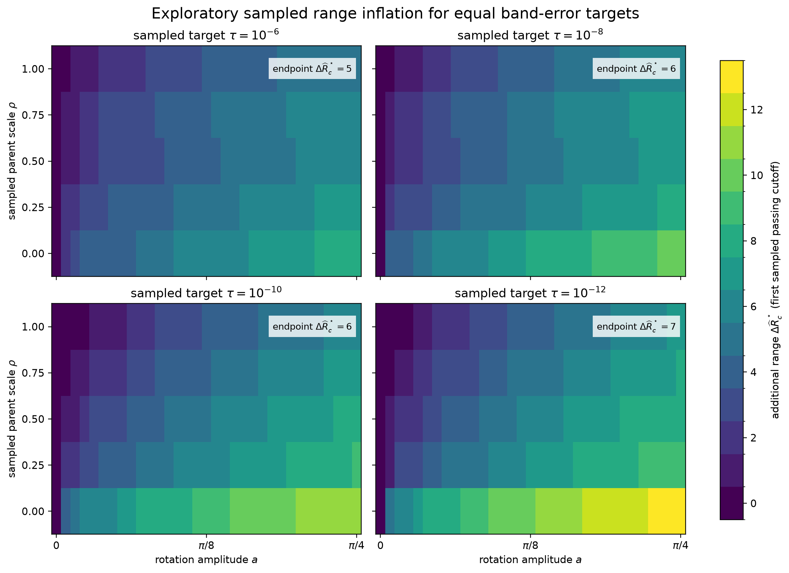

# Exploratory range-inflation preview

This preview asks a deliberately operational question: within the declared dense
integer inventory, how much additional ordinary-lattice range does the rotated representation
require to meet the same sampled maximum band-error target as the reference
representation?

For target $\tau$, define the **first sampled passing cutoff**

$$
\widehat R_c^\star(\rho,a;\tau)
=
\min_{R_c\in\mathcal R_{\mathrm{sampled}}}
\left\{R_c:\epsilon_{\max}(\rho,a,R_c)\leq \tau E_{\mathrm{ref}}\right\},
$$

and the sampled range inflation

$$
\Delta\widehat R_c^\star
=
\widehat R_{c,\mathrm{rotated}}^\star
-
\widehat R_{c,\mathrm{reference}}^\star.
$$

The reference error is the sampled maximum band error after ordinary-lattice
truncation. The rotated error is the sampled maximum total band error, which includes
its separately reported finite-interpolant discrepancy and deliberate truncation error. This
comparison retains the experiment's stated total-error scope; it does not assign an
off-node spectrum to the removed cyclic Nyquist block.

## What the existing exploratory grid shows

The source data use five parent scales, 33 amplitudes, construction mesh $N=256$, a
disjoint 1025-point evaluation mesh, and every integer cutoff

$$
\mathcal R_{\mathrm{sampled}}=\{0,1,\ldots,16\}.
$$

Positive sampled range inflation occurs at 159 of 165 sampled $(\rho,a)$ points for the
$10^{-6}$ and $10^{-8}$ targets and at 156 points for both $10^{-10}$ and
$10^{-12}$. The largest inflation occurs at the flat parent and maximum rotation, where
the reference is onsite while the rotated realization develops a long hopping tail.

At the dispersive endpoint $(\rho,a)=(1,\pi/4)$, the first sampled passing cutoffs are:

| target $\tau$ | reference | rotated comparison | sampled inflation |
|---:|---:|---:|---:|
| $10^{-6}$ | 3 | 8 | 5 |
| $10^{-8}$ | 4 | 10 | 6 |
| $10^{-10}$ | 6 | 12 | 6 |
| $10^{-12}$ | 7 | 14 | 7 |

Thus the central qualitative result survives the dispersive parent: two complete
representations with pointwise equivalent bands can require materially different
finite hopping ranges to reach the same sampled band accuracy.

## Why this is not yet a publication result

The hats remain essential because the five $\rho$ values and 33 amplitudes are sampled
points, not continuous-domain coverage, and $R_c=16$ is a declared development cap.
Within that cap there is no skipped-integer ambiguity. An independent verifier
reconstructs the error channels and first-passing decisions with maximum absolute
discrepancy $4.61\times10^{-13}$. Repeating the threshold-adjacent calculation at
$N=(128,256,512)$ with $M=4N+1$ changes none of the $10^{-8}$ decisions; every selected
cutoff passes and every immediately preceding integer cutoff fails.

This remains a development result because the protocol, cap and expansion rule,
acceptance controls, exact source provenance, and retained execution have not been
frozen or authorized. Continuous parent-scale and amplitude coverage is also not
claimed. This preview selects the clearest figure and narrative before those controls
are frozen; it is not retained evidence.
