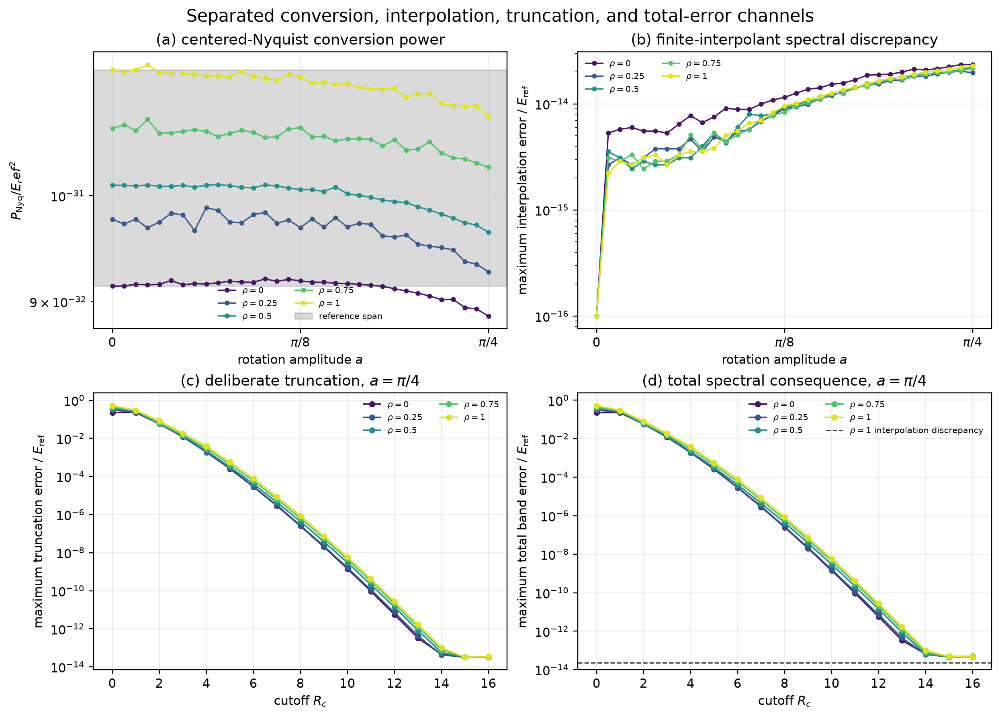

# Exploratory truncation-error channel decomposition

This figure keeps four distinct numerical channels visible rather than collapsing them
into a single locality diagnostic.

## (a) Centered-Nyquist conversion power

The even construction mesh has one centered $-N/2$ cyclic representative that cannot be
passed to PhysKit as an ordinary-lattice self-paired hopping term. KSD removes that block
and reports its normalized Frobenius power separately. Across the current exploratory
grid, the reference and comparison Nyquist powers remain between approximately
$8.87\times10^{-32}E_{\mathrm{ref}}^2$ and $1.14\times10^{-31}E_{\mathrm{ref}}^2$. This is a conversion-power
channel, not an off-node band error, and the near-floor values must not be promoted to a
continuous-domain bound.

## (b) Finite-interpolant spectral discrepancy

The finite Fourier blocks define the trigonometric interpolant $H_N(q)$. On the disjoint
evaluation mesh, its comparison spectrum differs from the directly evaluated ordinary
field by at most $2.35\times10^{-14}E_{\mathrm{ref}}$ over the sampled parent scales and amplitudes.
This channel contains the sampled finite-mesh interpolation/aliasing consequence before
any deliberate ordinary-lattice truncation.

## (c) Deliberate ordinary-lattice truncation

At $a=\pi/4$, truncating the complete ordinary comparison model produces the dominant
error at short range. For the fully dispersive endpoint $\rho=1$, the sampled maximum
truncation error decreases from about $5.25\times10^{-1}E_{\mathrm{ref}}$ at $R_c=0$ to
$8.65\times10^{-7}E_{\mathrm{ref}}$ at $R_c=8$ and $2.78\times10^{-11}E_{\mathrm{ref}}$ at $R_c=12$. It reaches
the binary64-scale floor of this calculation by $R_c=16$.

## (d) Total sampled spectral consequence

The total channel compares each truncated ordinary model directly with the untruncated
direct comparison field. It follows the deliberate-truncation curve while truncation
dominates, then saturates near $4\times10^{-14}E_{\mathrm{ref}}$ once interpolation and numerical
floors dominate. At $(\rho,a)=(1,\pi/4)$, the sampled total errors are approximately
$1.86\times10^{-2}E_{\mathrm{ref}}$ at $R_c=3$, $8.65\times10^{-7}E_{\mathrm{ref}}$ at $R_c=8$, and
$4.69\times10^{-14}E_{\mathrm{ref}}$ at $R_c=16$.

The interpolation, truncation, and total spectral errors are plotted as separate norms.
They are not stacked or treated as algebraically additive: matrix and eigenvalue errors
can reinforce or partially cancel. The dashed line in panel (d) only marks the
$\rho=1$ interpolation-discrepancy scale; it is not an additive reconstruction of the total.

These are sampled development results for $N=256$, the 1025-point disjoint evaluation
mesh, five $\rho$ values, 33 amplitudes, and 17 integer cutoffs $R_c=0,\ldots,16$.
Independent reconstruction agrees within $4.61\times10^{-13}$, and the $10^{-8}$
first-passing decisions do not change over $N=(128,256,512)$ with $M=4N+1$. They are
not retained evidence or continuous-$q$, continuous-$a$, or continuous-$\rho$ bounds.
