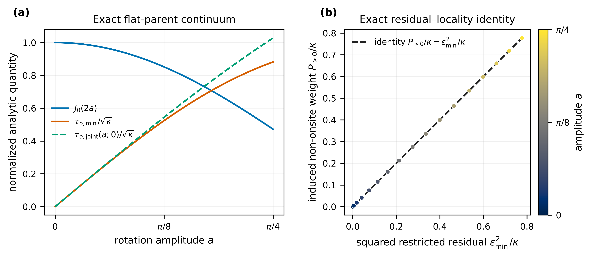
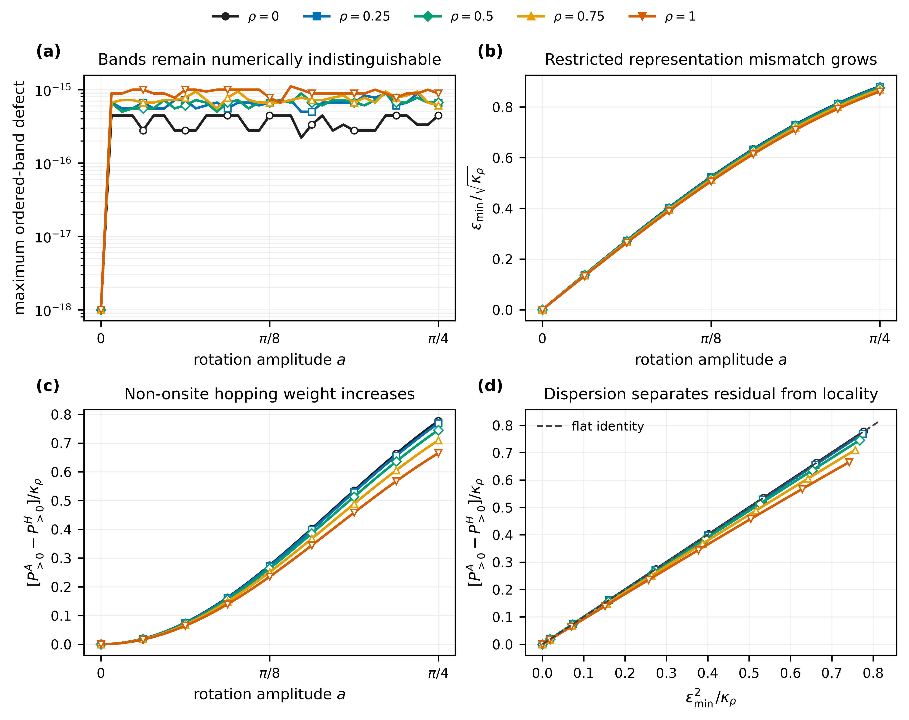
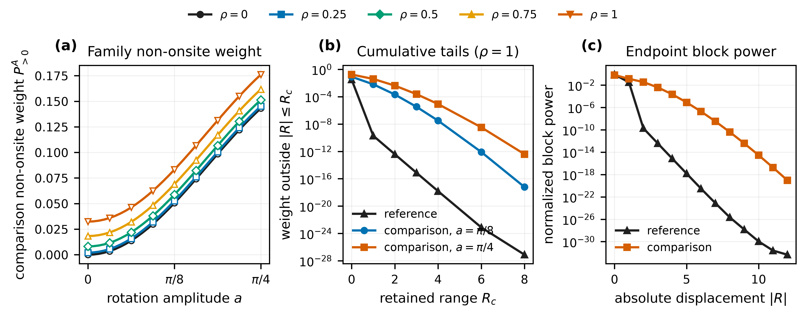
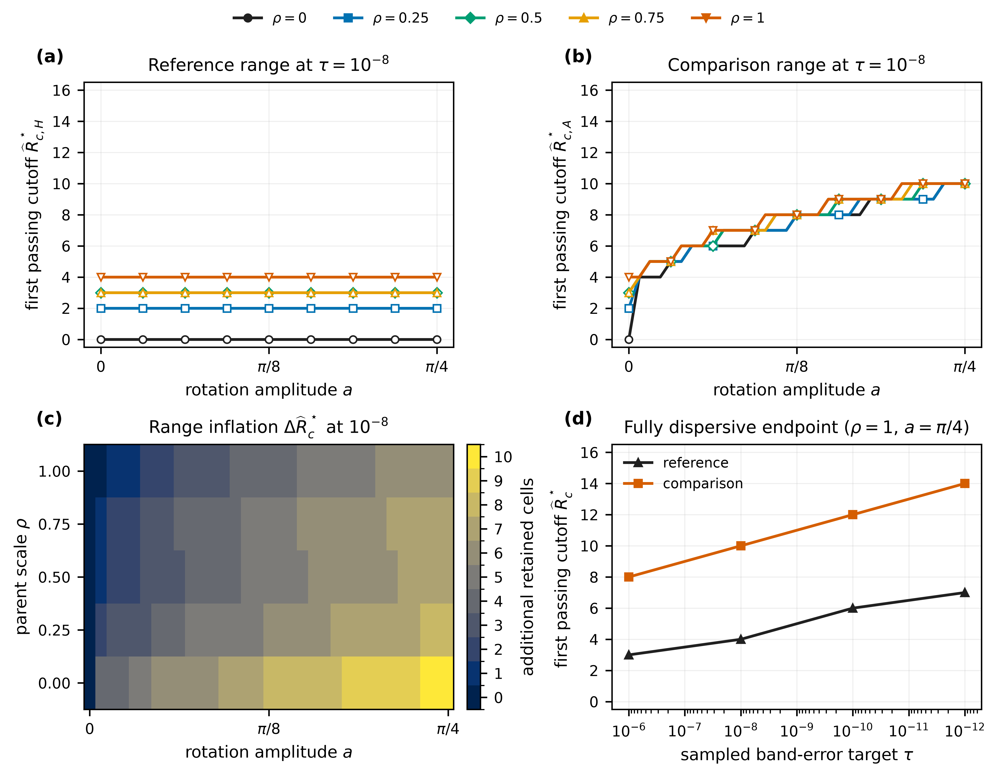
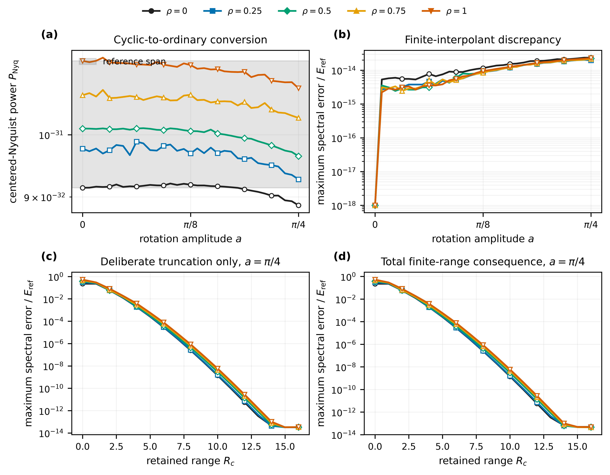
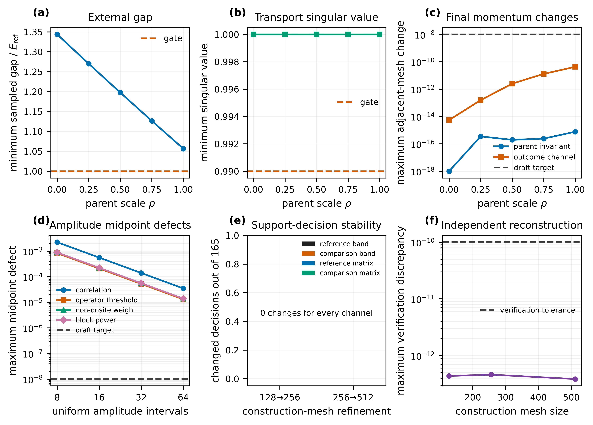

# Rank-two publication-figure storyboard

## Status and use

This storyboard is an **iterative visual design surface** for the Periodic1D rank-two
band-equivalence-versus-hopping-locality study. The current images use maintained
**development tables** solely to expose layout, hierarchy, labels, and narrative flow.
They are not retained complete-five-scale evidence, independently authenticated
publication inputs, or scientific validation.

The final figures must be regenerated from the admitted
`direct-embedded-rank2-five-scale-complete-v1` result after independent verification.
The final renderer must not read these development CSV files. Every final figure must be
bound by the rendering manifest to the verified result bytes.

## Narrative sequence

The visual argument is:

1. establish the exact flat-parent mechanism;
2. demonstrate that the bands remain unchanged across the dispersive five-scale family;
3. show the accompanying representation mismatch and hopping redistribution;
4. convert that redistribution into an equal-accuracy finite-range cost;
5. keep conversion, interpolation, deliberate truncation, and total consequences
   separate; and
6. disclose the numerical qualification, unresolved amplitude control, mesh stability,
   and independent-reconstruction evidence.

## Proposed main-text figures

### Figure 1 — Exact analytic benchmark

[](figures/storyboard/01-analytic-benchmark.pdf)

**Purpose:** Anchor the numerical study to the exact rank-two flat-parent result.

- **(a)** Show the analytic correlation and the two normalized acceptance thresholds.
- **(b)** Show the exact equality between squared restricted residual and induced
  non-onsite hopping weight.

**Claim supported:** Band equivalence does not remove a representation-level residual,
and for the flat parent that residual has an exact Fourier-locality meaning.

**Final-source requirement:** Analytic formulas or an independently verified analytic
reference component; never a fitted curve.

### Figure 2 — Five-scale core result

[](figures/storyboard/02-five-scale-core-result.pdf)

**Purpose:** Carry the central analytic-to-dispersive transition.

- **(a)** Maximum ordered-band defect across the sampled family.
- **(b)** Normalized restricted-alignment threshold.
- **(c)** Normalized excess non-onsite hopping weight.
- **(d)** Residual–locality relation and departure from the flat identity.

**Claim supported:** The complete fields remain band-equivalent while their restricted
representation mismatch and hopping-locality behavior vary systematically across the
sampled parent family.

**Nonclaim:** The five sampled values of \(\rho\) do not establish a continuous-domain
monotonicity theorem.

### Figure 3 — Hopping-locality profiles

[](figures/storyboard/03-hopping-locality-profiles.pdf)

**Purpose:** Make the real-space redistribution visible before introducing truncation.

- **(a)** Comparison non-onsite weight across all five parent scales.
- **(b)** Full-parent cumulative tails at selected amplitudes.
- **(c)** Reference and comparison block-power profiles at the fully dispersive endpoint.

**Claim supported:** A momentum-dependent representation redistributes hopping weight
across ordinary translations even though the complete band spectrum is unchanged.

**Iteration candidate:** If the complete record supports a readable comparison, panel
(b) may show selected parent scales \(\rho=(0,0.5,1)\) rather than only \(\rho=1\).

### Figure 4 — Equal-accuracy range inflation

[](figures/storyboard/04-equal-accuracy-range-inflation.pdf)

**Purpose:** Present the quantitative headline of the finite-range study.

- **(a)** First sampled passing reference cutoff at \(\tau=10^{-8}\).
- **(b)** First sampled passing comparison cutoff at the same target.
- **(c)** Additional retained range over the sampled \((a,\rho)\) grid.
- **(d)** Target sensitivity at \(\rho=1\), \(a=\pi/4\).

**Claim supported:** Equal sampled band accuracy can require a larger retained hopping
range in the rotated representation.

**Required presentation rule:** A cutoff not attained within \(R_c=0,\ldots,16\) must be
shown as unresolved or censored; it must not be silently clipped to 16.

### Figure 5 — Separated error channels

[](figures/storyboard/05-separated-error-channels.pdf)

**Purpose:** Prevent different approximation mechanisms from being conflated.

- **(a)** Centered-Nyquist conversion power.
- **(b)** Finite-interpolant spectral discrepancy.
- **(c)** Deliberate truncation-only spectral consequence.
- **(d)** Total finite-range spectral consequence.

**Claim supported:** The equal-accuracy result is reported with conversion,
interpolation, truncation-only, and total channels kept distinct.

**Nonclaim:** These spectral norms are not asserted to form an additive scalar error
budget.

## Proposed methods/control figure

### Figure 6 — Numerical controls

[](figures/storyboard/06-numerical-controls.pdf)

**Purpose:** Place the scientific plots beside their qualification and resolution
limits.

- **(a)** External-gap qualification across parent scale.
- **(b)** Frame-transport singular-value qualification.
- **(c)** Final adjacent momentum-mesh changes.
- **(d)** Amplitude midpoint defects and the unresolved draft target.
- **(e)** Adjacent-mesh support-decision stability.
- **(f)** Independent truncation-reconstruction discrepancy.

**Placement:** Methods/results boundary or supplementary material, depending on journal
space. The unresolved amplitude outcome must remain visible somewhere in the main paper
or an explicitly cited supplement.

## Supplementary candidates

The following should remain separate unless the complete execution shows that they are
needed to interpret the headline figures:

1. complete range-inflation maps at \(10^{-6},10^{-8},10^{-10},10^{-12}\);
2. momentum-refinement trajectories for each parent scale;
3. complete amplitude-refinement interval maps and disjoint validation, when available;
4. support-decision maps at construction meshes 128, 256, and 512;
5. verification-defect ledgers by scientific channel;
6. full hopping-power heat maps over amplitude and displacement;
7. selected reference/comparison band overlays as a conventional diagnostic; and
8. retained-result provenance and figure-digest tables.

## Visual rules for iteration

- Target two-column width near 7.1 inches; preserve at least 7.5–8 point text at final
  size.
- Supply vector PDF and 600-dpi PNG.
- Use color plus marker shape so parent scale is identifiable without color alone.
- Keep \(\rho=0\) black and the fully dispersive \(\rho=1\) visually prominent.
- Use one shared parent-scale legend per multi-panel figure.
- Use direct physical/mathematical labels rather than unexplained internal field names.
- Keep logarithmic floors explicit in captions.
- Mark unresolved and censored values; never render them as zero.
- Do not call sampled \(\rho=0\) values an analytic continuum.
- Do not merge hopping diagnostics with irreversible support-truncation consequences.
- State that connecting lines between sampled amplitudes are guides to the eye unless a
  separately qualified interpolant supports them.

## Reproduction

Render the storyboard from the calculation root environment:

```console
cd python
uv run python \
  ../calculations/periodic1d/rank2/band-equivalence-versus-hopping-locality/protocol/render_publication_storyboard.py
```

The renderer reads only calculation-local development inputs and results and writes the
six PDF/PNG pairs under `protocol/figures/storyboard/`. Re-rendering these prototypes
does not execute the scientific calculation and does not change their evidence status.
