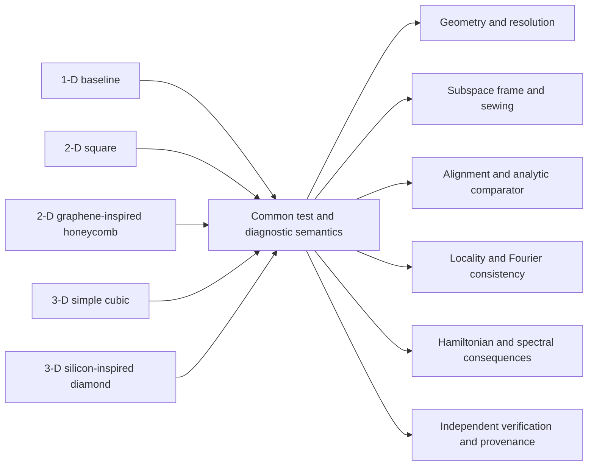

# Band-equivalence test and diagnostic parity

The operational parity contract is maintained at
[`experiments/model-adequacy/band-equivalence-test-and-diagnostic-parity.md`](../../../../../experiments/model-adequacy/band-equivalence-test-and-diagnostic-parity.md).

## Architecture rule

The 1-D, orthogonal 2-D/3-D, and non-orthogonal 2-D/3-D families expose the same
behavioral layers and diagnostic categories while retaining independent experiment
identities, schemas, tolerances, convergence results, runs, and evidence. One-dimensional
non-orthogonality is not a separate geometry because a one-vector basis has no
inter-vector angle.

Shared code is permitted only for behavior demonstrated to be geometry independent.
Geometry-specific orbit, metric, comparator, resource, and covariance logic remains with
its scientific owner. Every maintained 1-D diagnostic-catalog quantity must have an
independently calculated or independently derived counterpart in each applicable Paper 2
family. An inapplicable diagnostic is explicitly marked with a reason; it is never
fabricated as zero. A fixed-unit-scale global-rotation residual does not substitute for
Paper 1's positive splitting-scale minimum or exact-spectrum joint threshold.
