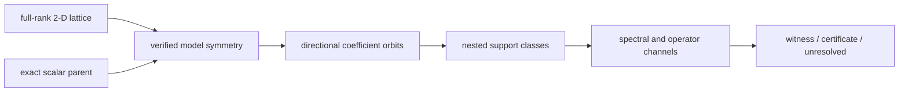
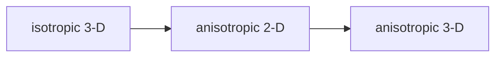

# Anisotropic 2-D schematics

## Scientific construction

The future experiment will separate lattice geometry, model symmetry, and directional
support policy before constructing evidence.

- Lattice vectors define physical geometry.
- Verified symmetry defines coefficient orbits.
- Support policy defines nested classes.
- Channels evaluate one common coefficient vector.

## Sequencing role

The stage isolates anisotropy before the final anisotropic three-dimensional experiment.

- It follows isotropic 3-D.
- It precedes anisotropic 3-D.
- It does not inherit results from either neighbor.

