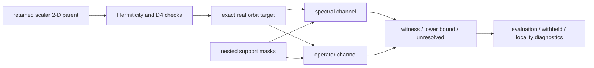
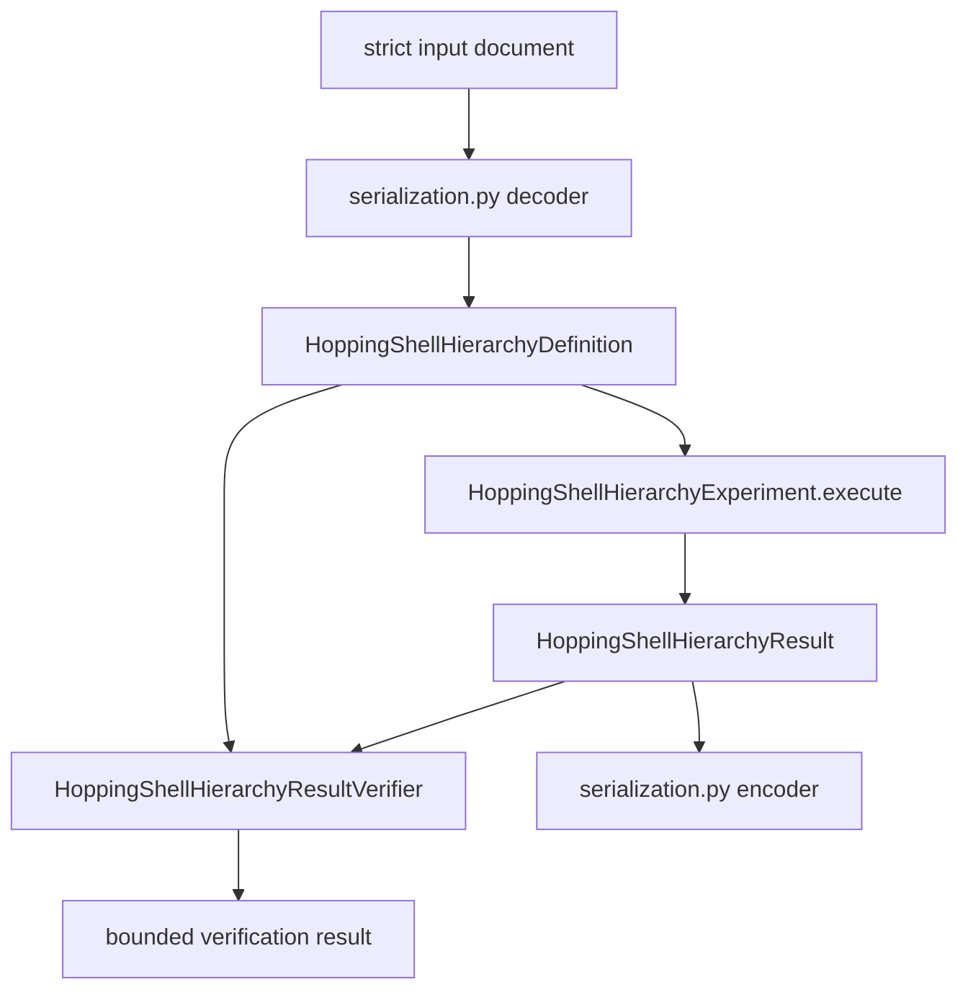

# Isotropic 2-D schematics

## Scientific flow

The experiment projects one retained finite parent into a square-symmetric target and
compares nested candidate classes in one maximal space.

- Projection occurs before class reduction.
- Both channels consume the same target and coordinates.
- Evaluation occurs after decisive evidence is fixed.

## Implementation flow

The package mirrors the existing periodic-1D experiments. There is no nested
`experiment/` or `execution/` source package.

- `definition.py` owns the immutable definition.
- `experiment.py` owns the in-process Action.
- `results.py` owns immutable result records.
- `verify.py` independently reconstructs decisive evidence without calling the Action.
- `serialization.py` transports rather than interprets input, result, and verification documents.

