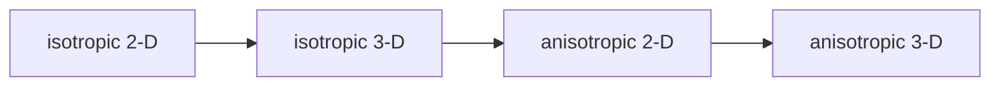
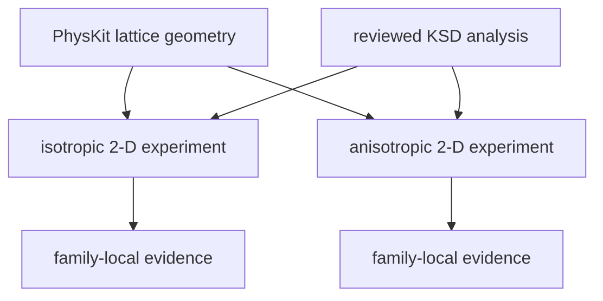

# Periodic 2-D schematics

## Experiment sequence

The periodic-2D package contributes the first and third stages of the selected sequence.

- Isotropic 2-D establishes the square-symmetric baseline.
- Isotropic 3-D then isolates dimensional extension.
- Anisotropic 2-D later isolates removal of axis-permutation symmetry.
- Anisotropic 3-D combines both stresses last.

## Two-dimensional ownership

Reusable geometry flows inward while scientific composition stays with each child.

- PhysKit supplies reviewed lattice primitives.
- KSD capabilities supply reviewed reusable analysis.
- Each experiment supplies its parent, orbits, channels, controls, and evidence.

