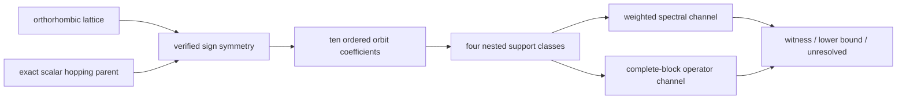
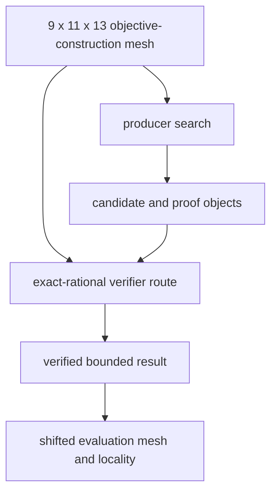
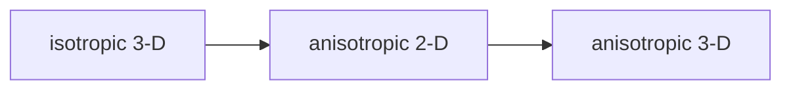

# Anisotropic 3-D schematics

## Scientific construction

The experiment builds anisotropic sign orbits from an exact orthorhombic scalar parent
before evaluating nested support classes.

- Lattice geometry fixes physical vectors and reciprocal coordinates.
- Parent symmetry permits signs but not axis permutations.
- Support groups define the experiment-specific hierarchy.
- Both channels consume the same maximal coefficient embedding.

## Evidence flow

Objective construction, verification, and evaluation have separate roles.

- Objective construction defines channel quadratics.
- Producer search proposes candidates and directions.
- Independent verification reconstructs decisive evidence.
- Evaluation and locality diagnostics occur downstream.

## Sequencing role

The package is preserved as the final concrete stress stage.

- Isotropic 3-D isolates dimension first.
- Anisotropic 2-D isolates symmetry removal second.
- This package combines both only after those stages.

