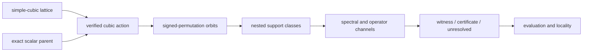
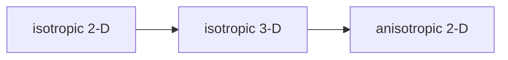

# Isotropic 3-D schematics

## Scientific construction

The experiment combines an exact cubic scalar parent with cubic orbit reduction and two
adequacy channels.

- Geometry and model symmetry are verified before orbit construction.
- Support classes add complete cubic orbits.
- Both channels evaluate one common coefficient vector.
- Evaluation diagnostics occur after decisive evidence is fixed.

## Sequencing role

The stage isolates dimensional extension before anisotropy is introduced.

- It follows isotropic 2-D.
- It precedes anisotropic 2-D.
- It does not inherit the first stage's thresholds or results.

