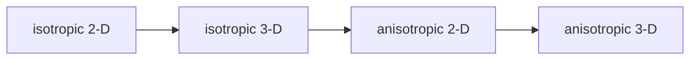
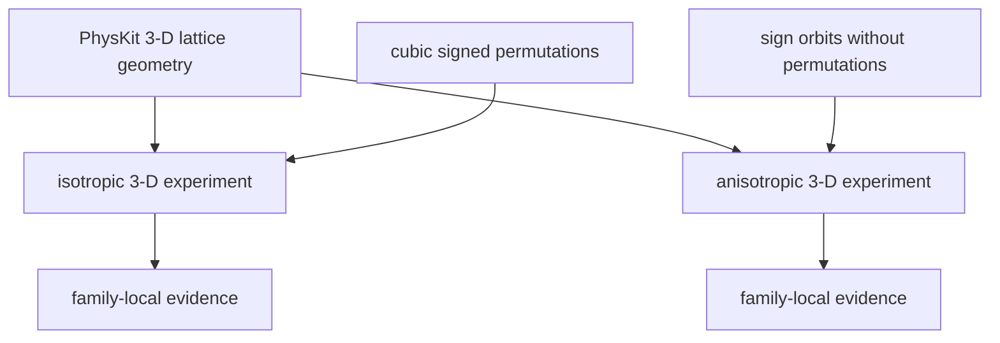

# Periodic 3-D schematics

## Child relationship

The isotropic and anisotropic children share evidence vocabulary but not experiment
identity or exact controls.

- Isotropic 3-D is implemented before anisotropic 2-D.
- Anisotropic 3-D is implemented after the anisotropic 2-D stage.
- Results and thresholds do not transfer between children.

## Geometry ownership

Reusable geometry and experiment-specific symmetry enter through separate owners.

- PhysKit supplies direct, reciprocal, and metric primitives.
- Each child verifies the symmetry action admitted by its parent.
- Each child constructs its own support orbits and evidence.

