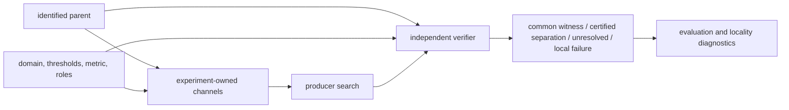
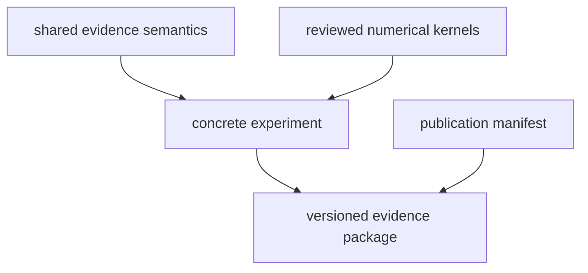

# Model-adequacy schematics

## Evidence construction

Each experiment builds two channel sets from one identified parent and candidate space,
then verifies decisive evidence through a separate route.

- Parent and frozen controls feed both producer and verifier.
- Producer search proposes candidates and proof objects.
- Verifier reconstructs scientific sets and retained premise evidence, then independently checks the selected owner-defined certificate relationships.
- Evaluation diagnostics remain downstream.

## Ownership

Shared evidence meaning and concrete experiment meaning remain separate.

- KSD shared semantics define decisive vocabulary.
- Each experiment defines parameters, channels, thresholds, metric choice, certificate-method binding, experiment data and retained evidence instantiating owner-defined validity conditions, evidence correlation, premise-failure policy, and interpretation.
- Optimization provides reviewed capability-specific intersection-feasibility and strict-separation certificate mathematics for explicitly supported set representations where a matching contract exists.
- Numerics provides reviewed unit-free transforms and invariant-diagnostic kernels with explicit public contracts, plus interval, directed-rounding, and enclosure primitives and arithmetic validity conditions where matching contracts exist.
- PhysKit provides physics-semantic records or adapters where needed and is not a required facade for direct KSD use of Numerics or Optimization; primitive arithmetic inside a physics-semantic diagnostic does not alone determine ownership.
- Publications cite retained experiment evidence.

