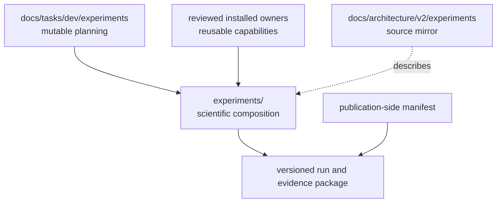
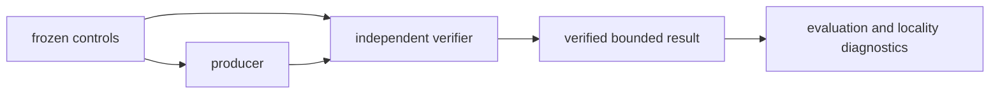

# Experiment architecture schematics

## Ownership flow

The experiment composes reusable owners while retaining scientific meaning and evidence
policy.

- Tasks coordinate mutable work.
- Architecture mirrors source contracts.
- Installed owners provide reusable capabilities.
- Experiment versions define immutable scientific composition.
- Publications cite retained evidence without owning the experiment.



## Mirror hierarchy

Every selected source node has one architecture node and one five-page bundle.

- Package maps to package directory.
- Subpackage maps to subpackage directory.
- Module maps to module directory.
- Public class maps beneath its defining module.
- Re-export does not create a duplicate class node.

```mermaid
flowchart LR
    package["package"] --> subpackage["subpackage"]
    subpackage --> module["module"]
    module --> class["ClassName"]
    package -. mirror .-> apackage["architecture package"]
    subpackage -. mirror .-> asubpackage["architecture subpackage"]
    module -. mirror .-> amodule["architecture module"]
    class -. mirror .-> aclass["architecture ClassName"]
```

## Evidence flow

Decisive evidence and downstream diagnostics remain directionally separated.

- Frozen controls feed both producer and verifier.
- Producer outputs candidates and proof objects.
- Verifier reconstructs decisive claims independently.
- Evaluation and locality diagnostics occur after decisive controls are fixed.
- No arrow authorizes execution or retention.


