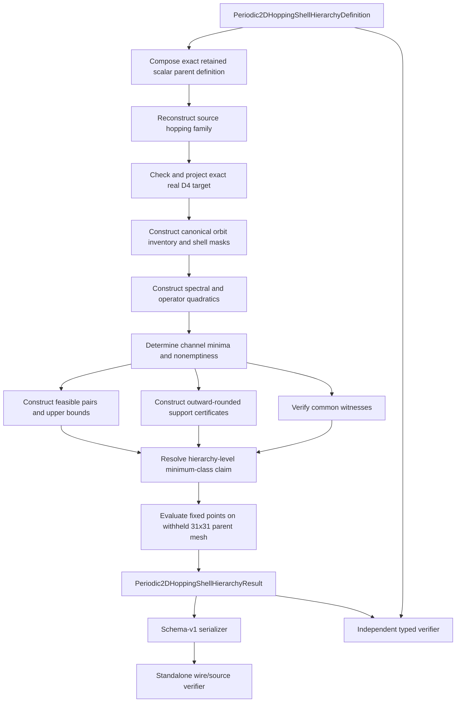
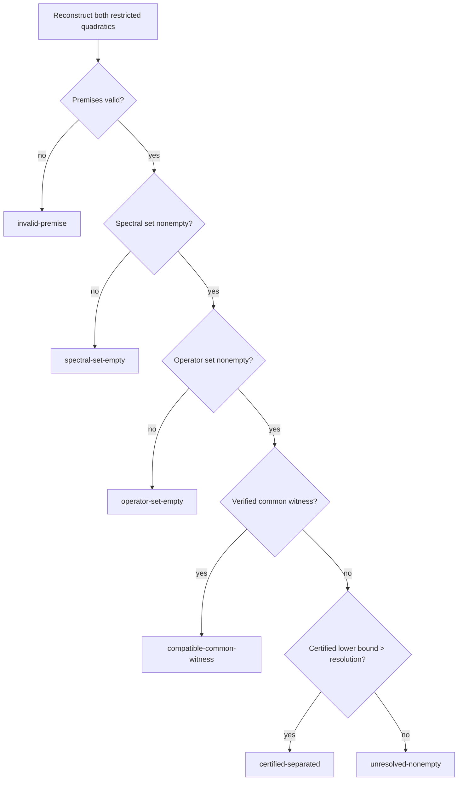

# HSH-1 calculation schematic

## Information-flow restrictions

- Source bytes and the frozen definition determine the exact projected target.
- Training coordinates and weights determine quadratics, feasible sets, certificates,
  and dispositions.
- Withheld direct-parent values are opened only after all training proof objects are
  fixed.
- Withheld diagnostics cannot alter weights, thresholds, coefficient bounds, shell
  order, witnesses, certificate directions, distance bounds, or dispositions.
- Serialization transports already constructed objects; it does not infer scientific
  meaning or repair invalid results.
- The standalone verifier may consume files and manifests but must not import producer
  modules.

## Per-class disposition logic

## Hierarchy-level decision

The hierarchy result may emit `minimum-tested-compatible-class-certified` only if the
first compatible class has an explicit witness and every earlier class is either
channel-empty or certified separated. If no class is compatible or any smaller class is
unresolved, the result reports only bounded per-class dispositions and, when present,
the first class with a found witness without calling it minimal.
