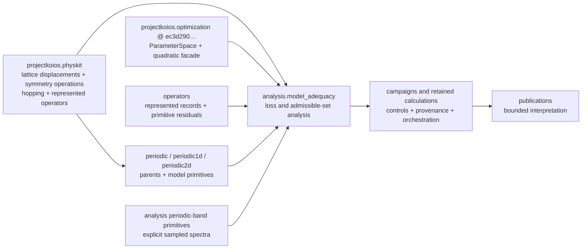
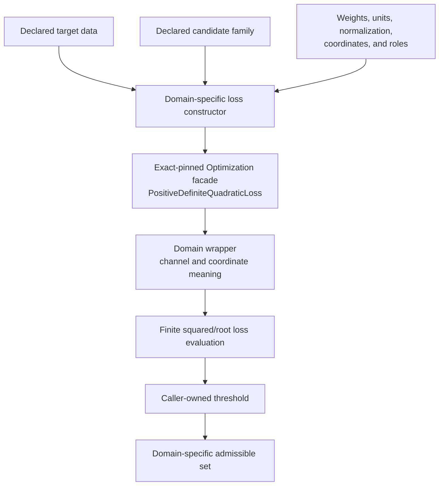
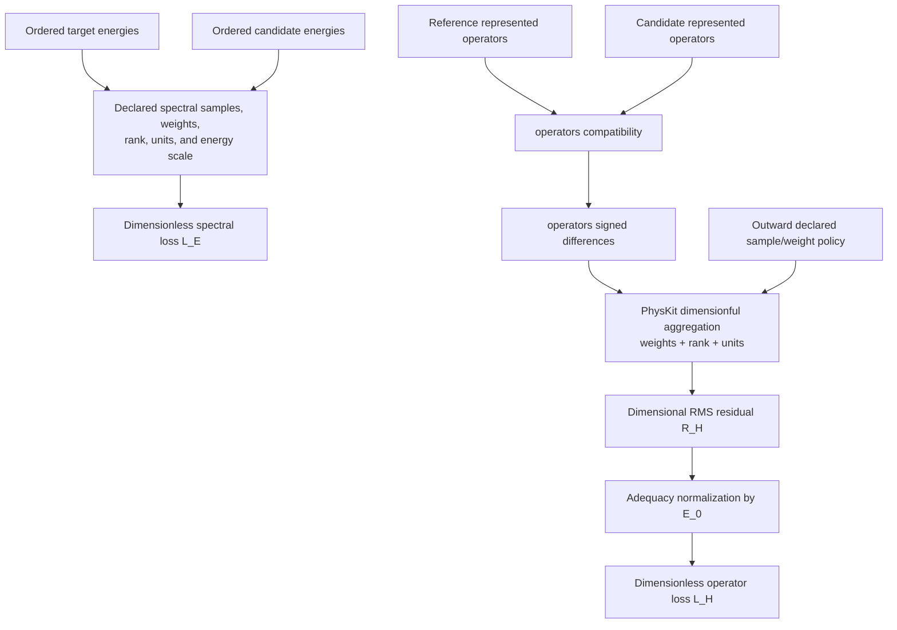
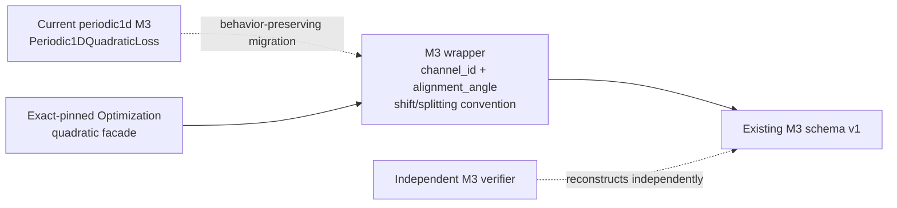
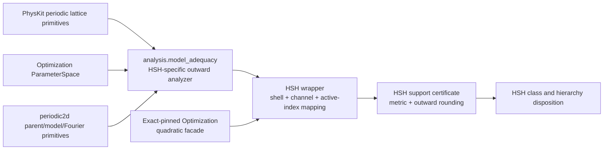
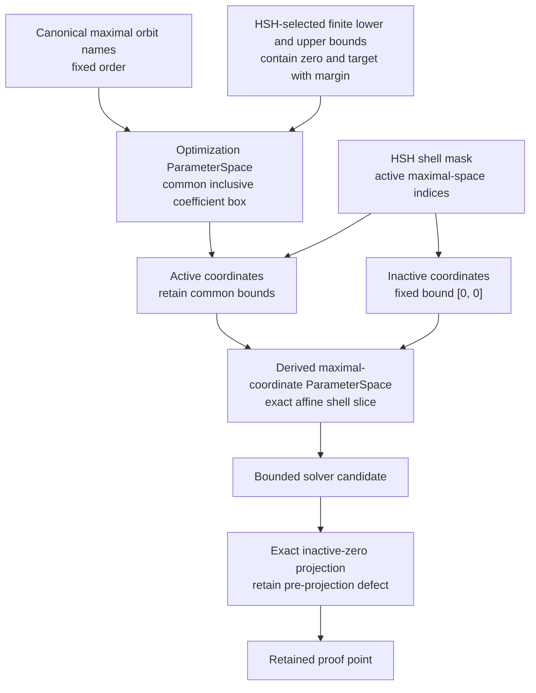
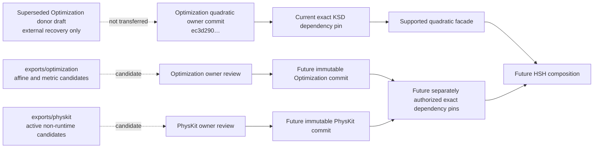
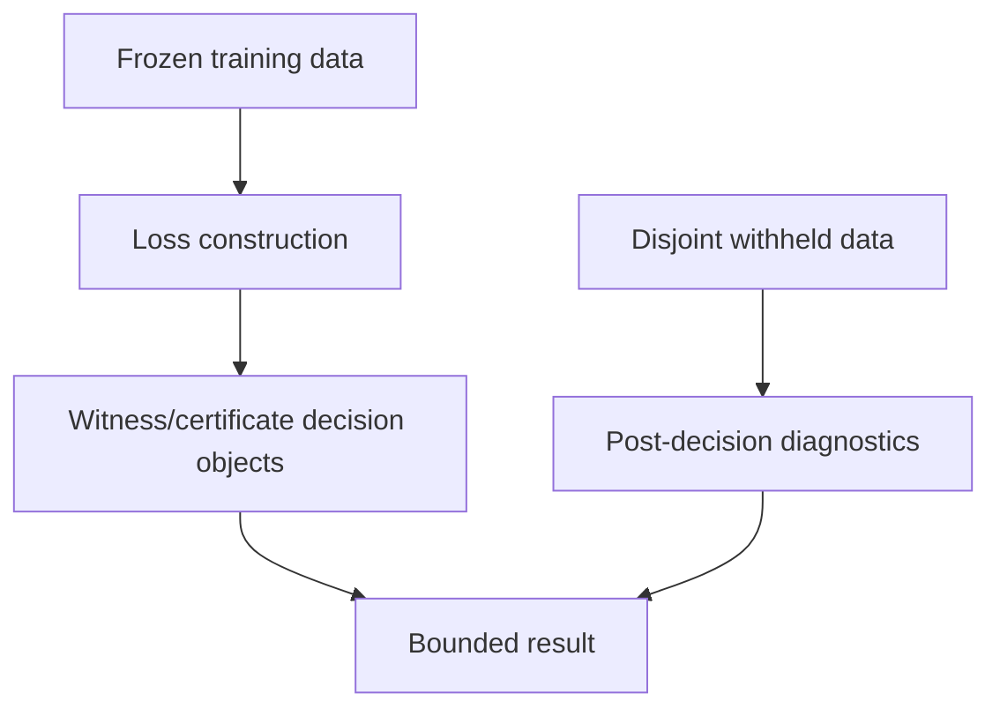

# Model-adequacy ownership and data-flow schematic

## Package dependency direction

The arrows show permitted outward consumption, not inheritance. Inward `operators` and
periodic model packages must not import `analysis.model_adequacy`. The adequacy layer
uses the exact-pinned optimization parameter-space contract directly; it does not create
a renamed coordinate-box wrapper. During migration, a legacy compatibility module may
re-export an outward class without becoming its implementation owner.

## Loss construction and evaluation

The generic quadratic facade does not discover targets, fit a model, choose weights,
select an alignment, apply a threshold, or assign a disposition. It may represent either
$L_E^2$ or $L_H^2$ only after a domain constructor derives explicitly normalized
completed-square coefficients. The dependency is accepted and pinned; KSD-specific
wrappers remain prospective.

## Spectral and represented-operator channels

Alignment and energy-reference selection occur before compatibility when required and
remain outward scientific-analysis policy. The outward loss definition selects samples
and weights; `operators` owns represented subtraction and primitive residuals, while
PhysKit owns reusable unit-bearing aggregation through $R_H$. Model adequacy owns the declared normalization
$L_H=R_H/E_0$. Neither layer may infer alignment or an energy reference from matrix
values.

## M3 compatibility path

The dotted M3 migration is prospective, but target integration and dependency repinning
are complete. Existing source and wire identity do not change because this diagram exists.
The verifier must not call the producer evaluator to establish independent
reconstruction.

## HSH ownership path

HSH selects its shell-radius sequence, source correlation, coefficient bounds, weights,
normalization, thresholds, certificate meaning, and hierarchy minimality. The inclusive
bound container and quadratic facade come from exact-pinned Optimization; lattice
operations, orbit/shell construction, projection, multiplicities, and dimensionful
hopping geometry come from PhysKit.

## Common coefficient box and exact shell slices

The common box and every shell slice use the same maximal-coordinate ordering. Equal
endpoints represent mathematical equality, not a numerical tolerance. The HSH builder
must prove that each active bound is copied unchanged and each inactive coordinate is
fixed exactly to zero.

## Export promotion boundary

The Optimization owner supplied its own quadratic implementation; KSD does not consume
the superseded quadratic donor bytes. The new affine/metric and PhysKit candidates still
require their respective owner reviews and immutable owner commits. No arrow runs
directly from active `exports/` source to runtime. Dependency integration, HSH
implementation, scientific execution, and scientific acceptance remain separate
decisions.

## Training and withheld roles

There is no arrow from withheld diagnostics back to loss construction, thresholds,
witnesses, or certificates unless a different protocol explicitly declares a second
training stage.
