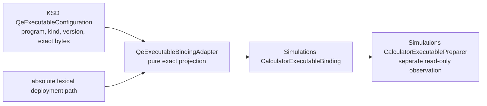

# `QeExecutableBindingAdapter`

## Responsibility

`ksdft2effmass.integration.quantum_espresso.executable_binding` owns the first
implemented Project Koios Simulations adapter. The fieldless
`QeExecutableBindingAdapter` projects one exact KSD
`QeExecutableConfiguration` and one absolute lexical deployment path into
`projectkoios.simulations.execution.CalculatorExecutableBinding`.

The projection is exact:

| KSD source | Simulations destination |
|---|---|
| `program` plus `executable_kind` | `identity.calculator_name` |
| `program_version` | `identity.calculator_version` |
| `executable_content_identity.byte_count` | `identity.byte_size` |
| `executable_content_identity.digest` | `identity.sha256` |
| supplied absolute path | `path` |

Actual QE program roles use the provider namespaces `Quantum ESPRESSO pw.x` and
`Quantum ESPRESSO bands.x`. Deterministic fixtures use the separate namespaces
`deterministic fixture for Quantum ESPRESSO pw.x role` and
`deterministic fixture for Quantum ESPRESSO bands.x role`; fixture bytes are never
represented as an actual QE executable.

## Boundary

The adapter does not read metadata or bytes, follow links, prepare or stage an
executable, invoke a process, infer provider compatibility, issue authority, or make a
scientific claim. The provider binding constructor rejects a nonpositive byte count and
a path that is not absolute and parent-traversal-free.
`LocalQeExecutionPreparer` composes this adapter with the Simulations
preparer and maps its mechanical failures into KSD preparation failures. A later
staging or process owner must still close its own mutable-state boundary.

KSD continues to own the selected QE program role, executable-kind distinction,
argument suffix, allowlisted environment additions, diagnostic-classifier identity,
and Workflow attempt correlation. Therefore this adapter makes only the exact
calculator-neutral executable identity reachable; it does not by itself satisfy the
deletion gate for KSD resource, predecessor-tree, workspace, diagnostic, staging, or
process-entry owners.

## Evidence

The source-mirrored software-verification owner is
`python/tests/software_verification/ksdft2effmass/integration/quantum_espresso/executable_binding/test__QeExecutableBindingAdapter__execution.py`.
It verifies actual-QE and deterministic-fixture namespaces, exact version and content
identity retention, absent-path nonobservation, and provider-invalid binding rejection.
The local-execution verification owner additionally covers provider preparation
mapping for missing, symbolic-link, non-regular, non-runnable, byte-size, digest, and
observation failures and verifies process non-invocation. Passing these tests
establishes the bounded software projection and read-only composition only.
