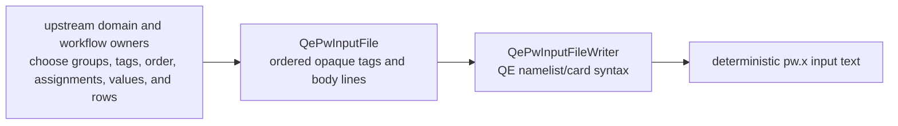
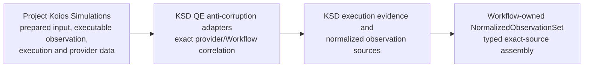

# `ksdft2effmass.integration.quantum_espresso` package

This canonical package is the concrete Quantum ESPRESSO anti-corruption boundary.
The accepted
[package-ownership decision](../../calculators/quantum-espresso-package-ownership-decision.md)
places every QE-specific contract and implementation here and the backend-neutral
plane-wave DFT port in `ksdft2effmass.calculators.dft.pw`.

Its first implemented capability represents and writes grouped `pw.x` input without
defining a comprehensive model of Quantum ESPRESSO variables or scientific settings.

## Current cross-repository ownership transition

The earlier KSD implementation remains present while the migration is staged, but it
is no longer the target owner for reusable calculator mechanics. Project Koios
Simulations owns prepared calculator inputs, exact executable identity and read-only
preparation, reusable execution records, native QE parsing, and SCF/NSCF/band-path
provider data. KSD retains Workflow correlation and persistence plus Kohn--Sham and
campaign interpretation.

The exact boundary action contracts, non-substitutability rules, replacement-wire strategy,
and deletion gates for the 101 qualified duplicate owners are defined in the
[Project Koios Simulations adapter boundary](simulations_adapter_boundary/). The
implemented boundaries are direct provider-input
[`QeCalculatorInputAdmission`](calculator_input/QeCalculatorInputAdmission/index.md),
the [`QeExecutableBindingAdapter`](executable_binding/index.md), and the reachable
[`QePwEvidenceAdapter`](execution_evidence/QePwEvidenceAdapter/index.md),
object-owned `QePwEvidencePublisher`, and final
[`QePwResultAssembler`](result_assembly/QePwResultAssembler/index.md). This
reachable execution-evidence application is restricted to `pw.x` and does not imply
`bands.x` support.
The input admission retains the provider instance and explicit KSD policy identity without a
wire or representation copy and is rechecked at executor entry. Native input bytes are
staged directly from the typed provider artifact; pseudopotentials and predecessor
trees retain their explicit local-resource policy. The approved dependency revision
and these boundaries do not authorize calculator execution.

## Implemented `pw.x` input boundary

`QePwInputFile` is an immutable, loose native-input DataObject. It preserves an
ordered tuple of grouping tags and body lines. A tag beginning with `&` denotes a
Fortran namelist; another tag denotes a QE card and may include its card option.
Unknown tags and body content are retained. The object does not know the catalog of
`pw.x` variables, choose a group, supply a default, normalize a value, validate
cross-field physics, or own pseudopotential and calculation provenance.

`QePwInputFileWriter` is the corresponding ActionObject. It supplies only the
mechanical namelist/card delimiters, indentation, ordering, and final newline. It
does not stage files, encode text to bytes, invoke `pw.x`, or claim that the emitted
input is accepted by any Quantum ESPRESSO version. Upstream objects remain responsible
for every grouping and scientific choice.

The retained silicon SCF example under
`examples/tutorials/silicon-scf/qe/` demonstrates this boundary using portable paths.
It is a software-writing example, not a new calculation, provenance record,
numerical-verification result, or scientific validation result.

## Implemented downstream boundaries and staged observation adaptation

QEXSD begins on the output side. The existing
`integration.quantum_espresso.qexsd` package mechanically parses explicit QEXSD bytes
after an independently obtained output artifact exists. It accepts exactly the
observed QEXSD `23.03.10` and `25.05.21` formats under the QES 1.0 namespace and
fails closed for unlisted versions. This bounded support does not claim exhaustive
coverage of either upstream schema. QEXSD does not define the input grouping model,
drive `QePwInputFileWriter`, or serve as the primary integration boundary.

The current source still implements staging, isolated workspace and one-attempt
process invocation, mechanical capture, artifact discovery, failure mapping,
operation-specific results, and Workflow dispatch adaptation as separate KSD
ActionObjects. These are transitional owners subject to the adapter boundary and its
per-capability deletion gates; capability overlap alone does not justify removal. The
accepted
[QE diagnostic outcome and retry decision](../../calculators/quantum-espresso-diagnostic-outcome-decision.md)
assigns executable- and version-bound diagnostic classification over exact independent
stdout and stderr artifacts to this integration while leaving dependency admission and
retry control with Workflow composition. The
[local-execution implementation contract](local_execution/)
fixes the implemented public Python DataObject, ResultObject, ActionObject,
confinement, capture, diagnostic, private-record, and Workflow-handoff boundaries.
These responsibilities consume exact written or retained inputs without moving
grouping or scientific policy into this package. The integration-owned first stage of
human-selected Option C is implemented and human-accepted as a bounded software
contract: `QeObservationAdapter`
requires one `QeParsedDocumentRecord` binding the exact QEXSD document,
source-content identity, parser implementation and parser version, plus an admitted
`ArtifactManifest` entry, reserved result identity, and supported normalization
policy/version. It rejects missing entries, byte-identity disagreement, unsupported
parser, native format or semantic
role, unsupported policy, and neutral-contract incompatibility without a partial
observation. Success retains the unchanged schema-version-1 neutral plane-wave record,
exact source and producer identities, parsed-document and parser identities, policy,
and explicit limitations in `QeExtractedObservationResult`. Every closed
failure retains the reserved result identity and the same manifest, entry,
parsed-document, source-content, parser, and policy correlation. The separately owned
Workflow stage consumes the exact immutable extracted result through its
calculator-independent `NormalizedObservationSource` protocol and assembles the
Workflow-owned `NormalizedObservationSet`; integration remains unaware of that
protocol and result owner.

## Historical integration-verification result

The following accepted result verifies the retained pre-adapter KSD implementation. It
must not be read as a decision to keep reusable provider mechanics in KSD after the
Project Koios Simulations capability became reachable.

The human-accepted and administratively closed
`migration.v2.integration.quantumespresso.verification` Task finds no
additional source migration or duplicate behavioral test necessary. The maintained
software-verification boundary already covers native input representation and writing,
Task and Simulation contracts, preparation and local fixture-process execution,
independent stream capture, diagnostic classification, outcome resolution, native
artifact discovery, QEXSD parsing, extracted-observation adaptation, and the separate
Workflow-owned exact-source assembly. Direct paths, injected closed failures, exact
artifact and result identities, source nonmutation, and inward dependency direction are
represented by their existing cohesive evidence owners. One package-level artifact
owner adds the previously missing complete dependency-direction guard: calculators and
workflows import no concrete integration, while QE integration imports no outward
application, campaign, analysis, or persistence owner.

| Verification requirement | Exact maintained evidence |
|---|---|
| Direct fixture-process and consumer path | `test__LocalQeExecutor__execution.py` (`SV-QE-EXECUTOR-001`), `test__QeObservationAdapter__adaptation.py` (`SV-QE-ADAPT-001`), and `workflows/test__NormalizedObservationAssembler.py` (`SV-WNO-001`) |
| Injected and fail-closed outcomes | `test__LocalQeExecutor__execution.py`, `test__QeCalculatorOutcomeResolver__resolution.py` (`SV-QE-OUTCOME-002` through `SV-QE-OUTCOME-006`), and `test__QeObservationAdapter__adaptation.py` (`SV-QE-ADAPT-003` through `SV-QE-ADAPT-009` and `SV-QE-ADAPT-011` through `SV-QE-ADAPT-013`) |
| Artifact/result identity and source nonmutation | `test__LocalQeExecutionPreparer__preparation.py` (`SV-QE-LOCAL-EXEC-001`, `SV-QE-LOCAL-EXEC-002`), `test__LocalQeExecutor__execution.py` (`SV-QE-EXECUTOR-001`), and `test__QeObservationAdapter__adaptation.py` (`SV-QE-ADAPT-001`, `SV-QE-ADAPT-002`) |
| Package dependency direction | `test__QeIntegrationDependencyDirection__contracts.py` (`SV-QE-INTEGRATION-VERIFY-001`, `SV-QE-INTEGRATION-VERIFY-002`) |
| Strict typing and test ownership | `resources/integration-verification-test-ownership.json` plus the maintained QE Ruff, mypy, and software-verification checks |

The composed affected slice contains 21 maintained test modules with 134 uniquely
identified test methods; its current run reports 180 passed cases and three skipped
external-QEXSD cases whose environment variables are absent. Full-package Ruff and
mypy checks and repository Python-conformance validation report no finding. This
accepted result establishes bounded software verification only. It does not establish
that external QEXSD artifacts are available, invoke Quantum ESPRESSO, or establish
numerical verification, scientific validation, uncertainty quantification, or
scientific acceptance.

The generic port, concrete object model, and protected execution boundary are
described in
[Quantum ESPRESSO integration architecture](../../calculators/quantum-espresso.md).
This integration owns the KSD anti-corruption, Workflow-correlation, persistence, and
scientific-interpretation boundary for QE data. Reusable provider mechanics belong to
Project Koios Simulations as allocated by the adapter design. Nothing in this
architecture authorizes Quantum ESPRESSO execution, dependency changes,
pseudopotential selection, or external computation.
