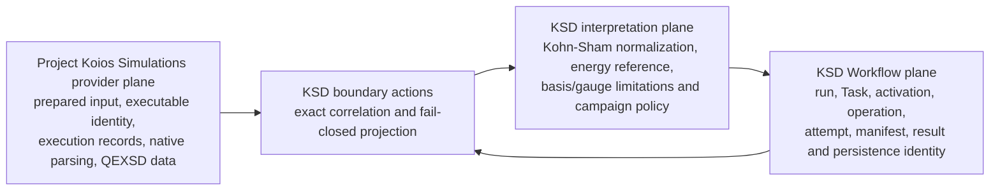

# Project Koios Simulations adapter boundary for Quantum ESPRESSO

## Status and purpose

This page is the implementation baseline for moving reusable calculator and Quantum
ESPRESSO mechanics to `projectkoios-simulations` without moving KSD Workflow identity,
correlation, persistence, campaign policy, or scientific interpretation out of this
repository. It refines the earlier package-ownership and Task decisions; it does not
authorize calculator execution or a dependency revision.

The KSD dependency pin is Project Koios Simulations reconciliation commit
`841f5e34afd0a83c9a63da10c41a9d513c1caa80`. It retains the execution-observation
owners originally introduced by named-exit-disposition commit
`a3916ca442be546839a39d131642e660a04c1495`, extending execution-observation commit
`2491859a3cc9edddae97d013aeba6016c8e3c07b`, based on merge commit
`f0aa79573988ce89bb8f8df43c55bb9dc3d43fdd`. Its provenance record
`docs/provenance/quantumespresso-execution-evidence-boundary.json` qualifies 101 KSD
owners in seven capability groups. The corresponding machine-readable KSD transition
plan is [simulations-adapter-boundary.json](../simulations-adapter-boundary.json).

Input admission uses `CalculatorIntegrationEnum` and `calculator_input` with that
exact reconciled provider revision. No retired import aliases or dual-contract
admission are introduced. The existing KSD PhysKit pin and UV override remain at
`de47fb7b895cdd5b4d9ab6ef1ed4f418029bace4`; this differs from the provider's
standalone PhysKit selection, so KSD compatibility checks use the resolved KSD
dependency graph rather than a provider source overlay.

## Ownership decision

The boundary has three distinct planes.

Project Koios Simulations owns reusable provider mechanics:

- exact prepared calculator inputs and external requirements;
- exact executable byte identity and read-only executable preparation;
- reusable calculator process records and the QE `pw.x` executor;
- native stdout, stderr, QEXSD, SCF, NSCF, and band-path data extraction; and
- calculator-neutral plane-wave DFT data records.

KSD retains:

- Workflow run, Task-definition, Task-instance, activation, operation, attempt, result,
  manifest, producer, authorization, dispatch, and persistence identities;
- exact correlation between those identities and provider records;
- predecessor admission and campaign continuation or retry policy;
- Kohn--Sham semantic normalization and explicit basis, gauge, retained-subspace,
  phase, unit, geometry, and energy-reference interpretation;
- scientific acceptance and intended-use decisions; and
- KSD-owned persistence envelopes for KSD ResultObjects.

An adapter is a pure anti-corruption action. It receives exact immutable provider
records and exact KSD correlation inputs, validates both sides, and returns either one
immutable KSD value or one typed failure. It performs no filesystem access, process
entry, implicit artifact discovery, authority issuance, retry, or scientific
acceptance.

## Non-substitutability rules

Capability overlap is not class-for-class substitutability.

1. `QeScfData` and `QeNscfData` are extracted provider data. Neither is a substitute
   for `QePwResult`, which is KSD mechanical execution evidence with
   Workflow and native-output correlations.
2. `QeBandsData` is a calculator-neutral projection of a `pw.x` band-path QEXSD
   document. It is not a substitute for `QeBandsResult`, which records a
   separate `bands.x` process role.
3. `CalculatorExecutionRecord` does not currently represent KSD's stream-content
   identities, monotonic duration, signal-versus-timeout termination, before/after
   workspace snapshots, diagnostic catalog, or diagnostic-aware calculator outcome.
4. `CalculatorInputRecord` has a canonical byte identity, but it contains no KSD
   Workflow producer identity, predecessor-result correlation, or execution authority.
5. `CalculatorPreparedExecutable` is a read-only observation. It neither authorizes
   execution nor closes the remaining process-entry time-of-check/time-of-use boundary.
6. Provider reference-energy metadata is not a KSD scientific energy-reference
   decision. An adapter must retain raw energies and require an explicit KSD policy
   whenever a reference is represented.

These rules prohibit direct result aliases, broad casts, unknown-provider fallbacks,
or a serializer that treats an external provider object as a KSD Workflow result.

## Boundary action contracts

### Prepared calculator input

`QeCalculatorInputAdmission` consumes the exact immutable
`projectkoios.simulations.calculator_input.CalculatorInputRecord` instance together
with the existing KSD `QeExecutionInput` Workflow and predecessor correlations. It
returns `QeCalculatorInputBinding`, which retains both instances directly. The binding
also retains every exact provider `CalculatorExternalInputRequirement` instance through
`QeExternalInputResourceBinding`, paired only with the KSD artifact identity and
root-confined deployment destination. It is not a wire adapter and does not copy
provider bytes, digests, source references, or external requirements into a
second calculator-input model.

The effect-free admission action requires an explicit KSD policy identity and verifies
the provider schema, QE integration, `pw.x` representation and preparation namespace;
exact native-input and
pseudopotential roles, filenames, byte counts, and SHA-256 identities; and predecessor
manifest membership. Unsupported contracts or mismatches return a closed typed
failure. The action performs no serialization, rendering, filesystem access, staging,
process invocation, or authority grant. If persistence is later required, the common
Workflow serializer owns the reviewed representation; this integration adds no input
JSON codec.

The public admission and binding are implemented and native-staging reachable:
`LocalQeExecutionPlan` retains the provider instance and explicit KSD policy identity,
`LocalQeExecutor` reruns admission before local effects, and `QeInputStager` writes the
native input directly from the binding's typed provider artifact. Local preparation no
longer accepts or observes a native-input source path. Pseudopotential source bindings
now contain only a KSD artifact identity and absolute local path; provider requirements
own filename, stable identity, format, byte count, SHA-256, provenance, role, and
optional element metadata throughout preparation, staging, and pre-entry snapshot
verification. Predecessor trees remain KSD-admitted evidence. The legacy
`QePseudopotentialArtifact` remains only as an admission and legacy-result-wire
correlation until the replacement result wire is reachable, so no legacy owner is
removed in this tranche.

### Executable binding

`QeExecutableBindingAdapter` projects the exact byte size, SHA-256,
program version, and absolute deployment path from the current KSD execution
configuration into `CalculatorExecutableBinding`. Its implemented contract is
[source-mirrored here](executable_binding/index.md). KSD continues to own the selected QE
program role, allowlisted argument/environment policy, diagnostic classifier identity,
and Workflow attempt correlation.

This adapter and the explicitly authorized Simulations dependency update are now
reachable. They do not replace the remaining KSD resource, predecessor-tree,
workspace, diagnostic, or process-entry semantics.

### Mechanical execution evidence

The first effect-free `QePwEvidenceAdapter` stage is implemented and reachable.
It consumes the exact `LocalQePreparedExecution` and `LocalQeCapturedProcess` objects,
not detached path or byte arguments. Through the provider-owned
`CalculatorExecutionObservationAssembler`, it produces
`QePwObservation`, which retains both exact KSD objects and the exact
immutable provider `CalculatorExecutionObservation`. The provider observation owns the
unchanged schema-version-one `execution.json` bytes, explicit process-entry fact,
normal-exit, signal, or timeout variant, monotonic duration, and exact stdout/stderr
byte identities. The adapter performs no filesystem access, process entry, authority
grant, diagnostic interpretation, or scientific acceptance.

`QePwEvidencePublisher` is now reachable immediately after adaptation. The
prepared execution owns its exact `LocalQeExecutionRecordDestination`; publication
accepts no detached path or bytes. It publishes without replacement, synchronizes the
file and directory, independently re-reads and hashes the retained bytes, and returns
`QePwPublishedEvidence` with the exact post-publication workspace manifest and
entry. Its source-mirrored contract is
[`QePwEvidenceAdapter`](../execution_evidence/QePwEvidenceAdapter/index.md).

`QePwResultAssembler` is now reachable after diagnostics, native-output collection,
outcome resolution, and private terminal publication. It returns `QePwResult`
directly only when predecessor sources, streams, snapshots, the provider record,
diagnostics, outputs, outcome, terminal record, and terminal publication agree
exactly. There is no public correlated-evidence intermediate or second result adapter.
All stages share `QePwEvidenceFailureCode`.

This application is restricted to `pw.x`; it does not enter or represent `bands.x`.
The process-entry, termination, duration, stream-identity, canonical execution-record,
publication-manifest, diagnostic, native-output, outcome, and terminal inputs are now
exact and reachable. Final persistence replacement remains blocked until `QePwResult` no longer retains
the legacy duplicate evidence payload and the replacement wire is reachable. Missing evidence must
produce a typed failure; it must never be reconstructed from an error message or
inferred from process return code alone.

### SCF and NSCF observation data

`QeScfObservationAdapter` and
`QeNscfObservationAdapter` will consume `QeScfData` or `QeNscfData`, an
admitted KSD artifact-manifest entry, a reserved KSD result identity, and an explicit
normalization policy. They will produce
`QePlaneWaveObservationSource`, which satisfies Workflow's
`NormalizedObservationSource` protocol and retains the unchanged backend-neutral
`KohnShamPlaneWaveCalculationRecord`.

SCF adaptation is admitted only when the provider data contains a complete QEXSD
record sufficient for the KSD neutral record. NSCF adaptation requires exact declared
band and sampled-k-point shape agreement. Both adapters retain source byte identity,
producer provenance, parser/provider contract identity, declared units, geometry, and
all explicit KSD limitations. They do not declare convergence or scientific validity.

### Band-path observation data

`QeBandPathObservationAdapter` will consume `QeBandsData`, exact source
manifest correlation, and an explicit KSD band-path interpretation policy. It will
produce `QeBandPathObservationSource` while retaining the provider-owned
`BandDiagramData` as the calculator-neutral data value.

The adapter must validate cell/path correlation and retain raw eV energies. A provider
reference energy and label may be retained only when the same reference is explicitly
selected by the KSD policy; otherwise adaptation fails. This result represents band
path data from `pw.x` QEXSD and never claims that `bands.x` ran.

## Identity and persistence strategy

Every successful adapter output must retain four separate identity layers:

1. **Workflow identity:** KSD result, run, Task, activation, operation, and attempt
   identities.
2. **Provider contract identity:** fully qualified provider record family plus its
   represented schema, preparation, parser, or extraction version.
3. **Content identity:** provider canonical record digest when defined, and exact KSD
   artifact-manifest entry SHA-256/byte count for every retained native file.
4. **Interpretation identity:** exact KSD normalization or band-path policy identity and
   version.

No layer may stand in for another. In particular, a provider `input_id`, Python class
name, filesystem path, or KSD result identity is not a content digest.

The replacement KSD wire is
`quantum-espresso-simulations-result:1`. Its intended concrete families are the
`pw.x` `QePwResult` and the two observation-source results listed above. This local
execution application introduces no `bands.x` execution result. The wire stores KSD
correlations, provider contract references, exact
content identities, explicit interpretation policy, and the KSD-owned neutral payload;
it does not store executable paths as authority and does not treat native output bytes
as embedded result fields.

`qe-result-value:1` was not extended for `pw.x`. The synthetic `QePwResult` branch
and its aggregate fixture entries now migrate atomically to
`quantum-espresso-simulations-result:1`; the replacement payload uses the established
nested `BaseTypedRecord` mapping/JSON boundary. No fallback read or dual write remains
for the old PW wire. The intentionally out-of-scope `QeBandsResult` and the
separately gated extracted-observation branch remain on their unchanged legacy wire
until their own replacement reachability exists.

## Fail-closed semantics

Each adapter owns a closed failure union specific to its operation. The shared failure
causes are:

- unsupported provider contract or schema/version;
- provider/KSD operation mismatch;
- Workflow identity or predecessor-correlation mismatch;
- source path, byte count, SHA-256, or manifest-entry mismatch;
- incomplete execution or native-output evidence;
- missing scientific convention required by the target KSD value; and
- represented provider energy reference without the matching KSD policy.

A failure retains the reserved result identity and exact input references needed for
correlation, but no partial successful ResultObject. Sanitized failure text is not
scientific evidence and does not replace typed identities.

## Staged deletion gates

The 101 qualified owners are not deleted as one batch.

| Capability group | Qualified owners | Transition | Deletion gate |
|---|---:|---|---|
| Native input and rendering | 10 | Partial provider input and external-requirement staging reachable | Provider native-input bytes and exact pseudopotential requirements govern preparation, staging, and pre-entry verification; predecessor correlations and legacy result-wire input records must be replaced before deletion. |
| Executable binding and preparation | 26 | Partial adapter | Exact binding adapter and provider preparer are reachable; remaining KSD-only resource, environment, predecessor-tree, and process-entry semantics have explicit owners. |
| Process capture | 14 | `pw.x` result assembly and persistence reachable | Exact stream hashes, duration, termination variant, canonical record publication, diagnostics, native-output manifest, outcome, and terminal publication are validated before `QePwResult` construction; the synthetic PW persistence branch now uses `quantum-espresso-simulations-result:1`. |
| Diagnostic classification | 14 | Partial adapter | Provider stream parsing is reachable and a version-bound closed diagnostic/outcome contract replaces the KSD duplicate without losing byte spans or contradictions. |
| Workspace and native-output evidence | 20 | Blocked | A reusable upstream owner exists or a reviewed decision explicitly retains the capability in KSD. |
| Terminal and calculator outcome | 14 | Blocked | Diagnostic-aware outcome and exact native-output/Workflow terminal correlation are reachable. |
| Provider data and consumer result correlation | 3 | Adapter required | SCF, NSCF, and band-path adapters plus replacement wire and synthetic round trips are reachable. |

A deletion tranche must also prove that no maintained source imports the deleted
owner, all affected Task predecessor checks use replacement result types, the
machine-readable qualification is updated, and the full KSD validation suite passes.
Passing software tests establishes software behavior only.

## Implementation order

1. Retain this design and its machine-readable contract.
2. Update the pinned Simulations dependency only under explicit authorization.
3. Implement the executable-binding adapter and exact synthetic tests; delete only
   semantics demonstrated to be redundant. This implementation is now present, with
   no provider-owner deletion in the same tranche.
4. Replace the remaining duplicate pseudopotential/input records while retaining provider external-resource requirements and KSD predecessor provenance; native provider bytes are now staged directly without an input wire.
5. Implement SCF, NSCF, and band-path observation adapters and their synthetic
   source/correlation tests.
6. Add the replacement wire and migrate each reachable synthetic family atomically.
   The `QePwResult` branch is now migrated; `QeExtractedObservationResult` remains
   separately gated and the legacy `bands.x` branch remains out of scope.
7. Close upstream execution-evidence gaps and implement the provider-observation
   binding; this stage is now reachable. Provider execution-record publication,
   direct `QePwResult` assembly, operation-specific Task consumption, and the PW
   replacement persistence wire are reachable. `QeBandsResult` and remaining
   `qe-result-value:1` owners require their own deletion gates.
8. Requalify each affected capability group and perform broader deletion only after
   reachability and full validation evidence exist.

No step authorizes Quantum ESPRESSO or Wannier90 execution, changes scientific
settings, validates a material, or establishes publication readiness.
