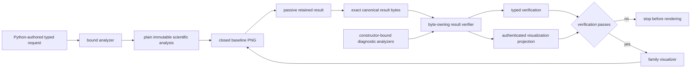
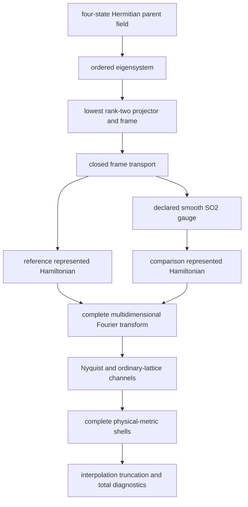
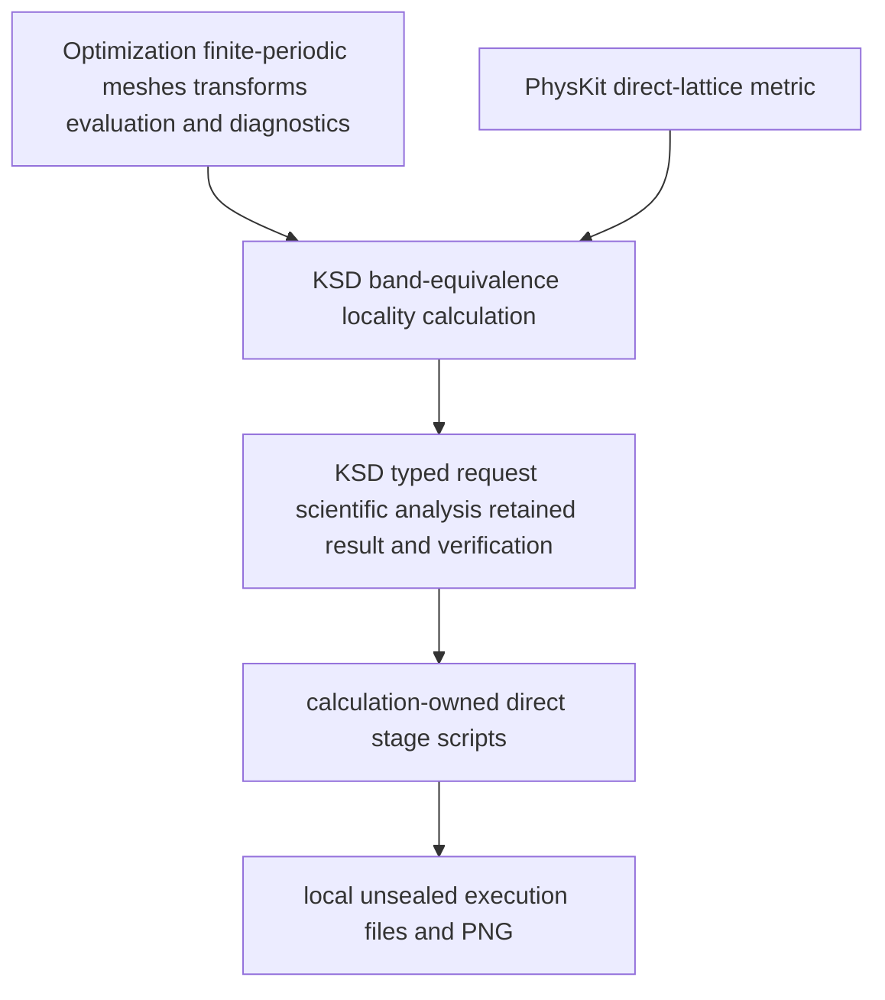
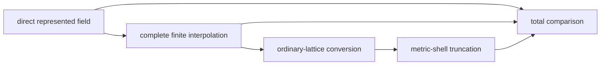
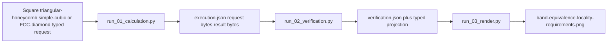

# Schematics

## Typed nominal lifecycle

The recorder projects a completed analysis without invoking the analyzer again. The
verifier does not invoke the production analyzer, and the visualizer does not invoke
either scientific calculation route.

## Finite scientific composition

Spatial dimension, parent-fiber dimension, and retained rank are separate contracts.

## Ownership layers

No dependency points from installed source into a calculation or experiment directory.

## Error-channel separation

Interpolation, conversion, truncation, and total comparisons are reported separately.
The diagram shows composition, not permission to add separately maximized norms.

## Direct family stages

The periodic-2D square, periodic-2D triangular/honeycomb, periodic-3D simple-cubic, and
periodic-3D FCC/diamond calculation roots own independent instances of these stages and
distinct execution identities. Every stage refuses overwrite, writes behind an
incomplete directory, and exposes a complete directory by rename. No stage seals or
publishes evidence.
