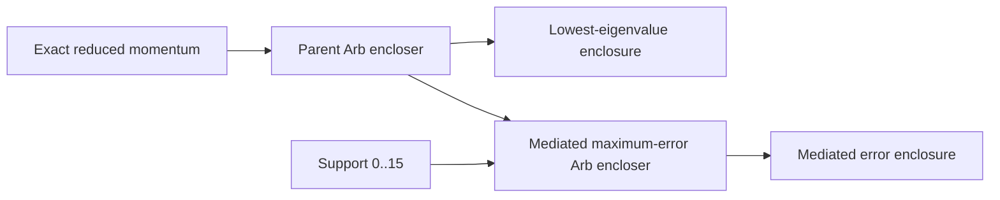

# Optional Arb parent and mediated enclosures

## Contract

The `arb` provider leaf implements local Python-FLINT enclosures for two bounded pieces
of the frozen periodic-1D rank-one proposition:

1. the lowest eigenvalue of the exact controlled four-state parent at one exact reduced
   momentum; and
2. the transform-mediated total maximum evaluation error at one support in `0..15`.

It requires the optional `certificates` extra, pinned to `python-flint==0.9.0`.

## Identity and invariants

The parent coefficients, 256-point construction mesh, 1025-point staggered evaluation
mesh, Fourier convention, support inventory, and `E_ref` unit remain fixed by the core
proposition. Inputs are exact rationals or built-in dimensionless integers. Arb
midpoint-radius balls are exported to exact rational endpoints without a binary64 round
trip.

## Dependencies and flow

The mediated action reuses the parent enclosure mechanics as a producer collaborator. No
independent containment verifier calls this implementation, and no direct-fit enclosure
is present.

## Serialization

All three result values derive from `BaseTypedRecord` and use the repository's final
typed mapping and canonical JSON boundary. There is no standalone JSON Schema or
provider-specific codec.

## Scientific boundary

The capability demonstrates rigorous local outward-enclosure mechanics for the exact
parent and mediated objective. It does not produce all 32 objective entries required by
`FirstPassingSupportResult`, does not classify the joint direct/mediated proposition,
does not independently verify containment, and does not create retained evidence.

## Source and test map

- [`records.py`](records/index.md): signed, parent, and mediated enclosure records.
- [`parent.py`](parent/index.md): controlled-parent lowest-eigenvalue encloser.
- [`mediated.py`](mediated/index.md): mediated maximum-error encloser.
- `python/tests/ksdft2effmass/certifications/periodic1d/rank1/test__Periodic1DRank1FirstPassingSupportArb.py`:
  local software-verification coverage.
- `doc/sphinx/api/certifications.rst`: optional public API route.

## Evidence and limitations

Tests establish software behavior, canonical serialization, and a mediated threshold
separation between supports 10 and 11. They do not establish the direct objective, the
joint first-passing proposition, retained certification evidence, scientific validation,
or human acceptance. Python-FLINT precision is process-global, so concurrent threaded
execution is unsupported.

## Navigation

- [Core proposition contract](../index.md)
- [Certification implementation](../../../../implementation.md)
- [Certification numerics](../../../../numerics.md)
- [Certification scientific boundary](../../../../scientifics.md)
