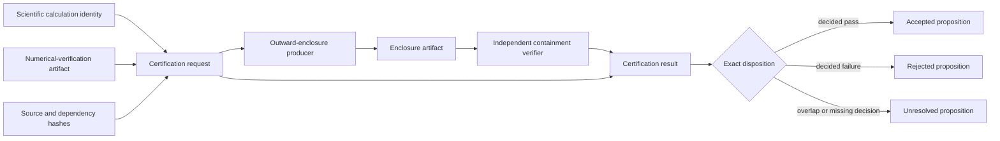

# Certification schematics

The dependency-free core covers request, result, canonical wire, structural correlation,
and exact disposition. The optional Arb leaf implements only parent and mediated pieces
inside the producer node. The complete producer artifact, direct objective, independent
containment verifier, and retained certification composition remain unimplemented. The
diagram does not imply persistence, scientific validation, or human acceptance.
