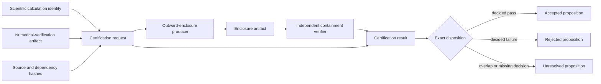

# Certification schematics

The implemented tranche covers the request, result, canonical wire, structural
correlation, and exact disposition nodes. Producer and independent containment-verifier
nodes remain unimplemented in the maintained audit tree.
