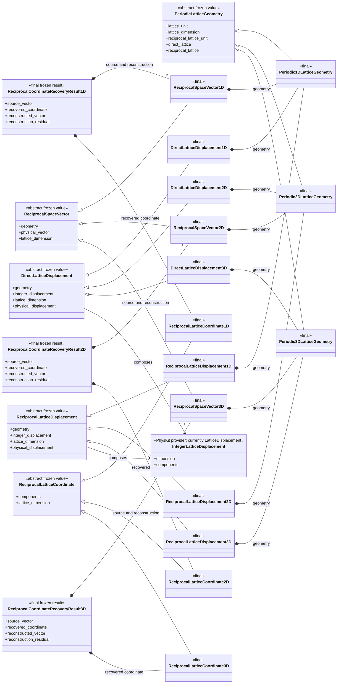
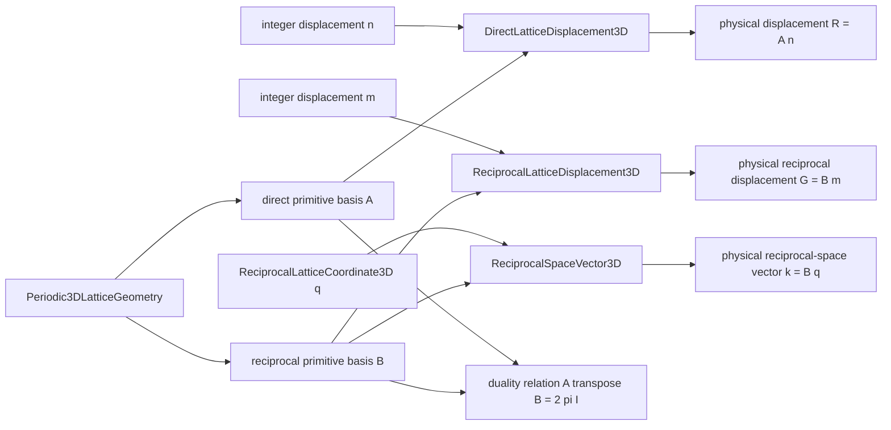
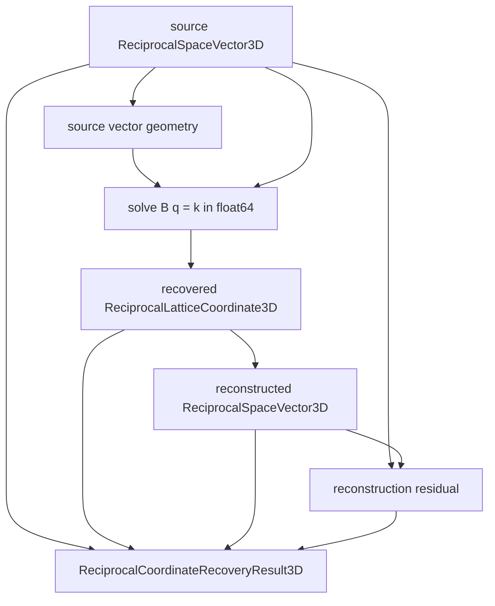
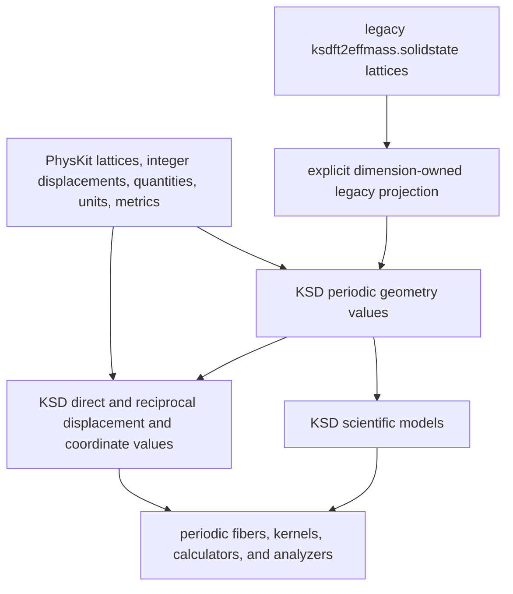

# Periodic geometry schematics

## Complete class hierarchy

Only the geometry and value classes belong to `ksdft2effmass.geometry.periodic`.
`IntegerLatticeDisplacement` is shown to make the composition explicit, but its current
implementation owner is PhysKit's `LatticeDisplacement`. Real-space kernels, hopping
terms, periodic fibers, and Bloch states are consumers outside this package.

## Direct and reciprocal construction

Integer direct and reciprocal displacements share the same provider coordinate shape but
acquire different physical meanings through the lattice that acts on them. A reciprocal-
space vector admits real coefficients and is not a reciprocal-lattice displacement.

## Reciprocal-coordinate recovery

The dimensional geometry owns the solve directly; there is no recovery-action class or
abstract result hierarchy. The result reports numerical reconstruction error. Tolerance
selection, pass/fail verification, reciprocal-quotient representative selection, and
periodic-state interpretation remain separate operations.

## Ownership and dependency direction

Core geometry has no dependency on scientific models, real-space kernels, periodic
fibers, calculations, campaigns, serialization, or the legacy lattice subsystem. Only
isolated migration projections import legacy records.
