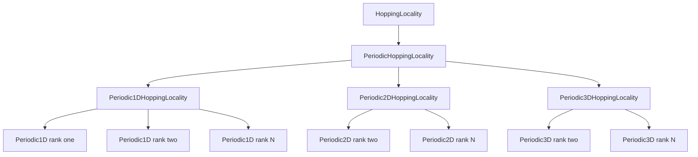
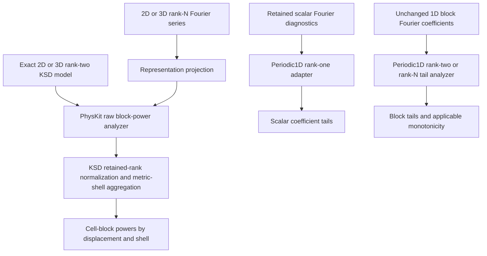
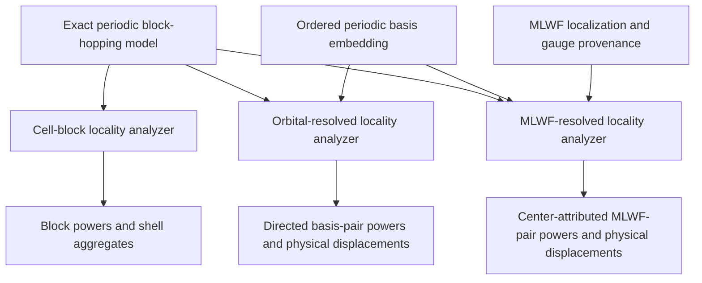
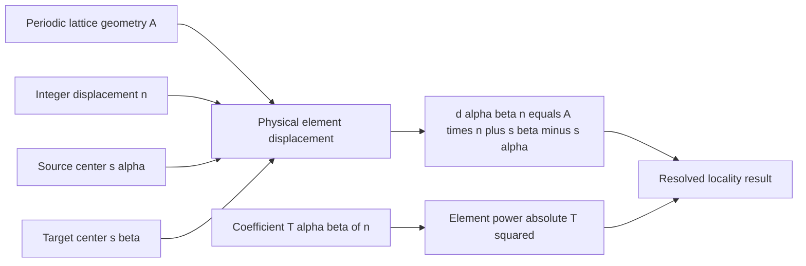
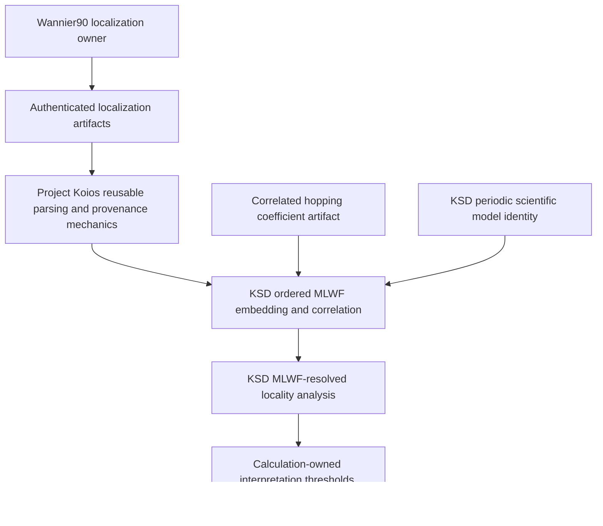
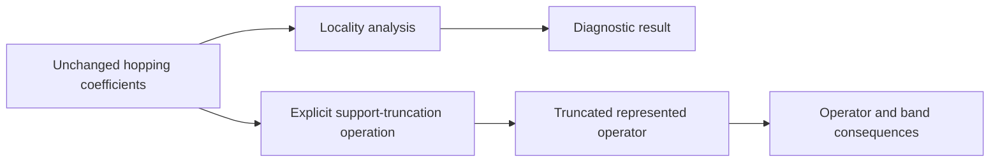

# Hopping-locality schematics

## Installed nominal hierarchy

Requests, analyses, and analyzers follow the same domain-to-periodic-to-dimension-to-rank
ownership chain. Rank two and rank $N$ are sibling capabilities.

## Installed numerical routes

The rank-$N$ periodic-2D/3D route remains representation level. Only the installed
rank-two dimensional route starts from an exact KSD block-hopping scientific model.

## Peer locality resolutions

The analyzers are peers. MLWF-resolved locality does not invoke orbital-resolved or
cell-block locality as an implementation step, although independent verification may
check that element powers sum to the block power.

## Geometry and basis correlation

Geometry supplies the primitive lattice. The embedding supplies the ordered internal
centers. Neither owner alone can infer the physical element displacement.

## MLWF provenance boundary

The locality owner consumes a correlated localization result. It does not execute
Wannier90, infer missing provenance, or promote an artifact into a validated material
model.

## Separation from truncation

Locality diagnoses unchanged coefficients. Removing coefficients and evaluating the
resulting operator remain separate operations.
