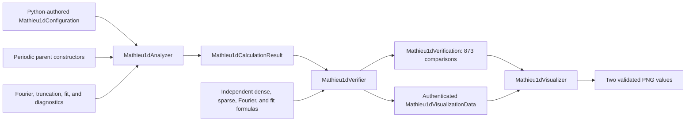
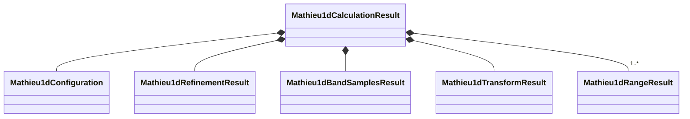

# Schematics

## Direct lifecycle



The arrows are data dependencies, not a generic Workflow or execution graph.

## Typed result composition



## Representation and reduction boundaries

```text
finite plane-wave fibers ─────┐
                              ├── sampled ordered parent spectra
periodic finite-difference ───┘

selected training band
        │ complete finite Fourier transform
        ▼
all N hopping representatives
        │
        ├── symmetric truncation ──► mediated range model
        └── same range basis ──────► direct weighted fit
                                      │
                                      ▼
                         route and withheld-sample diagnostics
```

The two parent matrices inhabit different finite coordinate representations and are
compared only through ordered eigenvalues at common sampled momenta. Range routes are
compared only after they share the same representative inventory.

## Authentication boundary

```text
exact result.json bytes
        │ SHA-256 + typed reconstruction
        ▼
independent complete result ──► independent comparisons
        │
        └── visualization projection ──► projection SHA-256
                                             │
passing stored verification + fresh equality │
                         └─────────────────────┘
                                      ▼
                               atomic rendering
```

Neither digest identity nor successful rendering establishes scientific validation.
