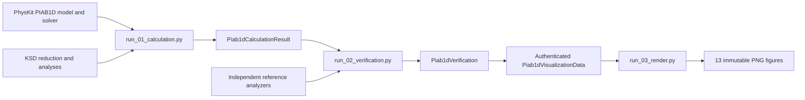
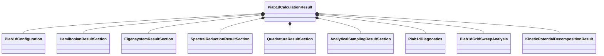
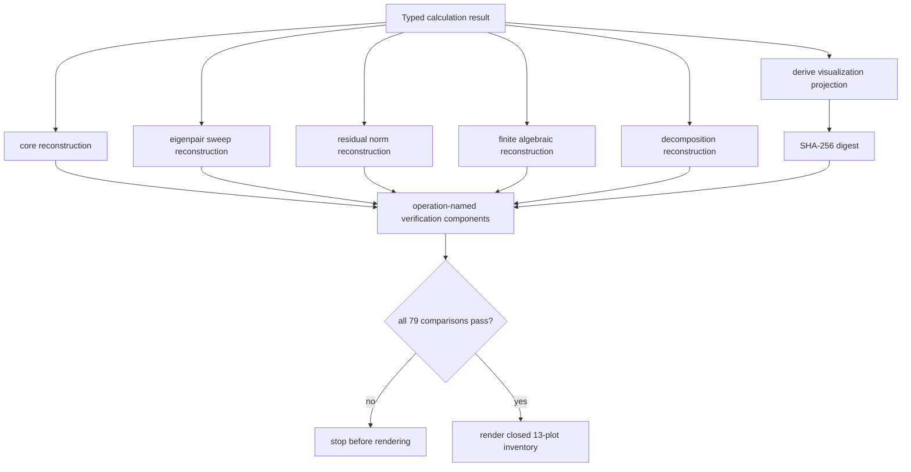

# Schematics

## Ownership and execution

## Typed result composition

## Verification composition

The arrows identify data dependencies. They do not represent a generic Workflow
framework or publication lifecycle.
