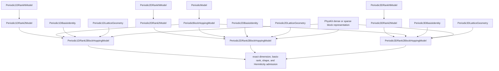

# `PeriodicBlockHoppingModel` schematic

The rank branch and representation branch express independent facts. Fixed rank refines
the dimensional finite-rank scientific model; block-hopping behavior supplies composed
provider representation and shared admissibility. The concrete class is the correlation
boundary.

PhysKit storage remains a composed immutable value. KSD does not subclass provider
representation classes and does not project structured basis coordinates through the
provider's descriptive basis string.
