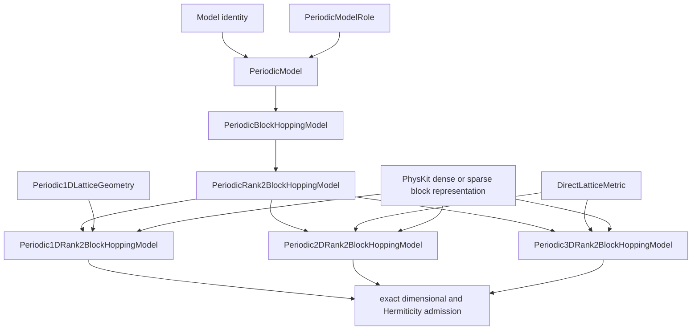

# `PeriodicRank2BlockHoppingModel` schematic

PhysKit storage remains a composed value. The KSD hierarchy never subclasses the
provider representation classes. Each child exposes the exact PhysKit direct lattice
required by shared dimensional admission.
