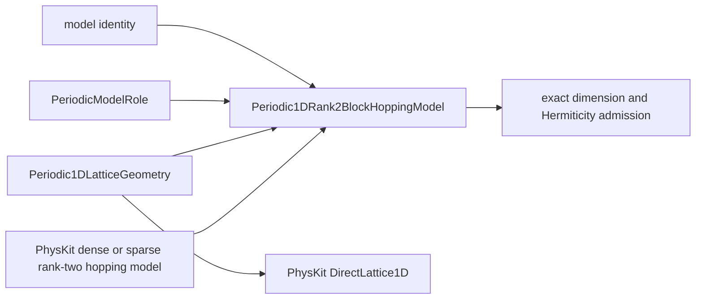
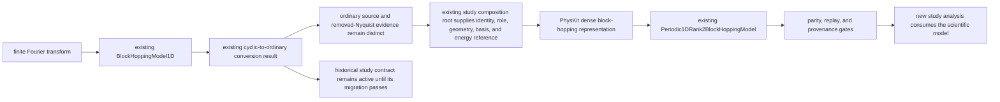

# `Periodic1DRank2BlockHoppingModel` schematic

The KSD value retains physical period and unit ownership. PhysKit owns the reconstructed
direct-lattice primitive and block-hopping representation. Neither provider value is a
KSD superclass.

## Study-by-study legacy migration

The diagram adds no class to the approved inheritance hierarchy. The study composition
root is the existing calculation or analyzer assembly boundary being migrated; it is not
a proposed reusable base, adapter, manager, or admission class.
