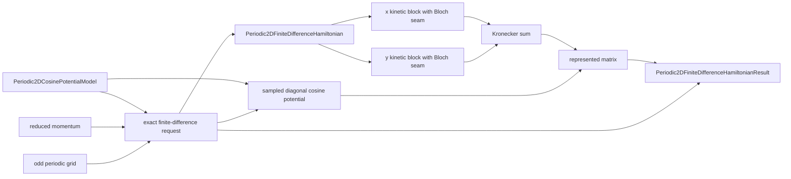

# `Periodic2DFiniteDifferenceHamiltonian` schematic

The result remains in its native coordinate state space. Comparison with a plane-wave
result requires a separately owned common-space transport.
