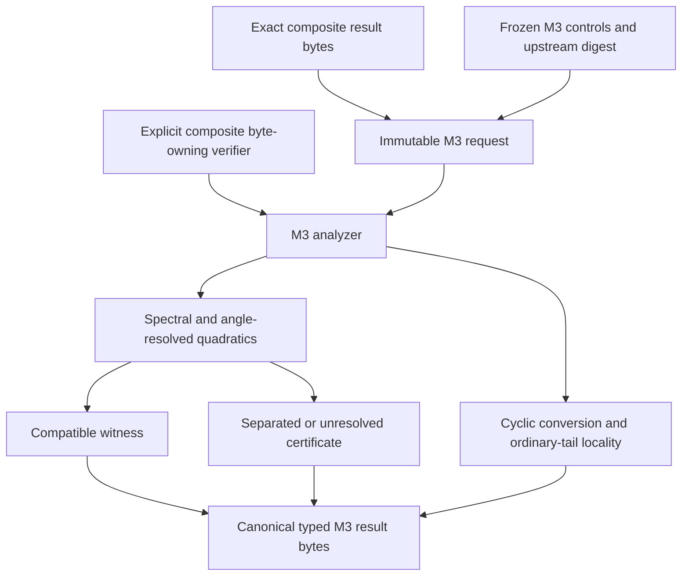
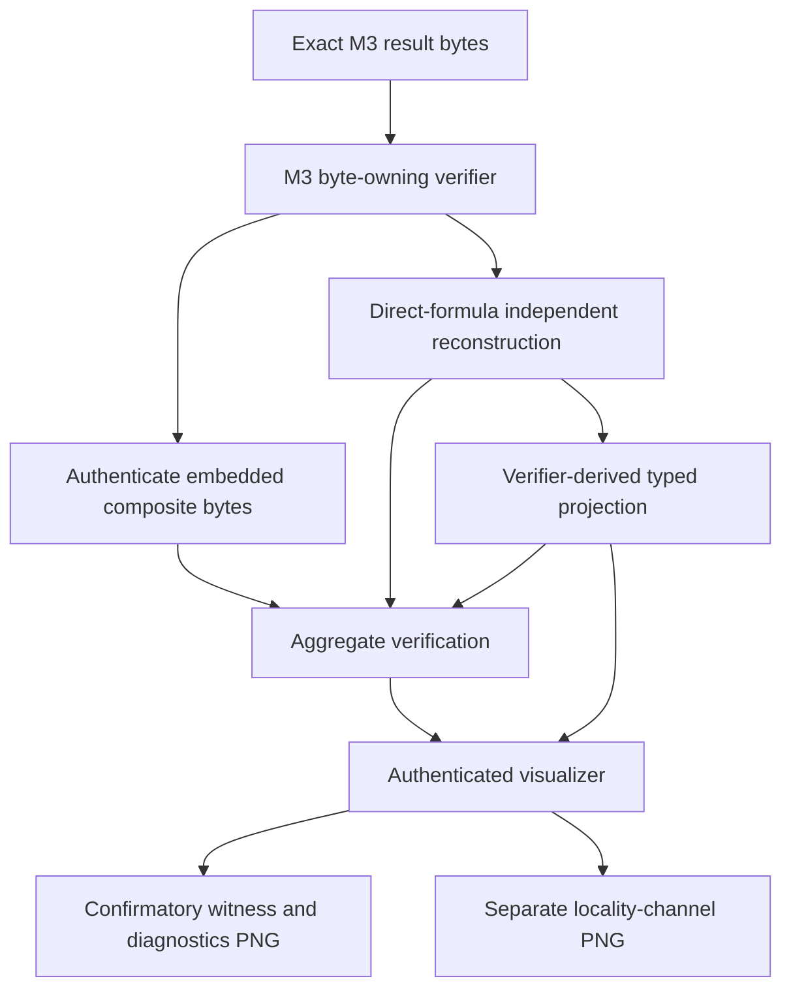

# Schematics

## Calculation and admission

## Independent verification and visualization

The verifier and renderer do not invoke the production analyzer. The M3 analyzer does
not invoke a composite producer.
