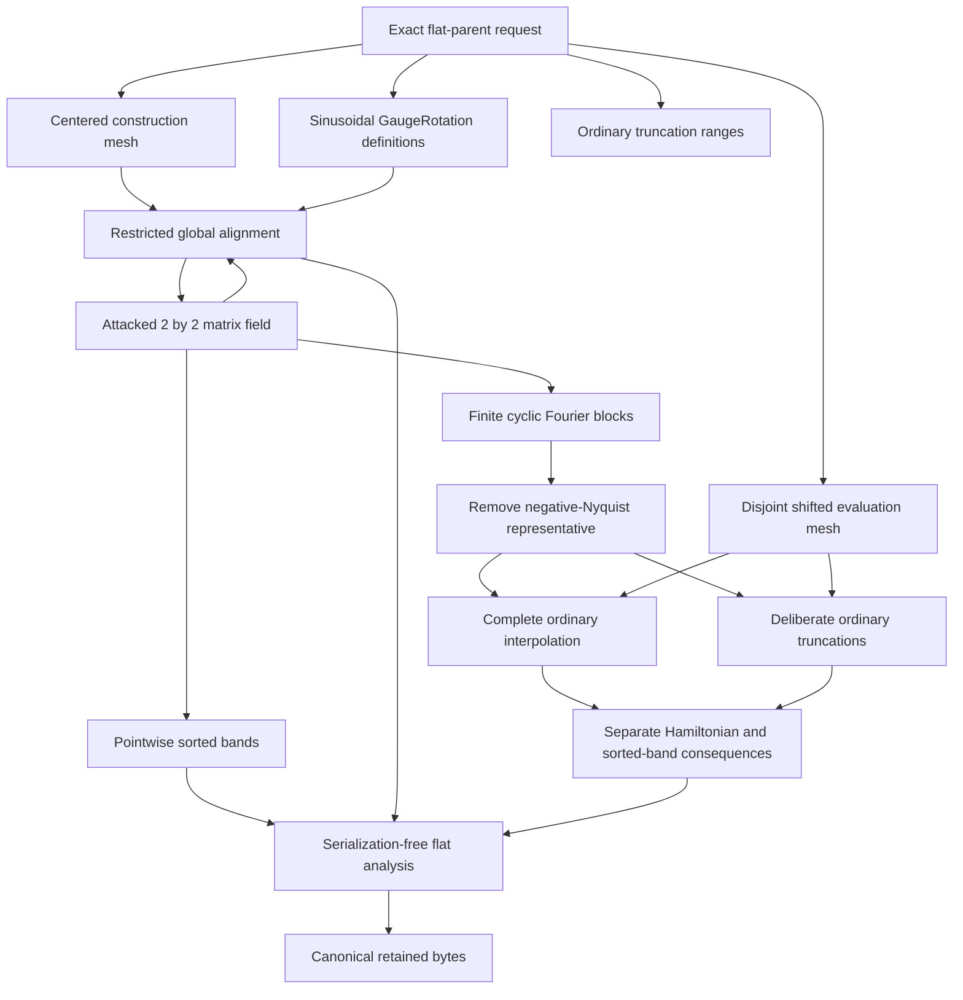
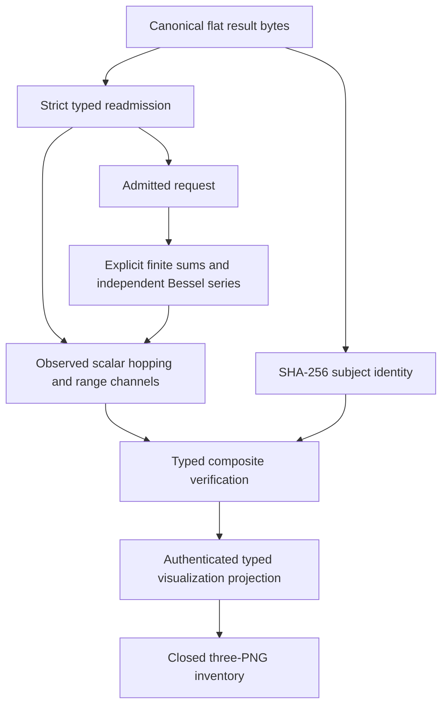
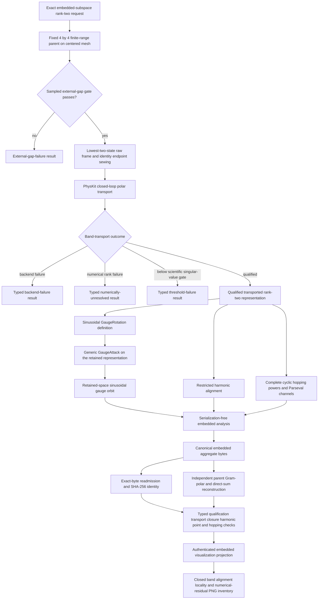
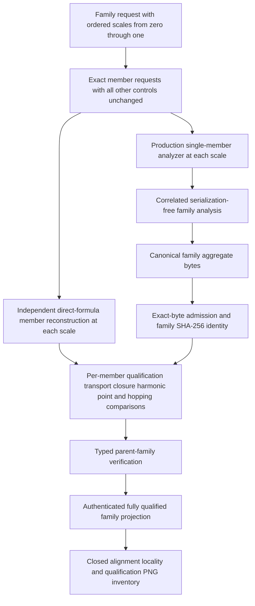
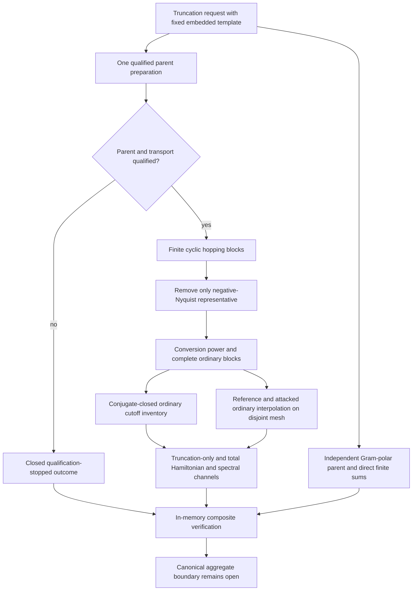
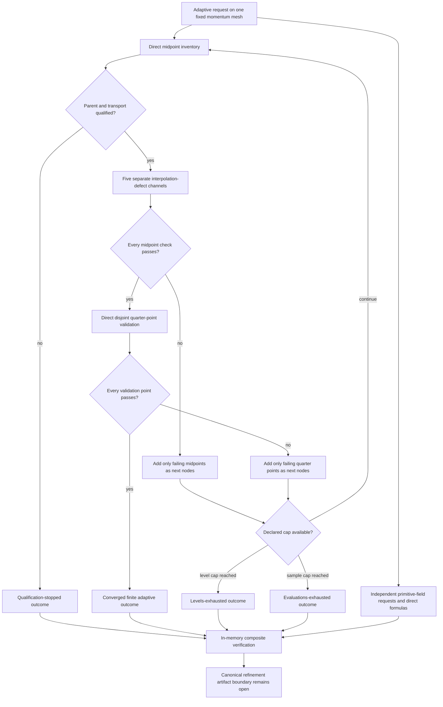

# Schematics

## Flat-parent calculation and retained projection

## Independent flat verification

## Embedded-subspace/rank2 scientific core

## Bounded parent-hopping family

## Embedded rank-two ordinary truncation

## Nested momentum refinement

```mermaid
flowchart TD
    RR[Refinement request with exact doubling meshes] --> MA[Complete single-mesh analysis at every size]
    MA --> Q{Every mesh qualified?}
    Q -- no --> QS[Qualification-stopped outcome with all mesh results]
    Q -- yes --> AP[Adjacent nested-mesh comparisons]
    AP --> PC[Parent diagnostic and shared-projector changes]
    AP --> LC[Correlation threshold hopping and angle changes]
    AP --> RC[Fine-mesh band reconstruction and Parseval residuals]
    PC --> D{Required final refinements pass every threshold?}
    LC --> D
    RC --> D
    D -- yes --> C[Converged finite-refinement outcome]
    D -- no --> U[Unresolved finite-refinement outcome]
    RR --> IR[Independent primitive-field mesh construction]
    IR --> IS[Independent single-mesh and shared-parent reconstruction]
    QS --> IV[Existing in-memory composite verification]
    C --> IV
    U --> IV
    IS --> IV
    IV --> OW[Canonical refinement artifact boundary remains open]
```

## Adaptive amplitude refinement

