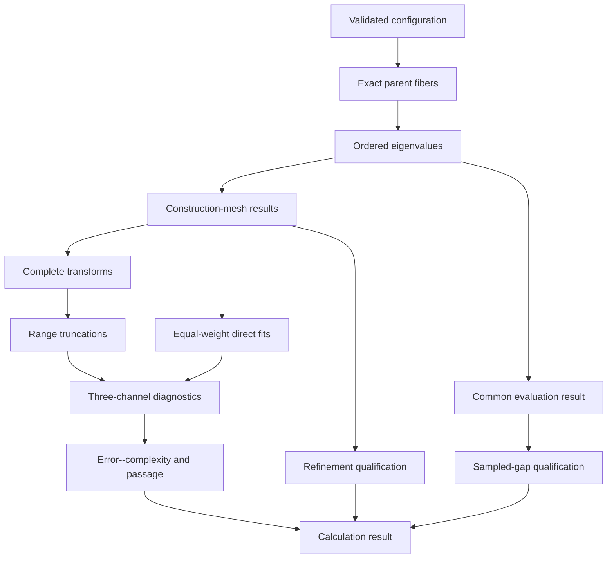
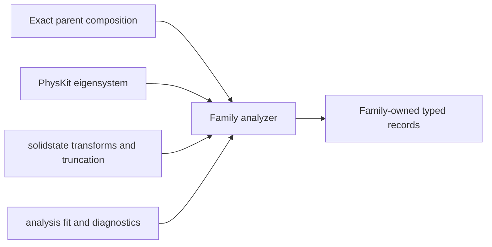
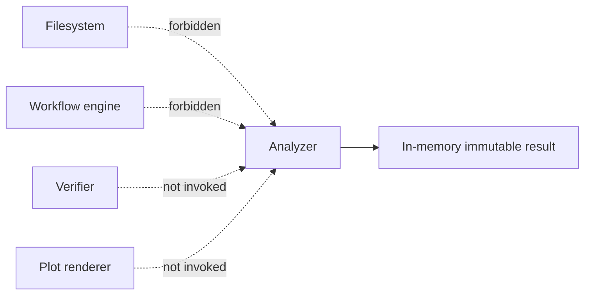

# Analysis schematics

## Calculation composition

## Reusable-owner boundary

Delegation preserves scientific meanings; it does not transfer family thresholds,
decisions, or provenance to reusable owners.

## Effect exclusion

