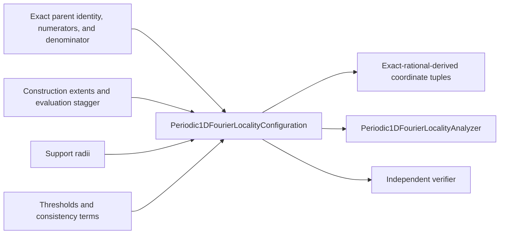
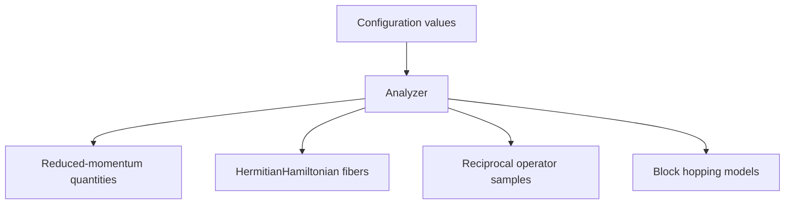
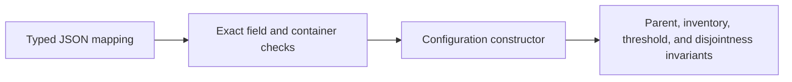

# Configuration schematics

## Direct-record boundary

The configuration follows the direct PIAB1D pattern: it is a typed input record, not a
model factory or protocol registry.

## Runtime ownership

Runtime Hamiltonians and operators are constructed by the action that uses them. They
are not hidden properties of the wire record.

## Decode path

