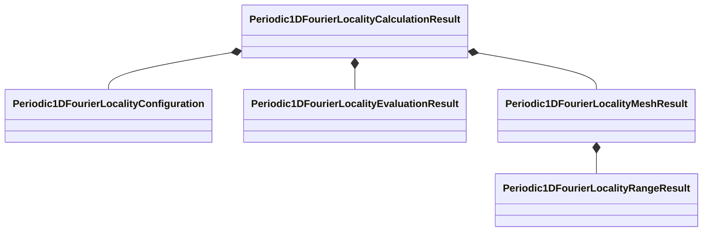
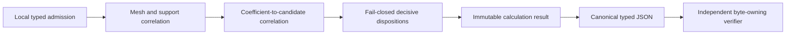

# Result-module schematics

## Aggregate ownership

Refinement and sampled-gap values are direct fields of the calculation result. Complete
transform values are direct fields of the mesh result. This keeps four cohesive records
without empty section objects or universal result layouts.

## Admission sequence

The result module does not calculate the parent spectrum and does not own verification,
rendering, file publication, or hashing.
