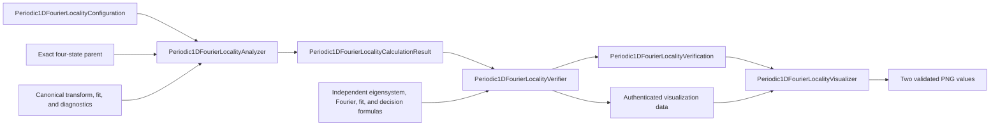
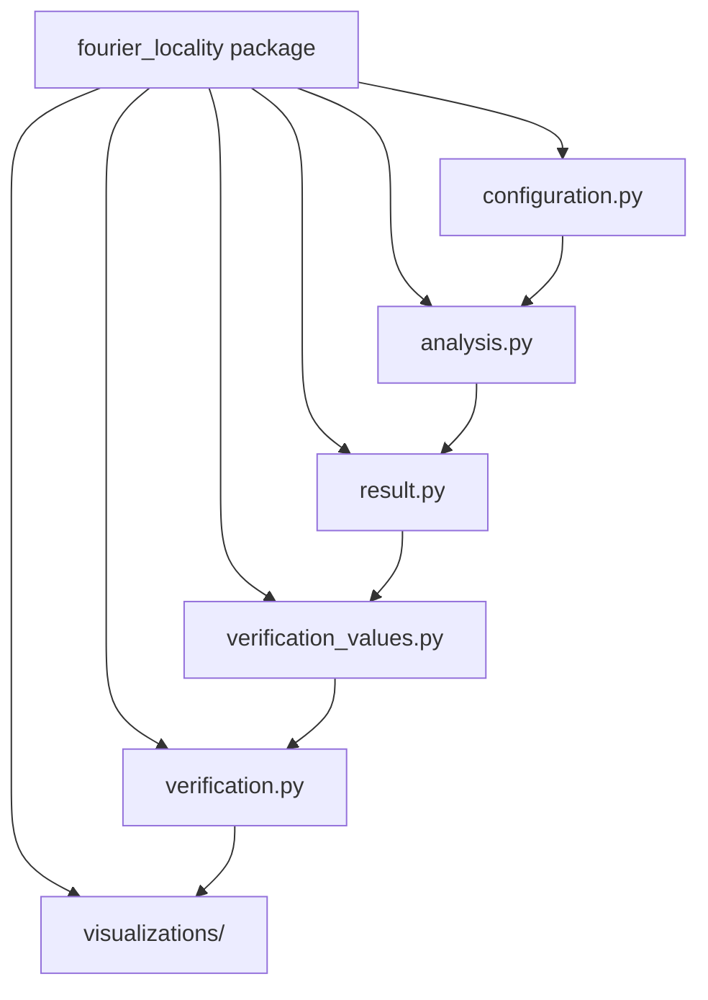
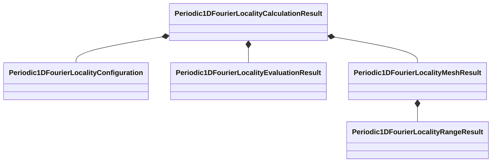
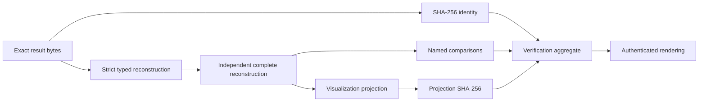

# Schematics

## Direct typed lifecycle

The arrows are typed data dependencies, not a Workflow or registry. The complete
calculate, independently verify, and authenticated-render lifecycle is implemented.

## Module ownership

The result module owns values and admission correlation only. It does not import a
producer, verifier, renderer, or calculation script.

## Result composition

## Authentication boundary

Digest equality establishes byte identity only.
