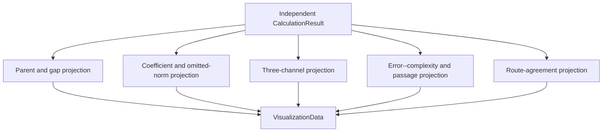
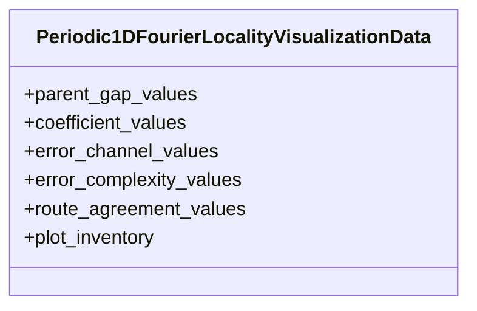

# `Periodic1DFourierLocalityVisualizationData` schematics

The verifier binds canonical projection bytes to the admitted subject through separate
subject and projection digests; the projection does not embed a duplicate subject digest.
