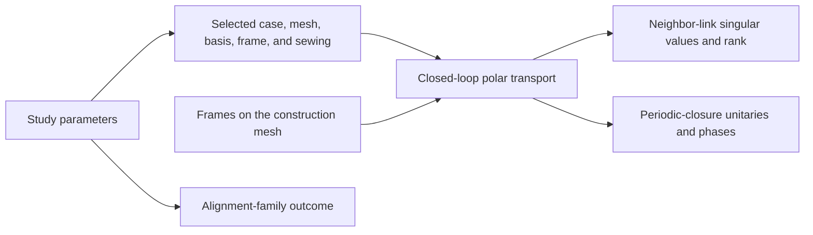
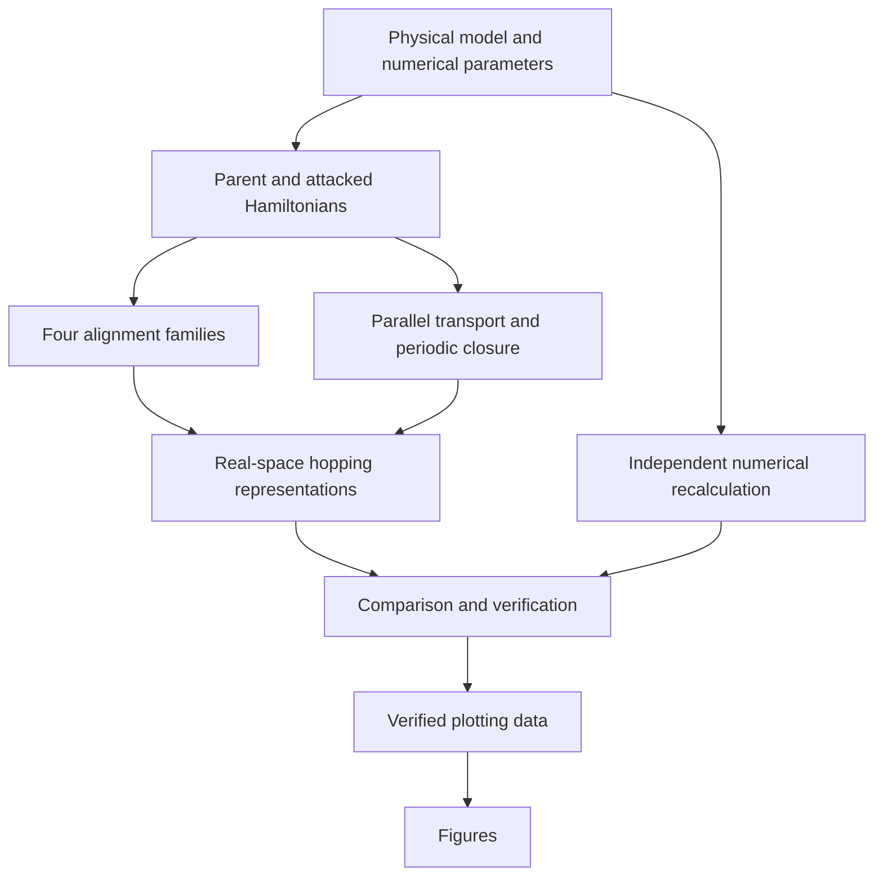

# Calculation flow for higher-rank frame alignment

## Transport data available now

The implemented code stores the fixed study parameters, the exact selected transport
geometry and identities, link-by-link transport diagnostics, closure transformations,
and alignment outcomes. It does not yet construct the higher-rank Hamiltonian family.

## Complete calculation planned for a later phase

The independent recalculation will evaluate the declared observables without calling the
production analysis path. Verification will compare both calculations and bind the plots
to the exact saved result. Figure construction will not calculate new scientific values.
