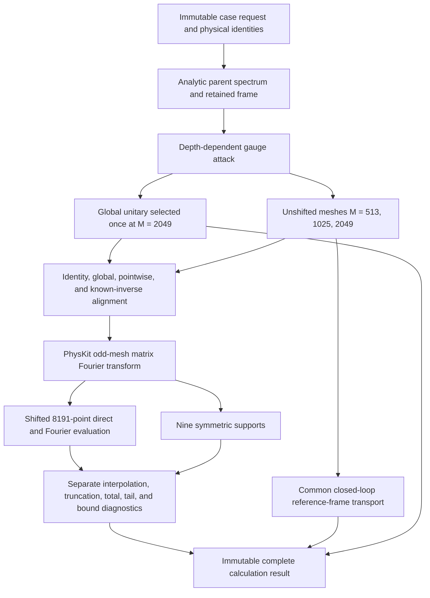
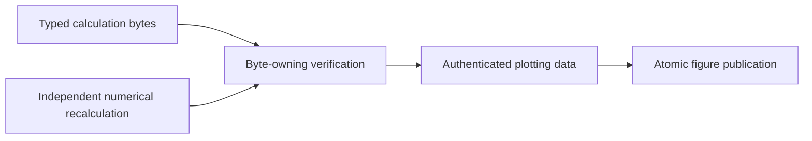

# Calculation flow for higher-rank frame alignment

## Implemented calculation producer

`Periodic1DHigherRankAlignmentAnalyzer` receives the request and concrete Optimization
and PhysKit owners in its constructor. Its `execute()` method has no arguments. The
producer does not inspect registries, import the historical calculation-local Workflow,
or infer missing physical identities.

Transport acts on the analytic reference frame and remains separate from all four
alignment families. The global unitary is selected only at $M=2049$ and reused on both
coarser meshes and the shifted direct-evaluation mesh. Pointwise alignment is selected
independently on each construction mesh. The known-inverse channel applies the analytic
inverse directly.

## Later authenticated lifecycle

This second flow is not implemented for the higher-rank family. Independent
recalculation must not call the production analyzer. Verification must own and hash the
exact admitted calculation bytes. Rendering must consume only authenticated data and
must not calculate new scientific values.
