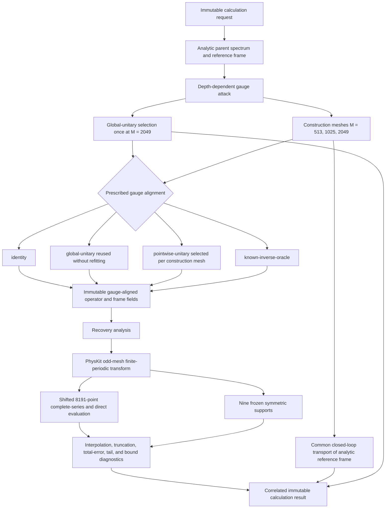
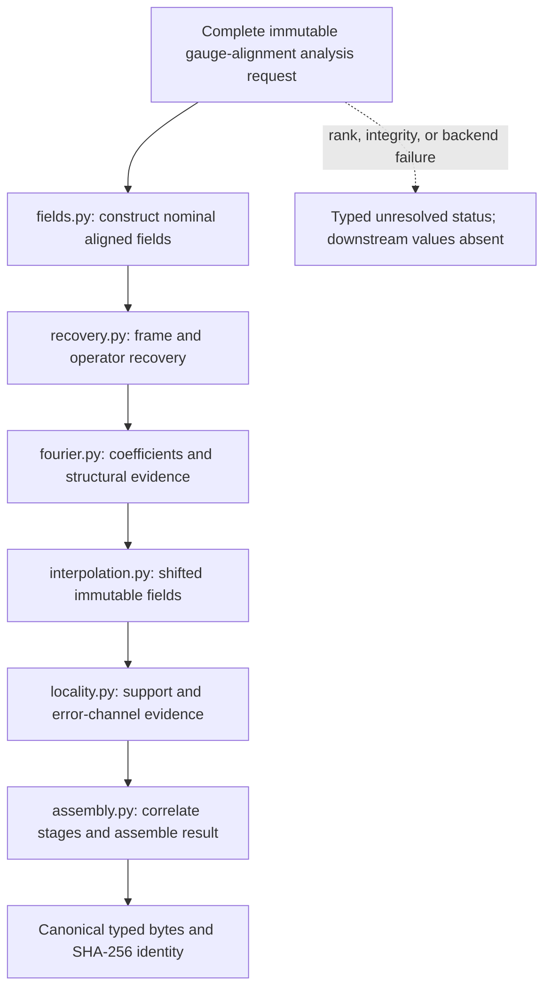
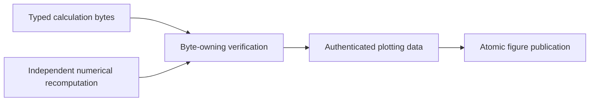
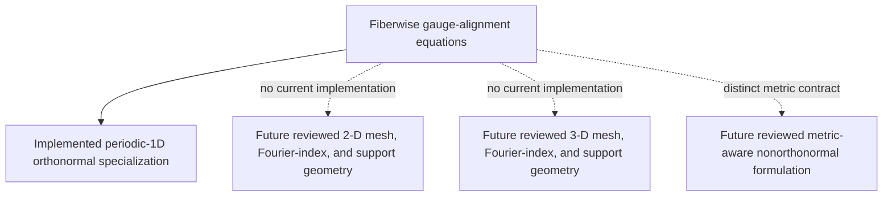

# Calculation flow for higher-rank gauge alignment

## Scientific producer flow

Closed-loop transport is common evidence and does not define a fifth gauge alignment.
The four gauge alignments are also distinct from the interpolation, truncation, and total
error channels evaluated after Fourier transformation.

## Typed stage lifecycle

Each stage retains its exact source request. Assembly rejects evidence from an equal but
replacement request, unrelated same-shaped arrays, wrong gauge alignment, wrong mesh,
or inconsistent selection provenance. Serialization owns wire mechanics only and does
not recompute scientific quantities.

`Periodic1DHigherRankAlignmentAnalyzer` receives the complete request and concrete
Optimization, PhysKit, and KSD owners in its constructor. Its `execute()` method has no
arguments. It does not inspect registries, import the historical calculation-local
Workflow, or infer missing physical identities.

## Later authenticated lifecycle

This lifecycle is not implemented for the higher-rank family. Independent recomputation
must bypass the production analyzer. Verification must own and hash the exact admitted
calculation bytes. Rendering must consume authenticated data and calculate no new
scientific values.

## Future dimensional and metric separation

The dashed boxes describe architectural boundaries, not available classes, stubs, or
software capabilities. The present 1-D Fourier and locality owners remain dimension
specific, and the present Procrustes contract remains orthonormal and $U(r)$-valued.
