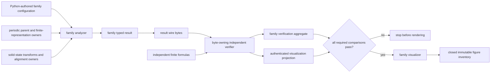
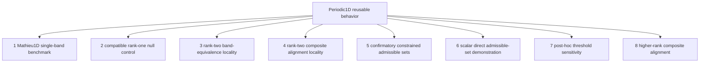

# Schematics

## Family-owned direct lifecycle



The arrows are direct data dependencies. They do not define a Workflow framework,
registry, or publication lifecycle.

## Ownership layers

```text
PhysKit
  quantities, lattice primitives, represented linear algebra, matrix norms
                         │
                         ▼
model_systems.periodic_1d       solidstate              operators / analysis
finite parent fibers            paths, frames,           represented values and
and Fourier potentials          sewing, transforms       reusable diagnostics
             └──────────────────────┬──────────────────────────┘
                                    ▼
                         periodic1d family analyzer
                                    │
                   concrete typed result and verification
                                    │
                                    ▼
                  calculations/<periodic1d-family>/
                 protocol, stages, provenance, rendering
```

## Eight separate calculation studies



No arrow between studies denotes version succession or evidence inheritance. Shared
mechanics do not merge their protocols, inputs, thresholds, result wires, evidence
status, or claims. The eight studies need not create eight reusable source children.

## Native and formal-certificate wires

```text
family analyzer ──> native typed binary64 result bytes ──> independent verifier
                              │                                  │
                              └── digest-bound outward export ──┘
                                             │
                                             ▼
                              proposition-specific certificate
                                             │
                                             ▼
                                 Formal checker result
```

Canonical native bytes remain numerical data. Only exact rational values or documented
outward rational intervals enter exact certificate fields.

## Common-coordinate rule

```text
parent space A ──map A──┐
                        ├── declared common retained coordinates ── comparison
parent space B ──map B──┘
```

Parent matrices are never subtracted directly when their finite spaces, bases, frames,
or coordinate orders differ.
