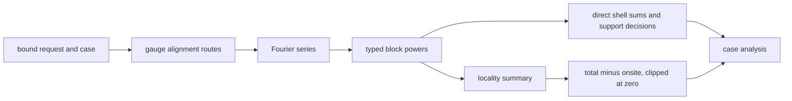

# `Periodic3DRankNBandEquivalenceHoppingLocalityCaseAnalyzer` schematic

The `D` branch is the deferred `TD-BEL-003` limitation. It is a reporting branch and
does not feed the direct shell-sum decision branch. See
[`TD-BEL-003`](../../../../../../../../tasks/tech_debt/band-equivalence-locality/index.md#td-bel-003-rank-n-non-onsite-summary-subtraction).
