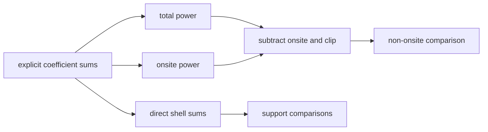

# `Periodic3DRankNBandEquivalenceHoppingLocalityFourierReferenceAnalyzer` schematic

The `N` route repeats the producer mechanism and is the deferred `TD-BEL-003`
independence gap. The direct shell route remains separate. See
[`TD-BEL-003`](../../../../../../../../tasks/tech_debt/band-equivalence-locality/index.md#td-bel-003-rank-n-non-onsite-summary-subtraction).
