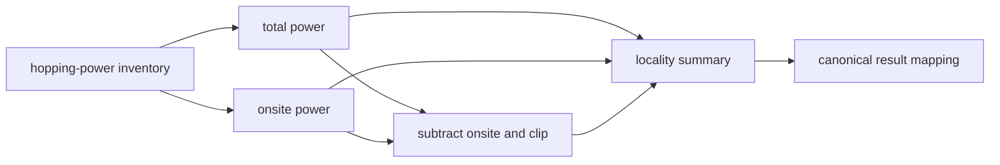

# `Periodic3DRankNBandEquivalenceHoppingLocalityLocalitySummary` schematic

The `N` edge is the deferred `TD-BEL-003` producer limitation. Serialization preserves
its output without certifying exact onsite-only support. See
[`TD-BEL-003`](../../../../../../../../tasks/tech_debt/band-equivalence-locality/index.md#td-bel-003-rank-n-non-onsite-summary-subtraction).
