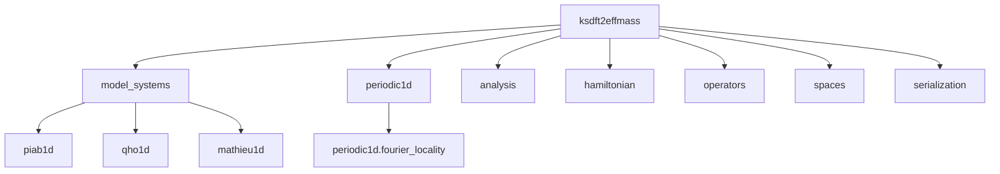
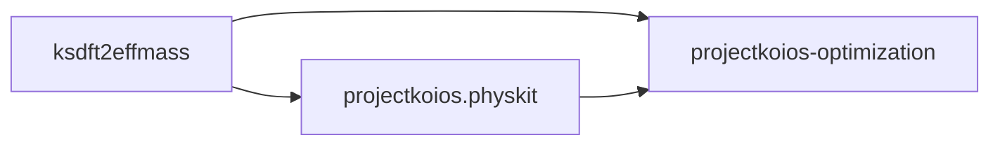

# `ksdft2effmass` package schematics

## Architecture v3 source ownership

Only documented maintained or prospective contracts are shown; this is not an exhaustive
import graph.

## Scientific data direction

Filesystem effects and evidence policy remain outside reusable scientific objects.

## Dependency direction

PhysKit must not depend on `ksdft2effmass`.
