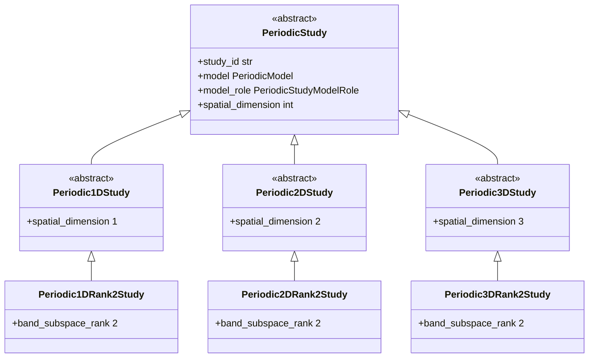

# Periodic study hierarchy

## Implemented contracts

`PeriodicStudy` is the dimension-neutral identity for one named periodic investigation,
one exact `PeriodicModel`, and that model's explicit `reference` or `candidate` role.
Its model type is retained generically so narrower study classes expose their exact
model without weakening the boundary. `PeriodicStudyOrchestrator` propagates the exact
model and concrete result types while constructing the immutable correlation.

The orchestrator hierarchy mirrors the study hierarchy exactly. Dimension and rank are
class-enforced identities. Structure type is not: FCC, BCT, diamond, and simple cubic
are supplied through the exact scientific model used by a named calculation. The base
classes declare no constructor, private validation helper, or static method.

`PeriodicStudyModelRole` is the dimension-neutral wire vocabulary for an explicit
comparison and has only `reference` and `candidate` members. It does not appear in a
single-model locality request and does not imply acceptance or validation.

## Children

- [`periodic1d`](../periodic1d/index.md)
- [`periodic2d`](../periodic2d/index.md)
- [`periodic3d`](../periodic3d/index.md)

## Scientific boundary

The reusable orchestrators establish typed one-model study correlations only. They do
not silently select analyzers, thresholds, shell inventories, comparison models,
persistence routes, or evidence status. Named 2D and 3D rank-two calculations now
compose these orchestrators with the peer hopping-locality analyzers and return the
study together with its unchanged shell-power analysis. The calculation owns the
explicit shell labels; the generic study hierarchy does not.
