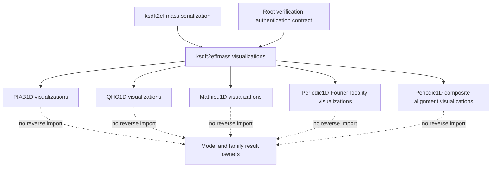
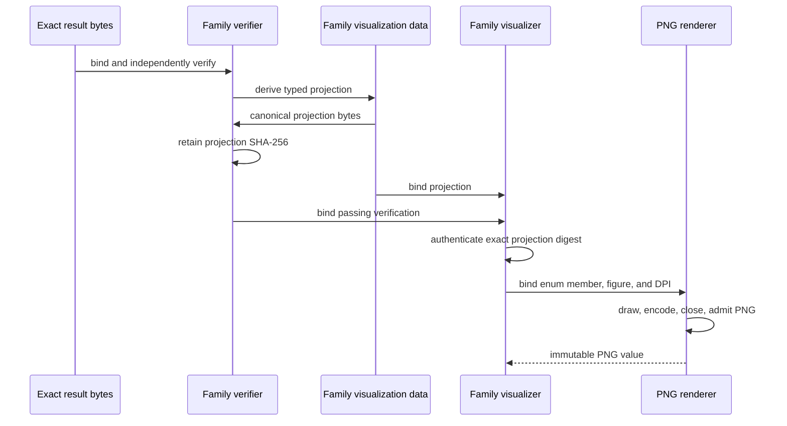
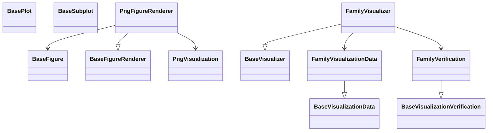

# Schematics

## Ownership and dependency direction

The dotted arrows express the prohibited reverse dependency: the root visualization
package does not import a family owner.

## Authentication and rendering sequence

## Type ownership

