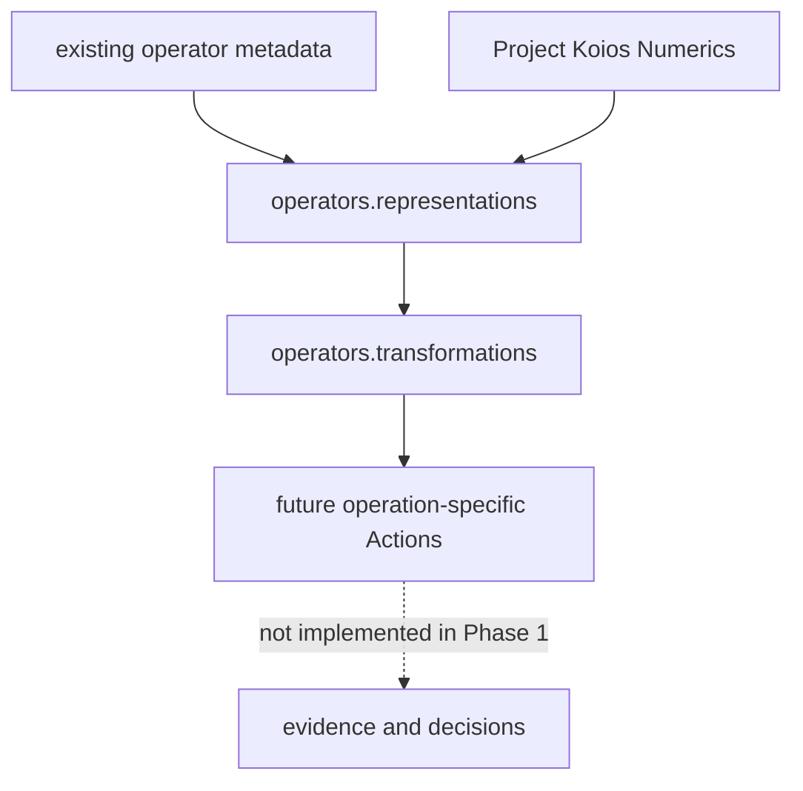
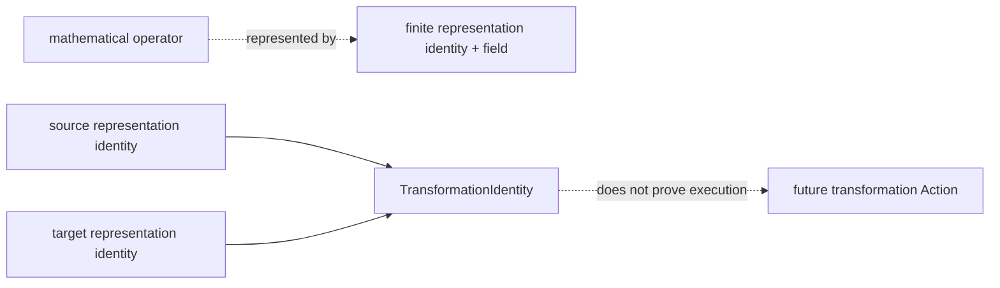
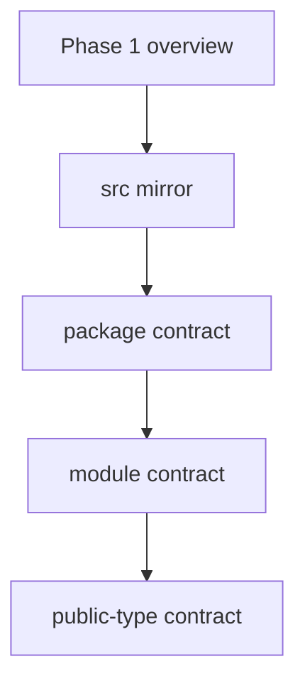

# Phase 1 schematics

## Layering

## Object separation

## Documentation descent

Package-level schematics:

- [representations](../src/ksdft2effmass/operators/representations/schematics.md);
- [transformations](../src/ksdft2effmass/operators/transformations/schematics.md).
