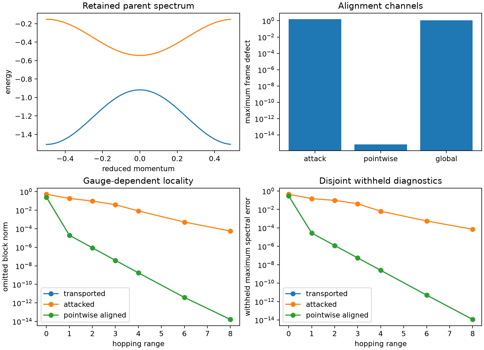
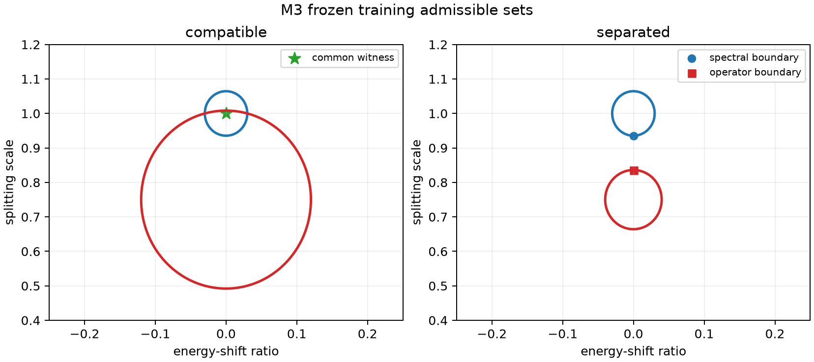
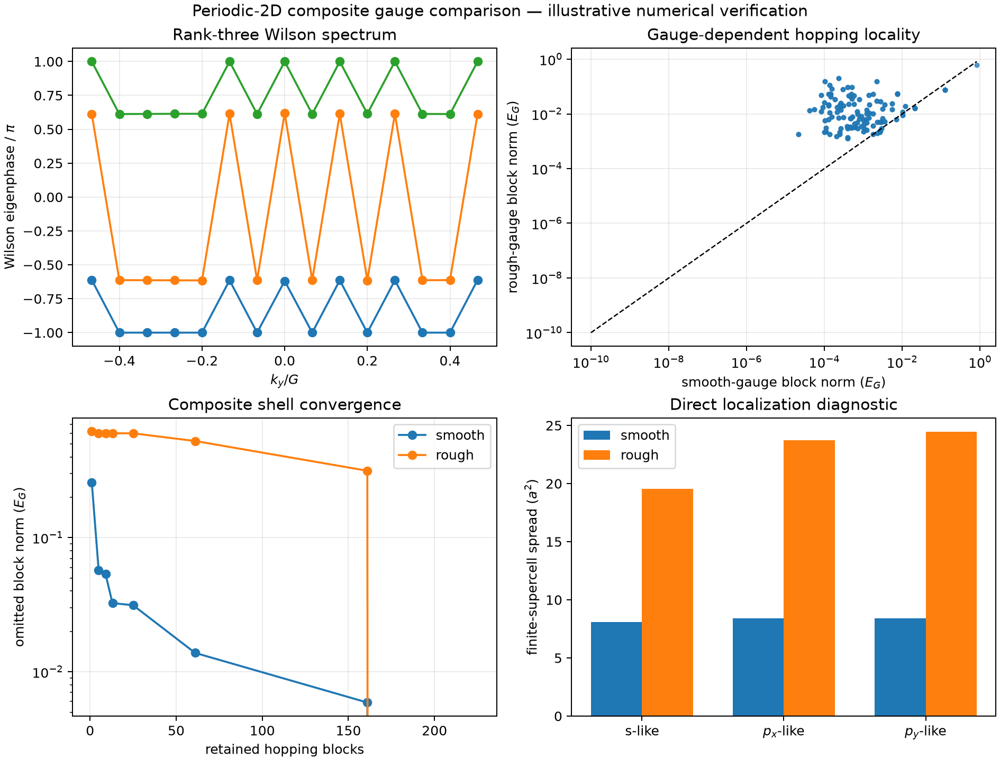
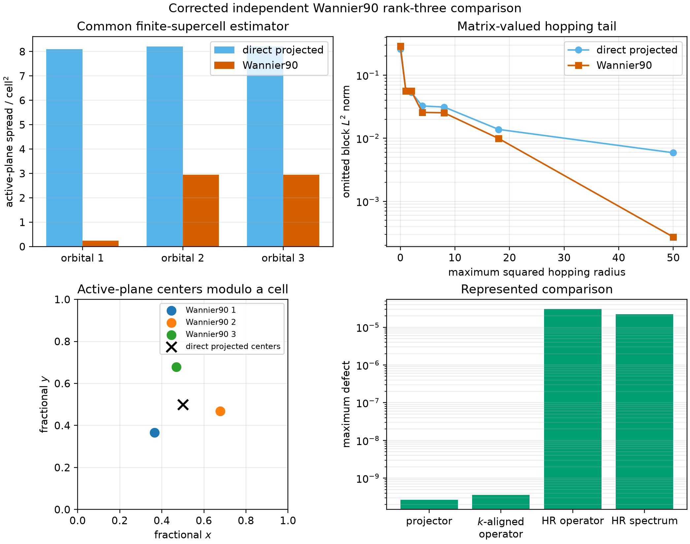

# Multiband gauge structure, aligned operators, and hopping locality

> <strong>Pre-results working manuscript.</strong> Red text
> identifies prospective work, open controls, unexecuted calculations, or conditional
> conclusions. The extracted finite calculations below retain their historical scope and
> are not results of a new Paper 3 protocol.

## Abstract

A composite Bloch spectrum does not identify a unique retained frame or a unique
matrix-valued hopping representation. We formulate the multiband extension of the
band-equivalence/locality program in terms of retained projectors, periodic frames,
complex unitary gauge classes, explicitly admissible alignments, and complete
matrix-valued Fourier blocks. Retained rank-two controls establish the distinction
between pointwise and global alignment and then demonstrate common-witness and
certified-separation logic under a nonidentity constrained family. Historical rank-three
calculations extracted
from Paper 1 v2 demonstrate finite-mesh
gauge consistency alongside large changes in spread and hopping tails, including one
algorithm-selected Wannier90 frame. These controls motivate,
but do not replace, a higher-rank protocol with independent verification and separately
qualified projection, frame, conversion, and truncation channels.

## I. State spaces before multiband comparison

Let $P(\mathbf k)$ be a constant-rank spectral projector and let
$F(\mathbf k):\mathbb C^r\to\mathcal H_p$ be a periodic orthonormal frame satisfying
$F F^\dagger=P$. The retained matrix field is

$$
H_F(\mathbf k)=F^\dagger(\mathbf k)H_p(\mathbf k)F(\mathbf k).
$$

A second frame $F'(\mathbf k)=F(\mathbf k)G(\mathbf k)$ gives

$$
H_{F'}(\mathbf k)=G^\dagger(\mathbf k)H_F(\mathbf k)G(\mathbf k),
\qquad G(\mathbf k)\in U(r).
$$

The spectra and projectors are unchanged, while the represented matrices and hopping
blocks generally change. A different retained rank requires a separately justified
projection or embedding. Without a declared map between the spaces, an operator
subtraction is undefined rather than merely large.

Spectral projection, orbital projection, disentanglement, downfolding, frame selection,
and hopping truncation are distinct operations. In particular, an exact spectral
projector commutes with the parent, whereas an orbital-semantic projector generally does
not. The latter may require an energy-dependent Feshbach--Löwdin operator or a separately
qualified unitary decoupling.

## II. Pointwise and global unitary alignment

Given reference and candidate frames of equal rank, define the cross-overlap

$$
M(\mathbf k)=F_{\mathrm{cand}}^\dagger(\mathbf k)F_{\mathrm{ref}}(\mathbf k)
=L(\mathbf k)\Sigma(\mathbf k)V^\dagger(\mathbf k).
$$

When the declared pointwise alignment family is the complete unitary group, the polar
factor

$$
U(\mathbf k)=L(\mathbf k)V^\dagger(\mathbf k)
$$

minimizes the pointwise Frobenius frame residual. A one-global-unitary comparison instead
uses

$$
B=\sum_{\mathbf k}F_{\mathrm{cand}}^\dagger(\mathbf k)
F_{\mathrm{ref}}(\mathbf k)=L_B\Sigma_BV_B^\dagger,
\qquad U_{\mathrm{glob}}=L_BV_B^\dagger.
$$

These are different admissible alignment families, not two numerical approximations to
the same problem. A rank-deficient cross-overlap or aggregate leaves an undetermined
unitary action in null spaces. Equality at the declared singular-value cutoff is
therefore deficient and must fail closed unless a separately reviewed completion rule is
part of the protocol.

For momentum-dependent alignment, matrices are aligned before Fourier transformation:

$$
\widetilde H(\mathbf R)
=\frac{1}{N_k}\sum_{\mathbf k}e^{-i\mathbf k\cdot\mathbf R}
U^\dagger(\mathbf k)H(\mathbf k)U(\mathbf k).
$$

This mixes hopping ranges and requires periodicity and reciprocal-boundary sewing.
Wilson-loop and closure phases remain sewing diagnostics; they are not topological claims
without an independently qualified continuum construction.

### Extracted rank-two alignment control

A retained four-state synthetic parent supplies an isolated lowest-two-state group. A
known smooth periodic real rotation preserves the retained projector within
$3.24\times10^{-16}$ while producing maximum frame and represented-operator defects
$1.506$ and $0.997$ in the attacked frame. Pointwise Procrustes alignment recovers the
known inverse attack within $6.77\times10^{-16}$ and reduces the operator defect to
$9.83\times10^{-16}$. In contrast, the best one-global-unitary channel leaves maximum
frame and operator defects $1.131$ and $0.744$.

The attack also lengthens the matrix-hopping tail without changing any band energy. At
range eight, its omitted block norm and withheld maximum spectral error are
$5.65\times10^{-5}$ and $7.04\times10^{-5}$, compared with approximately
$1.6\times10^{-14}$ and $1.2\times10^{-14}$ after transport or pointwise recovery.
These values establish a finite controlled alignment/locality mechanism, not a general
optimizer or continuum decay law.

## III. Admissible sets and bounded decisions

Let $X$ be a declared model-parameter domain with metric $d$, and let
$L_E(\boldsymbol\theta)$ and $L_{H,\mathrm{orb}}(\boldsymbol\theta)$ be frozen spectral
and aligned-operator losses. The latter minimizes only over the declared admissible
alignment family. For fixed thresholds, define

$$
\begin{aligned}
\mathcal A_E&=\{\boldsymbol\theta\in X:L_E(\boldsymbol\theta)\le\tau_E\},\\
\mathcal A_H&=\{\boldsymbol\theta\in X:L_{H,\mathrm{orb}}(\boldsymbol\theta)\le\tau_H\},\\
\delta^*&=\inf_{\boldsymbol\theta_E\in\mathcal A_E,
\boldsymbol\theta_H\in\mathcal A_H}
 d(\boldsymbol\theta_E,\boldsymbol\theta_H).
\end{aligned}
$$

**Proposition (witnesses and certified separation).** For nonempty
$\mathcal A_E$ and $\mathcal A_H$, a common witness in their intersection proves
$\delta^*=0$. Every feasible pair supplies an upper bound on $\delta^*$. A certified
bound $0<\underline\delta\le\delta^*$ proves that the sets are disjoint. Failure of a
search or local optimizer to find a common witness proves none of these statements. If
both sets are compact and disjoint, their distance is attained and strictly positive;
without compactness, disjoint nonempty sets can have zero distance.

*Proof.* A common witness supplies a feasible equal pair of distance zero. Any other
feasible pair bounds the defining infimum from above, while a positive certified lower
bound excludes an intersection. If both sets are compact, their Cartesian product is
compact and the continuous distance function attains its minimum. A zero attained
minimum would identify a common point, so disjointness makes that minimum positive. A
failed search supplies neither a witness nor a lower bound. $\square$

If either set is empty, the corresponding single-criterion feasibility test fails; no
finite set-to-set distance is reported in its place. The proposition is general decision
bookkeeping, not a claim that an arbitrary nonconvex separation has been computed.

### Controlled rank-two common-witness precursor

The retained M3 calculation from Paper 1 v2 starts from a transported rank-two reference
$H(k)$ and uses the candidate below. Here $E_{\mathrm{ref}}>0$ is an arbitrary
reference-energy normalization, not a band gap:

$$
H_{s,\lambda}(k)=\overline E(k)I+sE_{\mathrm{ref}}I
+\lambda\left[H(k)-\overline E(k)I\right],
\qquad (s,\lambda)\in[-0.25,0.25]\times[0.4,1.2].
$$

Its operator comparison minimizes over a prospectively frozen family of nine constant
real rotations with angles from $-1.2$ to $1.2$ radians. It excludes the
momentum-dependent pointwise alignment that recovers the constructed frame attack.

With $\tau_E=0.03$ and $\tau_H=0.33$, the original candidate $(s,\lambda)=(0,1)$
passes both requirements using the nonidentity constant alignment $\phi=0.3$:

$$
L_E(0,1)=7.59\times10^{-16},
\qquad
L_H(0,1;\phi=0.3)=0.3286318914.
$$

This retained point is the common witness in the left panel below; compatibility does
not follow merely from visual boundary overlap.

Keeping $\tau_E=0.03$ but tightening the operator threshold to $\tau_H=0.31$ moves the
closest spectral and operator boundary points to splitting scales $0.9354687052$ and
$0.8360013041$. The analytic quadratic certificate gives

$$
\delta^*=0.0994674010>0.05,
$$

where $0.05$ is the frozen separation resolution.

At the compatible threshold, the nonidentity $0.3$-radian constant alignment admits the
explicit common witness (left). Tightening only the operator threshold produces
certified separation within the same frozen nine-angle family (right). The panels do not
compare an unrestricted pointwise alignment with no alignment.

This precursor directly exercises a constrained multiband alignment family, but only a
finite one. It establishes neither a continuous or momentum-dependent optimizer nor a
higher-rank result or transferable physical thresholds. Its role is to demonstrate the
common-witness and certified-separation decisions before the higher-rank alignment
families below introduce additional feasibility and conditioning questions.

## IV. Extracted rank-three two-dimensional evidence

A retained two-dimensional calculation compared a smooth projected frame with a periodic
rough internal gauge for the lowest three bands. The two frames agreed spectrally within
$1.22\times10^{-15}E_{\mathrm{ref}}$ and in unordered discrete Wilson-loop eigenphases within
$2.22\times10^{-15}$. The finite-mesh winding diagnostic was zero in both frames.
Nevertheless, their common finite-supercell spread estimators were $24.90a^2$ and
$67.70a^2$, while the omitted hopping norms beyond squared-radius shell 18 were
$1.38\times10^{-2}E_{\mathrm{ref}}$ and $5.25\times10^{-1}E_{\mathrm{ref}}$.

These values establish a finite rank-three gauge/locality control. They do not certify a
continuum Chern invariant, a global localization optimum, or a material Hamiltonian.

## V. Extracted algorithm-selected Wannier90 bridge

A separate synthetic two-dimensional calculation used Wannier90 3.1.0 on a
$15\times15\times1$ mesh with three trial projections and no disentanglement. The direct
projected and Wannier90-selected frames had maximum projector discrepancy
$2.65\times10^{-10}$. Pointwise identification reduced their represented-operator
discrepancy to $3.57\times10^{-10}E_{\mathrm{ref}}$. A bounded family allowing integer orbital
translations in $[-1,1]^2$ followed by one constant orbital unitary instead left an
operator discrepancy of $1.490E_{\mathrm{ref}}$.

Under one common finite-supercell estimator, the Wannier90 and direct-frame spreads were
$6.1359a^2$ and $24.5163a^2$. At squared radius 50, their omitted hopping norms were
$2.72\times10^{-4}E_{\mathrm{ref}}$ and $5.90\times10^{-3}E_{\mathrm{ref}}$. A retained six-case mesh, cutoff, and
embedding study was nonmonotone and reached different localization basins. The evidence
therefore supports one finite algorithm-selected comparison, not mesh-independent
localization or global MLWF optimality.

The full sensitivity record is retained in Appendix A rather than interpreted as a
convergence sequence.

## VI. Prospective multiband protocol

Paper 3 will require a separately selected retained rank,
parent family, real $SO(r)$ or complex $U(r)$ gauge class, global-periodic-frame
algorithm, rank thresholds, sewing traversal, tensor meshes, support inventory,
truncation targets, serializers, and independent verifier. Rank-two formulas and Paper 2
numerical controls will not be inherited without a reviewed specialization.

The future evidence ledger will keep parent discretization,
projection or disentanglement, frame construction, covariant equivalence, restricted
alignment, Fourier conversion, interpolation, deliberate truncation, and total
Hamiltonian/spectral consequences separate. No combined diagnostic score is planned.

## VII. Results boundary

No new Paper 3 numerical result, experiment identity,
protocol freeze, retained run, or evidence package exists. New conclusions may be added
only after a higher-rank protocol is frozen and independently verified. The extracted
rank-three controls above retain their original finite-mesh and synthetic scope.
